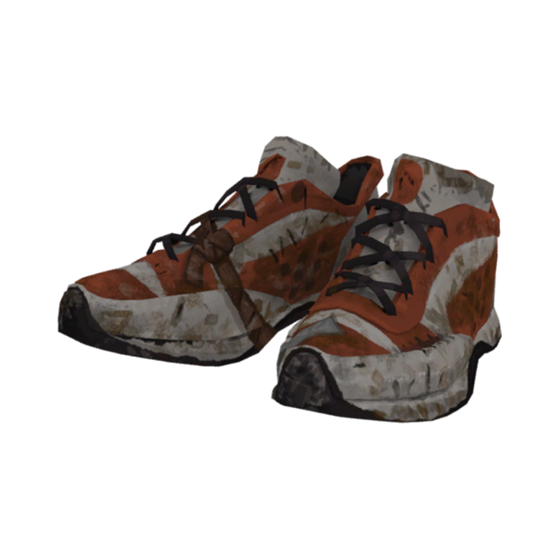

# Running Shoes

**Running Shoes**

| Property | Details |
| --- | --- |
|  |  / *Running\_Shoes\_icon.png* |
| **General** |  |
| Item Type | Clothing\|- |
| Renewable | Yes ([Beachcombing](./Beachcombing.md)) |
| Clothing Slot | Outer feet |
| **Statistics** |  |
| Weight | 0.50 kg(1.1 lbs) |
| Warmth bonus | 1.0 °C(1.8 °F) |
| Windproof bonus | 0.5 °C(0.9 °F) |
| Waterproof bonus | 0% |
| Protection | 1% |
| Mobility | 0% |
| Harvest | 2 × [Cured leather](./Cured%20Leather.md) / 75 minutes |
| Repair | 1 × [Cured leather](./Cured%20Leather.md), 1 [Cloth](./Cloth.md) / 90 minutes / 20% condition |

> “**Light nylon shoes designed to feel weightless. Better than running around barefoot but ... not much.**”
>
> — In-game description

**Running Shoes** are a type of [footwear](./Clothing.md) in *The Long Dark*.

## Overview

The running shoes are a common starting item. They're lightweight, but they don't offer much warmth or protection, and the waterproofing is nonexistent. It is recommended to replace them, as they don't offer much of anything, and it is highly ill-advised to repair them, as they require valuable cured leather for repairs, and they only give 20% condition back per repair, making it extremely expensive to repair, especially for an inferior item. However, the shoes should still be picked up when found, as they can be harvested for two pieces of cured leather, which can be used to repair top-tier shoes such as [Mukluks](./Mukluks.md) and [Insulated Boots](./Insulated%20Boots.md).

## Gallery

| Column 1 | Column 2 | Column 3 |
| --- | --- | --- |
|  / *Old model.* |  / *Clothing model icon* |  / *Clothing model icon* |

## Update history

- UPDATE **19 December 2016 ([Update](./The%20Long%20Dark%20%E2%80%94%20Early%20Access%20Changelog.md#0.386)):**
  - Renamed from *Sneakers* to *Running Shoes*

**Lua execution error in Module:Navbox function navbox** [ru:Кроссовки](ru:%D0%9A%D1%80%D0%BE%D1%81%D1%81%D0%BE%D0%B2%D0%BA%D0%B8)
