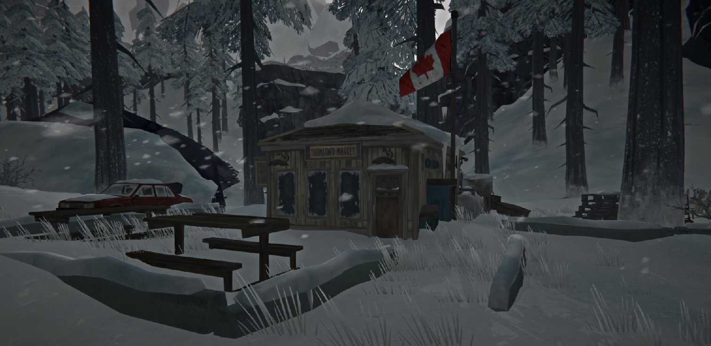

# Rural Store

<table class="infobox">
<caption>Rural Store</caption>
<colgroup>
<col style="width: 33%" />
<col style="width: 33%" />
<col style="width: 33%" />
</colgroup>
<tbody>
<tr>
<td colspan="2">
[[File:

<table class="gallery">
<colgroup>
<col style="width: 50%" />
<col style="width: 50%" />
</colgroup>
<tbody>
<tr>
<th><figure>

<figcaption>Exterior</figcaption>
</figure></th>
<td><figure>
[Missing image: Rural_store.jpg]
<figcaption>Interior</figcaption>
</figure></td>
</tr>
</tbody>
</table></td>
<td>
250px]]
</td>
</tr>
<tr>
<td colspan="2">
<strong>Location</strong>
</td>
<td></td>
</tr>
<tr>
<td colspan="2"><figure>
[Missing image: Rural_Store_Location.png]
<figcaption>Rural_Store_Location.png</figcaption>
</figure></td>
<td></td>
</tr>
<tr>
<td>
Region
</td>
<td>
<a href="./Pleasant%20Valley.md" class="wikilink" title="Pleasant Valley">Pleasant Valley</a>|-
</td>
<td>
Location
</td>
</tr>
<tr>
<td>
Description
</td>
<td>
A small 2-room convenience store
</td>
<td></td>
</tr>
<tr>
<td colspan="2">
<strong>General</strong>
</td>
<td></td>
</tr>
<tr>
<td>
Type
</td>
<td></td>
<td></td>
</tr>
<tr>
<td><figure>

<figcaption>bed_icon.png</figcaption>
</figure></td>
<td></td>
<td></td>
</tr>
<tr>
<td></td>
<td>
Has an interior|}

The <strong>Rural Store</strong>, also known as the Rural Gas Station or Thomson's Market, is a small convenience store in <a href="./Thomson%27s%20Crossing.md" class="wikilink" title="Thomson&#39;s Crossing">Thomson's Crossing</a> in <a href="./Pleasant%20Valley.md" class="wikilink" title="Pleasant Valley">Pleasant Valley</a>, across the road from the <a href="./Community%20Hall.md" class="wikilink" title="Community Hall">Community Hall</a>.

<h2 id="Overview">Overview</h2>

The Rural Store consists of two rooms: The main store in the front area, and a back room.

The main area has several shelves, a checkout place with a <a href="./Register.md" class="wikilink" title="Register">Register</a>, and a few fridges. Food like <a href="./Beef%20Jerky.md" class="wikilink" title="Beef Jerky">Beef Jerky</a> and <a href="./Salty%20Crackers.md" class="wikilink" title="Crackers">Crackers</a> can be found on the shelves, while <a href="./Cash.md" class="wikilink" title="Cash">Cash</a> and matches can be found near the register and sodas will spawn in the <a href="./Fridge.md" class="wikilink" title="Fridges">Fridges</a>. First Aid items such as <a href="./Antiseptic.md" class="wikilink" title="Antiseptic">Antiseptic</a> can spawn on the shelves. A Sewing Premier <a href="./Research%20Book.md" class="wikilink" title="Research Book">Research Book</a> is often hidden on the counter next to the fridge.

The back room holds a <a href="./Metal%20Shelf.md" class="wikilink" title="Metal Shelf">Metal Shelf</a> with a <a href="./Microwave.md" class="wikilink" title="Microwave">Microwave</a> and <a href="./First%20Aid%20Kit.md" class="wikilink" title="First Aid Kit">First Aid Kit</a> with 2 <a href="./Locker.md" class="wikilink" title="Lockers">Lockers</a>. Ammunition casings can sometimes be found under the shelf and lockers.

<h2 id="Wintermute">Wintermute</h2>

In Wintermute, the store holds 2 <a href="./Collectibles.md" class="wikilink" title="Collectibles">Collectibles</a> related to 2 quests. The first is a book called <a href="./Local%20Legends%20-%20Sasquatch.md" class="wikilink" title="Local Legends - Sasquatch">Local Legends - Sasquatch</a> related to the mission <a href="./Tall%20Tales.md" class="wikilink" title="Tall Tales">Tall Tales</a>.

The second is <a href="./Pleasant%20Valley%20Collectible%2C%20Part%20One.md" class="wikilink" title="Pleasant Valley Collectible, Part One">Pleasant Valley Collectible, Part One</a>, a note on the corkboard behind the counter related to the <a href="./Forest%20Talkers%20%28side%20mission%29.md" class="wikilink" title="Forest Talkers (side mission)">Forest Talkers (side mission)</a>. <strong>Lua execution error in Module:Navbox function navbox</strong>
</td>
<td></td>
</tr>
</tbody>
</table>

