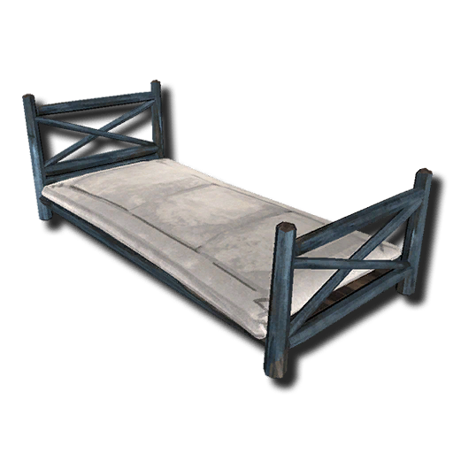

# Rustic Bed

**Categories:** Interactable Objects · **Source:** [Fandom](https://thelongdark.fandom.com/wiki/Rustic_Bed)

**Rustic Bed**

_Rustic\_Bed\_icon.png_

**Release:** [TFTFT Part 6 Broken Silence](./The%20Long%20Dark%20%E2%80%94%20Changelog.md#2.33)

**Values**

**Weight:** 5.00 kg (11 lbs)

**Actions**

**Backpack:** Drop, Place

The **Rustic Bed** is a [Decorations](./Decorations.md) and [Bed](./Bed.md) item that can be [Crafted](./Crafting.md) as part of the [Safehouse Customization](./Safehouse%20Customization.md) feature.

## Overview

A makeshift bed with a mattress but no bedsheets, a Rustic Bed can be crafted at a [Furniture Workbench](./Furniture%20Workbench.md), but requires [Woodworking Tools](./Woodworking%20Tools.md).

This bed can be [Slept](./Sleep.md) in and gives a [Warmth](./Warmth.md) bonus of +4 °C (+ 7.2 °F). This is slightly warmer than most types of the beds found across the Island, but better bed options exist:

- The [Quilted Bed](./Quilted%20Bed.md) +6 °C (+10.8 °F) and the [Bear Hide Bed](./Bear%20Hide%20Bed.md) (+10 °C (+18 °F) are much warmer beds that can be crafted but these require [Cured Deer Hide](./Cured%20Deer%20Hide.md)/[Cured Black Bear Hide](./Cured%20Black%20Bear%20Hide.md) and [Ptarmigan Down](./Ptarmigan%20Down.md) to craft, as well as much longer crafting hours.
- As a result, the Rustic Bed can be a cheaper option to craft if the player is low on resources and needs a bed.

Progress for Crafting this item will be stored in the Furniture Workbench's container inventory, rather than the player's inventory. Once crafted, the item can be automatically placed in the Safehouse. Canceling this prompt will force the item back into the Furniture Workbench's container inventory. The bed can only be placed on a wide, clear space on the floor when in Customization Mode.

Despite having a Backpack carry weight value, the bed cannot be picked up and placed back into the player's inventory once crafted, and so it cannot be carried from one base to another. The only option is to move or destroy it (destroying the bed will yield no resources, so consider the material cost/time investment before creating this item).

## Crafting

**Rustic Bed**

| Property | Details |
| --- | --- |
|  | 720 minutes (12 hour 0 minutes) |
| **Requirements** |  |
| Facility |  |
| Tool |  |
| **Materials** |  |
| Item | [Cedar Firewood](./Cedar%20Firewood.md) |
| Quantity | 10 |
|  | [Cloth](./Cloth.md) |
|  | 12 |
|  | [Cured Gut](./Cured%20Gut.md) |
|  | 2 |

## Update History
