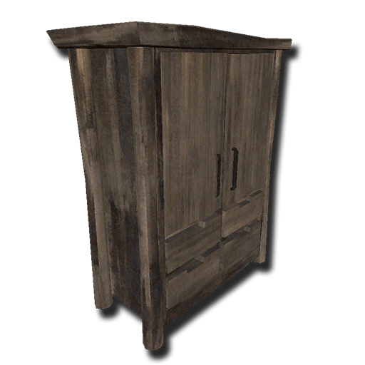

# Rustic Closet

**Rustic Closet**

| Property | Details |
| --- | --- |
|  |  / *Rustic\_Closet\_icon.png* |
| Release | [TFTFT Part 6 Broken Silence](./The%20Long%20Dark%20%E2%80%94%20Changelog.md#2.33) |
| **Values** |  |
| Weight | 15.00 kg (33 lbs) |
| **Actions** |  |
| Backpack | Drop, Place |

**Rustic Closet** is a [Decorations](./Decorations.md) that can be [Crafted](./Crafting.md) as part of the [Safehouse Customization](./Safehouse%20Customization.md) feature.

## Overview

A makeshift wooden closet, a Rustic Closet can be crafted at a [Furniture Workbench](./Furniture%20Workbench.md), but requires [Woodworking Tools](./Woodworking%20Tools.md).

The compartments have a storage capacity of:

- 2 closets each holding 20.00 kg.
- 4 drawers each holding 10.00 kg.
- Overall total storage capacity of 80.00 kg.

Progress for Crafting this item will be stored in the Furniture Workbench's container inventory, rather than the player's inventory. Once crafted, the item can be automatically placed in the Safehouse. Canceling this prompt will force the item back into the Furniture Workbench's container inventory. The closet can only be placed on a wide, clear space on the floor when in Customization Mode.

Despite having a Backpack carry weight value, the closet cannot be picked up and placed back into the player's inventory once crafted, and so it cannot be carried from one base to another. The only option is to move or destroy it (destroying the closet will yield no resources, so consider the material cost/time investment before creating this item).

- 

## Crafting

**Rustic Closet**

| Property | Details |
| --- | --- |
|  | - |
|  | - |
|  | 540 minutes (9 hour 0 minutes) |
| **Requirements** |  |
| Facility | **Template:iconlink** |
| Tool | **Template:iconlink** |
| **Materials** |  |
| **Template:iconlink plain** |  |
| Item | [Fir Firewood](./Fir%20Firewood.md) |
| Quantity | 18 |
| **Template:iconlink plain** |  |
|  | [Reclaimed Wood](./Reclaimed%20Wood.md) |
|  | 3 |
| **Template:iconlink plain** |  |
|  | [Scrap Metal](./Scrap%20Metal.md) |
|  | 2 |

**Lua execution error in Module:Navbox function navbox** [ru:Шкаф в деревенском стиле](ru:%D0%A8%D0%BA%D0%B0%D1%84_%D0%B2_%D0%B4%D0%B5%D1%80%D0%B5%D0%B2%D0%B5%D0%BD%D1%81%D0%BA%D0%BE%D0%BC_%D1%81%D1%82%D0%B8%D0%BB%D0%B5)
