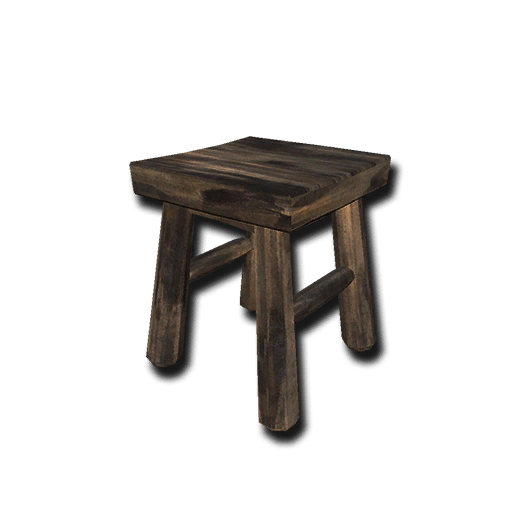

# Rustic Stool

**Categories:** Interactable Objects · **Source:** [Fandom](https://thelongdark.fandom.com/wiki/Rustic_Stool)

**Rustic Stool**

_Rustic\_Stool\_icon.png_

**Release:** [TFTFT Part 6 Broken Silence](./The%20Long%20Dark%20%E2%80%94%20Changelog.md#2.33)

**Values**

**Weight:** 2.00 kg (4.4 lbs)

**Actions**

**Backpack:** Drop, Place

The **Rustic Stool** is a [Decorations](./Decorations.md) item that can be [Crafted](./Crafting.md) as part of the [Safehouse Customization](./Safehouse%20Customization.md) feature.

## Overview

A makeshift wooden stool, a Rustic Stool can be crafted at a [Furniture Workbench](./Furniture%20Workbench.md), but requires [Woodworking Tools](./Woodworking%20Tools.md).

Once crafted, the item is automatically placed into the player's inventory. It can only be placed on floors when in Customization Mode. It can later be picked up and placed back into the player's inventory or destroyed (yielding no resources).

## Crafting

**Rustic Stool**

| Property | Details |
| --- | --- |
|  | - |
|  | - |
|  | 360 minutes (6 hour 0 minutes) |
| **Requirements** |  |
| Facility | **Template:iconlink** |
| Tool | **Template:iconlink** |
| **Materials** |  |
| **Template:iconlink plain** |  |
| Item | [Fir Firewood](./Fir%20Firewood.md) |
| Quantity | 4 |

## Update History
