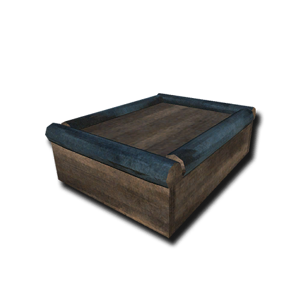

# Rustic Storage Box

**Categories:** Interactable Objects · **Source:** [Fandom](https://thelongdark.fandom.com/wiki/Rustic_Storage_Box)

**Rustic Storage Box**

_Rustic\_Storage\_Box\_icon.png_

**Release:** [TFTFT Part 6 Broken Silence](./The%20Long%20Dark%20%E2%80%94%20Changelog.md#2.33)

**Values**

**Weight:** 2.00 kg (4.4 lbs)

**Actions**

**Backpack:** Drop, Place

**Rustic Storage Box** is a [Decorations](./Decorations.md) that can be [Crafted](./Crafting.md) as part of the [Safehouse Customization](./Safehouse%20Customization.md) feature.

## Overview

A makeshift wooden storage box, a Rustic Storage Box can be crafted at a [Furniture Workbench](./Furniture%20Workbench.md), but requires [Woodworking Tools](./Woodworking%20Tools.md).

The box has a storage capacity of 15.00 kg (33.06 lbs).

Progress for Crafting this item will be stored in the Furniture Workbench's container inventory, rather than the player's inventory. Once crafted, the item can be automatically placed in the Safehouse. Canceling this prompt will force the item back into the Furniture Workbench's container inventory. The box can only be placed on a wide, clear space on the floor or a flat surface when in Customization Mode.

The Rustic Storage Box is the only storage furniture item that can be picked up and placed back into the player's inventory once crafted and deployed from the Furniture Workbench. This allows it to be carried from one base to another, should the player wish to reuse it.

## Crafting

**Rustic Storage Box**

| Property | Details |
| --- | --- |
|  | 360 minutes (6 hour 0 minutes) |
| **Requirements** |  |
| Facility |  |
| Tool |  |
| **Materials** |  |
| Item | [Cedar Firewood](./Cedar%20Firewood.md) |
| Quantity | 8 |

## Update History
