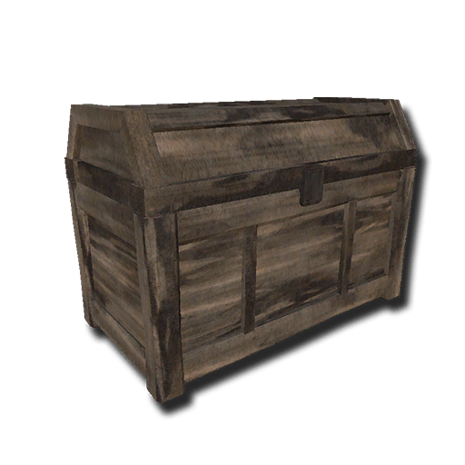

# Rustic Storage Trunk

**Categories:** Interactable Objects · **Source:** [Fandom](https://thelongdark.fandom.com/wiki/Rustic_Storage_Trunk)

**Rustic Storage Trunk**

| Property | Details |
| --- | --- |
|  |  / _Rustic\_Storage\_Trunk\_icon.png_ |
| Release | [TFTFT Part 6 Broken Silence](./The%20Long%20Dark%20%E2%80%94%20Changelog.md#2.33) |
| **Values** |  |
| Weight | 5.00 kg (11 lbs) |
| **Actions** |  |
| Backpack | Drop, Place |

**Rustic Storage Trunk** is a [Decorations](./Decorations.md) that can be [Crafted](./Crafting.md) as part of the [Safehouse Customization](./Safehouse%20Customization.md) feature.

## Overview

A makeshift wooden storage trunk, a Rustic Storage Trunk can be crafted at a [Furniture Workbench](./Furniture%20Workbench.md), but requires [Woodworking Tools](./Woodworking%20Tools.md).

The trunk has a storage capacity of 35.00 kg (77.16 lbs).

Progress for Crafting this item will be stored in the Furniture Workbench's container inventory, rather than the player's inventory. Once crafted, the item can be automatically placed in the Safehouse. Canceling this prompt will force the item back into the Furniture Workbench's container inventory. The trunk can only be placed on a wide, clear space on the floor or a flat surface when in Customization Mode.

Despite having a Backpack carry weight value, the trunk cannot be picked up and placed back into the player's inventory once crafted, and so it cannot be carried from one base to another. The only option is to move or destroy it (destroying the trunk will yield no resources, so consider the material cost/time investment before creating this item).

- 

## Crafting

**Rustic Storage Trunk**

| Property | Details |
| --- | --- |
|  | - |
|  | - |
|  | 420 minutes (7 hour 0 minutes) |
| **Requirements** |  |
| Facility | **Template:iconlink** |
| Tool | **Template:iconlink** |
| **Materials** |  |
| **Template:iconlink plain** |  |
| Item | [Fir Firewood](./Fir%20Firewood.md) |
| Quantity | 9 |

## Update History
