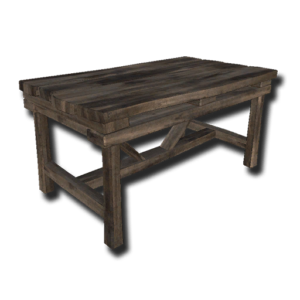

# Rustic Table

**Contents**

- [Overview](#overview)
- [Harvesting](#harvesting)
- [Crafting](#crafting)
- [Update History](#update-history)

**Rustic Table**

| Property | Details |
| --- | --- |
|  |  / *Rustic\_Table\_icon.png* |
| Release | [TFTFT Part 6 Broken Silence](./The%20Long%20Dark%20%E2%80%94%20Changelog.md#2.33) |
| **Values** |  |
| Weight | 8.00 kg (17.6 lbs) |
| **Actions** |  |
| Backpack | Drop, Place |

The **Rustic Table** is a [Decorations](./Decorations.md) item that can be [Crafted](./Crafting.md) as part of the [Safehouse Customization](./Safehouse%20Customization.md) feature.

## Overview

A makeshift wooden table, a Rustic Table can be crafted at a [Furniture Workbench](./Furniture%20Workbench.md), but requires [Woodworking Tools](./Woodworking%20Tools.md).

Progress for Crafting this item will be stored in the Furniture Workbench's container inventory, rather than the player's inventory. Once crafted, the item can be automatically placed in the Safehouse. Canceling this prompt will force the item back into the Furniture Workbench's container inventory. The table can only be placed on a wide, clear space on the floor when in Customization Mode.

Despite having a Backpack carry weight value, the table cannot be picked up and placed back into the player's inventory once crafted, and so it cannot be carried from one base to another. The only option is to move or destroy it (destroying the table will yield no resources, so consider the material cost/time investment before creating this item).

## Harvesting

The Rustic Table can be harvested with a [Hatchet](./Hatchet.md) in 1 hour 30 minutes for 6 [Fir Firewood](./Fir%20Firewood.md).

## Crafting

**Rustic Table**

| Property | Details |
| --- | --- |
|  | - |
|  | - |
|  | 480 minutes (8 hour 0 minutes) |
| **Requirements** |  |
| Facility | **Template:iconlink** |
| Tool | **Template:iconlink** |
| **Materials** |  |
| **Template:iconlink plain** |  |
| Item | [Fir Firewood](./Fir%20Firewood.md) |
| Quantity | 10 |

## Update History

**Template:update history****Lua execution error in Module:Navbox function navbox** [ru:Стол в деревенском стиле](ru:%D0%A1%D1%82%D0%BE%D0%BB_%D0%B2_%D0%B4%D0%B5%D1%80%D0%B5%D0%B2%D0%B5%D0%BD%D1%81%D0%BA%D0%BE%D0%BC_%D1%81%D1%82%D0%B8%D0%BB%D0%B5)
