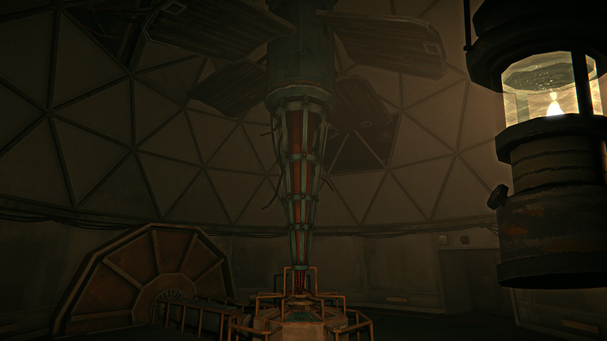
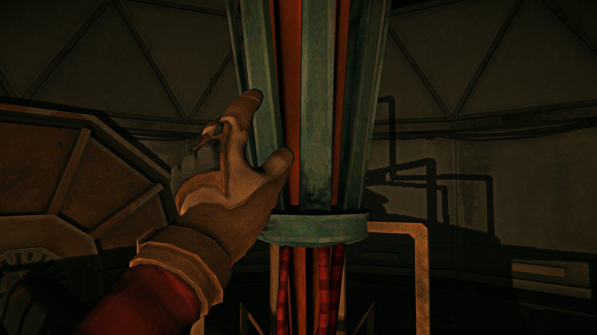
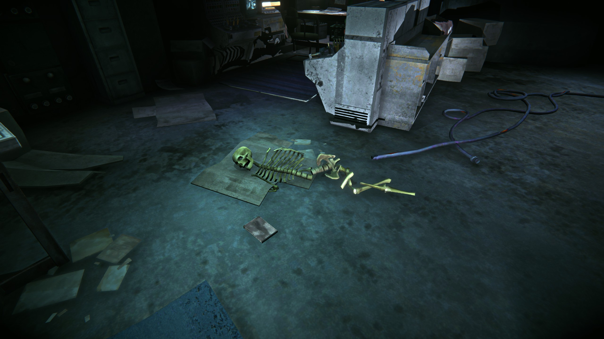

# Rüdiger's Machine

**Categories:** Indoor locations, Locations, Locations in Zone of Contamination · **Source:** [Fandom](https://thelongdark.fandom.com/wiki/R%C3%BCdiger's_Machine)

**Rüdiger's Machine**

| Property | Details |
| --- | --- |
|  |  / _Rüdiger's\_Machine.jpg_ |
| **Location** |  |
|  |  / _Rüdiger's\_Machine\_Location.png_ |
| Region | [Zone of Contamination](./Zone%20of%20Contamination.md)\|- |
| **General** |  |
|  / _bed\_icon.png_ |  |
|  / _workbench\_icon\_green.png_ |  |

|  / _The machine room when unpowered_ |  / _The survivor almost touching the device_ /  / _The Security Chief's Remains in the control room._ |

## Notes

---

1. [Post by Raphael van Lierop on the Hinterland Forums](https://hinterlandforums.com/forums/topic/48715-dont-forget-to-leave-a-review-_/page/2/#comment-311778)[↩︎](#fnref1)
