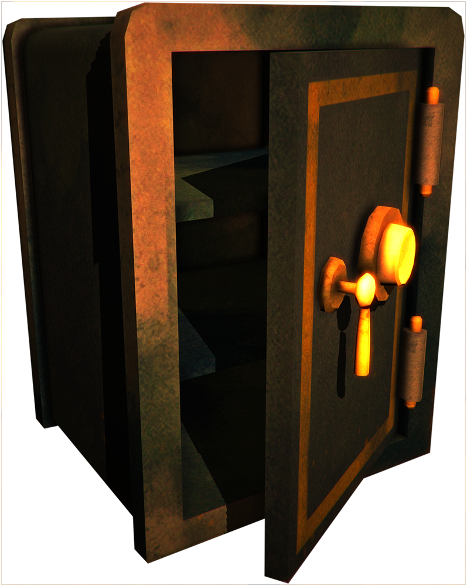

# Safe

**Categories:** Interactable objects, Interactable Objects · **Source:** [Fandom](https://thelongdark.fandom.com/wiki/Safe)

**Contents**

- [Overview](#overview)
- [Loot](#loot)
- [Locations](#locations)
- [Safecracking](#safecracking)

**Safe**

| Property | Details |
| --- | --- |
|  | [Safe](../assets/Safe.png) |
| Release | TBD |
| Update | [0.00](./The%20Long%20Dark%20%E2%80%94%20Early%20Access%20Changelog.md) |
| Story item | No |
| **Container** |  |
| Capacity | 10.0 kg(22 lbs) |
| **Advanced data** |  |
| Object key | GAMEPLAY\_SafeContaine |

A **Safe** is a stationary interactable object that can work as a storage container.

## Overview

Safes have a combination lock and can contain rare items such as [Flare Shells](./Flare%20Shell.md), [MREs](./Military-Grade%20MRE.md) or [Mukluks](./Mukluks.md).

A safe can hold 10kg.

## Loot

|  | Item | Rarity |
| --- | --- | --- |
| [Cash icon](../assets/Cash_icon.png) | [Cash](./Cash.md) | 13.04% |
| [Military Grade MRE icon](../assets/Military-Grade_MRE_icon.png) | [Military-Grade MRE](./Military-Grade%20MRE.md) | 10.87% |
| [Rifle Cartridge icon](../assets/Rifle_Cartridge_icon.png) | [Rifle Cartridge](./Rifle%20Ammunition.md) | 10.87% |
| [Maple Syrup icon](../assets/Maple_Syrup_icon.png) | [Maple Syrup](./Maple%20Syrup.md) | 5.43% |
| [Emergency Stim icon](../assets/Emergency_Stim_icon.png) | [Emergency Stim](./Emergency%20Stim.md) | 5.43% |
| [Flare icon](../assets/Flare_icon.png) | [Flare](./Flare.md) | 5.43% |
| [Flare Shell icon](../assets/Flare_Shell_icon.png) | [Flare Shell](./Flare%20Shell.md) | 5.43% |
| [Insulated Boots icon](../assets/Insulated_Boots_icon.png) | [Insulated Boots](./Insulated%20Boots.md) | 5.43% |
| [Mukluks icon](../assets/Mukluks_icon.png) | [Mukluks](./Mukluks.md) | 5.43% |
| [Book icon](../assets/Book_icon.png) | [Book](./Book.md) | 5.43% |
| [Revolver Ammunition icon](../assets/Revolver_Ammunition_icon.png) | [Revolver Ammunition](./Revolver%20Ammunition.md) | 5.43% |
| [Wool Ear Wrap icon](../assets/Wool_Ear_Wrap_icon.png) | [Wool Ear Wrap](./Wool%20Ear%20Wrap.md) | 3.26% |
| [Can of Gunpowder icon](../assets/Can_of_Gunpowder_icon.png) | [Can of Gunpowder](./Can%20of%20Gunpowder.md) | 2.17% |
| [Magnifying Lens icon](../assets/Magnifying_Lens_icon.png) | [Magnifying Lens](./Magnifying%20Lens.md) | 2.17% |
| [Flashlight icon](../assets/Flashlight_icon.png) | [Flashlight](./Flashlight.md) | 2.17% |
| [Expedition Parka icon](../assets/Expedition_Parka_icon.png) | [Expedition Parka](./Expedition%20Parka.md) | 2.17% |
| [Rifle Ammunition icon](../assets/Rifle_Ammunition_icon.png) | [Rifle Ammunition](./Rifle%20Ammunition.md) | 2.17% |
| [Simple Arrow icon](../assets/Simple_Arrow_icon.png) | [Simple Arrow](./Simple%20Arrow.md) | 2.17% |
| [Cowichan Sweater icon](../assets/Cowichan_Sweater_icon.png) | [Cowichan Sweater](./Cowichan%20Sweater.md) | 2.17% |
| [Revolver icon](../assets/Revolver_icon.png) | [Revolver](./Revolver.md) | 1.09% |
| [Distress Pistol icon](../assets/Distress_Pistol_icon.png) | [Distress Pistol](./Distress%20Pistol.md) | 1.09% |
| [Cured Wolf Pelt icon](../assets/Cured_Wolf_Pelt_icon.png) | [Cured Wolf Pelt](./Cured%20Wolf%20Pelt.md) | 1.09% |

## Locations

There are ten safes in the game. They are located:

- [Bleak Inlet](./Bleak%20Inlet.md): [Last Resort Cannery](./Last%20Resort%20Cannery.md), at the end of the obstacle course
- [Desolation Point](./Desolation%20Point.md): [Hibernia Processing](./Hibernia%20Processing.md) basement, opposite side of the room from the [Work Bench](./Work%20Bench.md).
- [Forlorn Muskeg](./Forlorn%20Muskeg.md): hidden in the [Old Spence Family Homestead](./Old%20Spence%20Family%20Homestead.md) behind some [Crates](./Crate.md)
- [Mountain Town](./Mountain%20Town.md): [Milton Credit Union](./Milton%20Credit%20Union.md)
- [Mystery Lake](./Mystery%20Lake%20%28region%29.md):
  - [Carter Hydro Dam](./Carter%20Hydro%20Dam.md), Upper Dam Level, in the Control Room
  - [Trapper's Homestead](./Trapper%27s%20Homestead.md)
- [Sundered Pass](./Sundered%20Pass.md):
  - [Last Lonely House](./Last%20Lonely%20House.md), in the locked room,
  - [Weather Station](./Weather%20Station.md), inside Radar Dome.
- [Zone of Contamination](./Zone%20of%20Contamination.md):
  - [Concentrator](./Concentrator.md) offices
  - [Langston Mine](./Langston%20Mine.md), Level 2

## Safecracking

Opening a safe requires neither resources, nor luck, but can be somewhat time-consuming. The player can turn the dial by using the arrow keys.

- For the first tumbler, the dial needs to be rotated counterclockwise. A click can be heard and an open lock icon will display in the box to the right when the correct number is reached.
- When first tumbler is unlocked, the dial should then be rotated clockwise.
- After unlocking the second tumbler, rotation to be changed again to counterclockwise.
- A moment after third tumbler is unlocked, the "Open" button will appear.

If the correct number is missed, cracking the safe can be started again by rotating the dial counterclockwise. Since safes can be cracked in the dark, it can be a good task to save for early mornings or late nights. After a safe is opened, it won't require cracking anymore.

