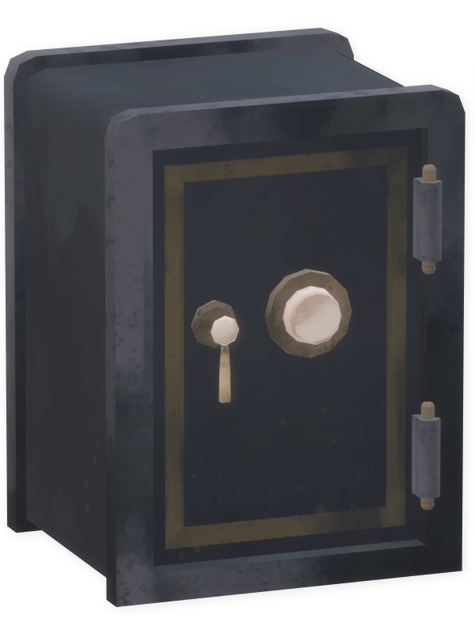
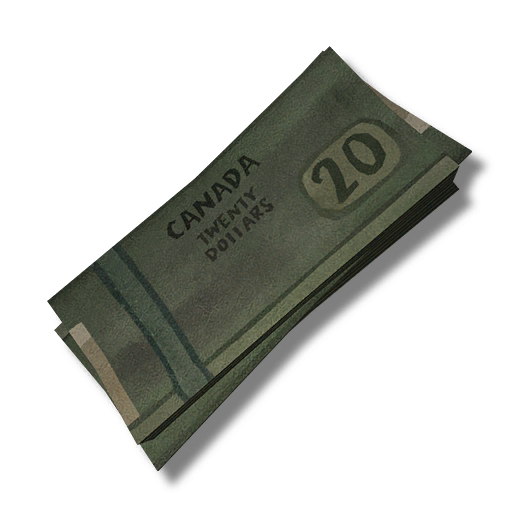
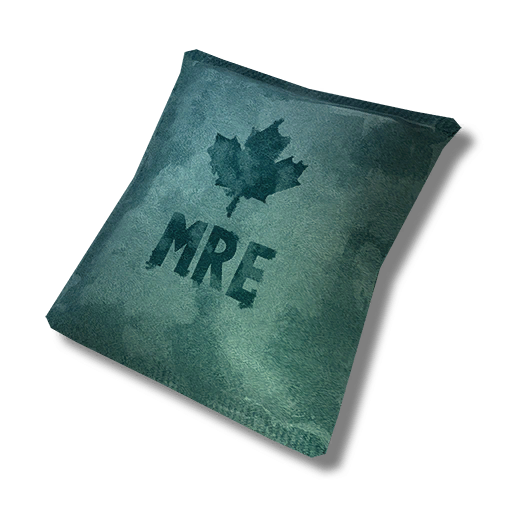
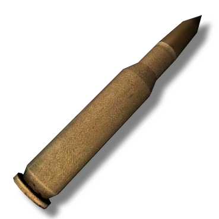
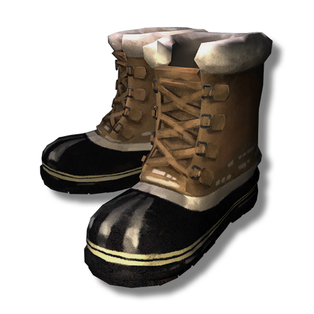
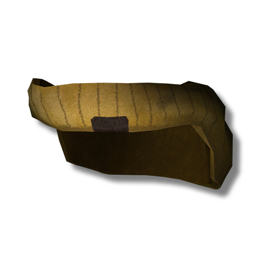
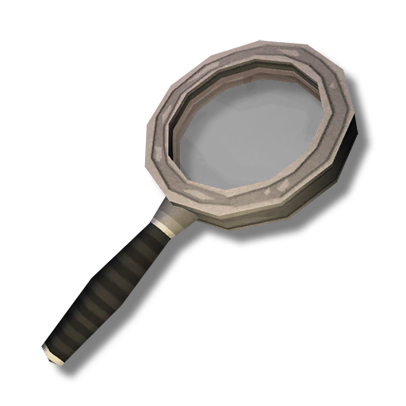
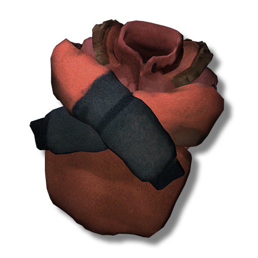
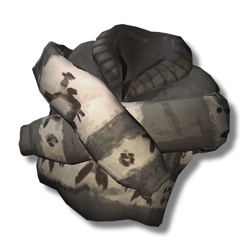
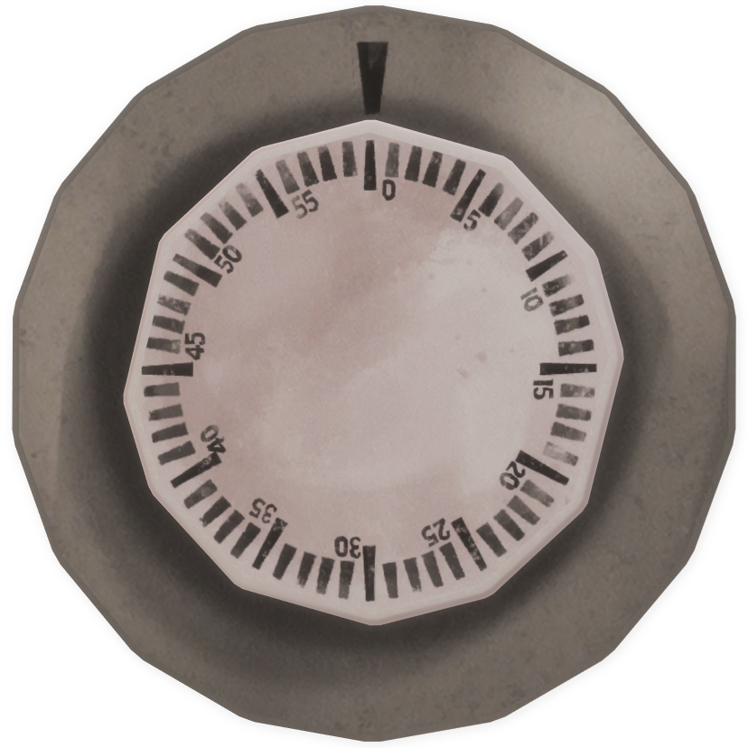

# Safe

**Contents**

- [Overview](#Overview)
- [Loot](#Loot)
- [Locations](#Locations)
- [Safecracking](#Safecracking)

<table class="infobox">
<caption>Safe</caption>
<colgroup>
<col style="width: 50%" />
<col style="width: 50%" />
</colgroup>
<tbody>
<tr>
<td colspan="2"><figure>

<figcaption>Safe.png</figcaption>
</figure></td>
</tr>
<tr>
<td>
Release
</td>
<td>
TBD
</td>
</tr>
<tr>
<td>
Update
</td>
<td>
<a href="./The%20Long%20Dark%20%E2%80%94%20Changelog.md#0.00" class="wikilink" title="0.00">0.00</a>
</td>
</tr>
<tr>
<td>
Story item
</td>
<td>
No
</td>
</tr>
<tr>
<td colspan="2" class="section">
<strong>Container</strong>
</td>
</tr>
<tr>
<td>
Capacity
</td>
<td>
10.0 kg(22 lbs)
</td>
</tr>
<tr>
<td colspan="2" class="section">
<strong>Advanced data</strong>
</td>
</tr>
<tr>
<td>
Object key
</td>
<td>
GAMEPLAY_SafeContaine
</td>
</tr>
</tbody>
</table>

A **Safe** is a stationary interactable object that can work as a storage container.

## Overview

Safes have a combination lock and can contain rare items such as <a href="./Flare%20Shell.md" class="wikilink" title="Flare Shells">Flare Shells</a>, <a href="./Military-Grade%20MRE.md" class="wikilink" title="MREs">MREs</a> or <a href="./Mukluks.md" class="wikilink" title="Mukluks">Mukluks</a>.

A safe can hold 10kg.

## Loot

<table>
<colgroup>
<col style="width: 33%" />
<col style="width: 33%" />
<col style="width: 33%" />
</colgroup>
<thead>
<tr>
<th></th>
<th>
Item
</th>
<th>
Rarity
</th>
</tr>
</thead>
<tbody>
<tr>
<td></td>
<td></td>
<td></td>
</tr>
<tr>
<td><figure>

<figcaption>Cash_icon.png</figcaption>
</figure></td>
<td>
<a href="./Cash.md" class="wikilink" title="Cash">Cash</a>
</td>
<td>
13.04%
</td>
</tr>
<tr>
<td><figure>

<figcaption>Military-Grade_MRE_icon.png</figcaption>
</figure></td>
<td>
<a href="./Military-Grade%20MRE.md" class="wikilink" title="Military-Grade MRE">Military-Grade MRE</a>
</td>
<td>
10.87%
</td>
</tr>
<tr>
<td><figure>

<figcaption>Rifle_Cartridge_icon.png</figcaption>
</figure></td>
<td>
<a href="./Rifle%20Ammunition.md" class="wikilink" title="Rifle Cartridge">Rifle Cartridge</a>
</td>
<td>
10.87%
</td>
</tr>
<tr>
<td><figure>

<figcaption>Maple_Syrup_icon.png</figcaption>
</figure></td>
<td>
<a href="./Maple%20Syrup.md" class="wikilink" title="Maple Syrup">Maple Syrup</a>
</td>
<td>
5.43%
</td>
</tr>
<tr>
<td><figure>

<figcaption>Emergency_Stim_icon.png</figcaption>
</figure></td>
<td>
<a href="./Emergency%20Stim.md" class="wikilink" title="Emergency Stim">Emergency Stim</a>
</td>
<td>
5.43%
</td>
</tr>
<tr>
<td><figure>

<figcaption>Flare_icon.png</figcaption>
</figure></td>
<td>
<a href="./Flare.md" class="wikilink" title="Flare">Flare</a>
</td>
<td>
5.43%
</td>
</tr>
<tr>
<td><figure>

<figcaption>Flare_Shell_icon.png</figcaption>
</figure></td>
<td>
<a href="./Flare%20Shell.md" class="wikilink" title="Flare Shell">Flare Shell</a>
</td>
<td>
5.43%
</td>
</tr>
<tr>
<td><figure>

<figcaption>Insulated_Boots_icon.png</figcaption>
</figure></td>
<td>
<a href="./Insulated%20Boots.md" class="wikilink" title="Insulated Boots">Insulated Boots</a>
</td>
<td>
5.43%
</td>
</tr>
<tr>
<td><figure>

<figcaption>Mukluks_icon.png</figcaption>
</figure></td>
<td>
<a href="./Mukluks.md" class="wikilink" title="Mukluks">Mukluks</a>
</td>
<td>
5.43%
</td>
</tr>
<tr>
<td><figure>

<figcaption>Book_icon.png</figcaption>
</figure></td>
<td>
<a href="./Book.md" class="wikilink" title="Book">Book</a>
</td>
<td>
5.43%
</td>
</tr>
<tr>
<td><figure>

<figcaption>Revolver_Ammunition_icon.png</figcaption>
</figure></td>
<td>
<a href="./Revolver%20Ammunition.md" class="wikilink" title="Revolver Ammunition">Revolver Ammunition</a>
</td>
<td>
5.43%
</td>
</tr>
<tr>
<td><figure>

<figcaption>Wool_Ear_Wrap_icon.png</figcaption>
</figure></td>
<td>
<a href="./Wool%20Ear%20Wrap.md" class="wikilink" title="Wool Ear Wrap">Wool Ear Wrap</a>
</td>
<td>
3.26%
</td>
</tr>
<tr>
<td><figure>

<figcaption>Can_of_Gunpowder_icon.png</figcaption>
</figure></td>
<td>
<a href="./Can%20of%20Gunpowder.md" class="wikilink" title="Can of Gunpowder">Can of Gunpowder</a>
</td>
<td>
2.17%
</td>
</tr>
<tr>
<td><figure>

<figcaption>Magnifying_Lens_icon.png</figcaption>
</figure></td>
<td>
<a href="./Magnifying%20Lens.md" class="wikilink" title="Magnifying Lens">Magnifying Lens</a>
</td>
<td>
2.17%
</td>
</tr>
<tr>
<td><figure>

<figcaption>Flashlight_icon.png</figcaption>
</figure></td>
<td>
<a href="./Flashlight.md" class="wikilink" title="Flashlight">Flashlight</a>
</td>
<td>
2.17%
</td>
</tr>
<tr>
<td><figure>

<figcaption>Expedition_Parka_icon.png</figcaption>
</figure></td>
<td>
<a href="./Expedition%20Parka.md" class="wikilink" title="Expedition Parka">Expedition Parka</a>
</td>
<td>
2.17%
</td>
</tr>
<tr>
<td><figure>

<figcaption>Rifle_Ammunition_icon.png</figcaption>
</figure></td>
<td>
<a href="./Rifle%20Ammunition.md" class="wikilink" title="Rifle Ammunition">Rifle Ammunition</a>
</td>
<td>
2.17%
</td>
</tr>
<tr>
<td><figure>

<figcaption>Simple_Arrow_icon.png</figcaption>
</figure></td>
<td>
<a href="./Simple%20Arrow.md" class="wikilink" title="Simple Arrow">Simple Arrow</a>
</td>
<td>
2.17%
</td>
</tr>
<tr>
<td><figure>

<figcaption>Cowichan_Sweater_icon.png</figcaption>
</figure></td>
<td>
<a href="./Cowichan%20Sweater.md" class="wikilink" title="Cowichan Sweater">Cowichan Sweater</a>
</td>
<td>
2.17%
</td>
</tr>
<tr>
<td><figure>

<figcaption>Revolver_icon.png</figcaption>
</figure></td>
<td>
<a href="./Revolver.md" class="wikilink" title="Revolver">Revolver</a>
</td>
<td>
1.09%
</td>
</tr>
<tr>
<td><figure>

<figcaption>Distress_Pistol_icon.png</figcaption>
</figure></td>
<td>
<a href="./Distress%20Pistol.md" class="wikilink" title="Distress Pistol">Distress Pistol</a>
</td>
<td>
1.09%
</td>
</tr>
<tr>
<td><figure>

<figcaption>Cured_Wolf_Pelt_icon.png</figcaption>
</figure></td>
<td>
<a href="./Cured%20Wolf%20Pelt.md" class="wikilink" title="Cured Wolf Pelt">Cured Wolf Pelt</a>
</td>
<td>
1.09%
</td>
</tr>
</tbody>
</table>

## Locations

There are ten safes in the game. They are located:

- <a href="./Bleak%20Inlet.md" class="wikilink" title="Bleak Inlet">Bleak Inlet</a>: <a href="./Last%20Resort%20Cannery.md" class="wikilink" title="Last Resort Cannery">Last Resort Cannery</a>, at the end of the obstacle course
- <a href="./Desolation%20Point.md" class="wikilink" title="Desolation Point">Desolation Point</a>: <a href="./Hibernia%20Processing.md" class="wikilink" title="Hibernia Processing">Hibernia Processing</a> basement, opposite side of the room from the <a href="./Work%20Bench.md" class="wikilink" title="Work Bench">Work Bench</a>.
- <a href="./Forlorn%20Muskeg.md" class="wikilink" title="Forlorn Muskeg">Forlorn Muskeg</a>: hidden in the <a href="./Old%20Spence%20Family%20Homestead.md" class="wikilink" title="Old Spence Family Homestead">Old Spence Family Homestead</a> behind some <a href="./Crate.md" class="wikilink" title="Crates">Crates</a>
- <a href="./Mountain%20Town.md" class="wikilink" title="Mountain Town">Mountain Town</a>: <a href="./Milton%20Credit%20Union.md" class="wikilink" title="Milton Credit Union">Milton Credit Union</a>
- <a href="./Mystery%20Lake%20%28region%29.md" class="wikilink" title="Mystery Lake">Mystery Lake</a>:
  - <a href="./Carter%20Hydro%20Dam.md" class="wikilink" title="Carter Hydro Dam">Carter Hydro Dam</a>, Upper Dam Level, in the Control Room
  - <a href="./Trapper%27s%20Homestead.md" class="wikilink" title="Trapper&#39;s Homestead">Trapper's Homestead</a>
- <a href="./Sundered%20Pass.md" class="wikilink" title="Sundered Pass">Sundered Pass</a>:
  - <a href="./Last%20Lonely%20House.md" class="wikilink" title="Last Lonely House">Last Lonely House</a>, in the locked room,
  - <a href="./Weather%20Station.md" class="wikilink" title="Weather Station">Weather Station</a>, inside Radar Dome.
- <a href="./Zone%20of%20Contamination.md" class="wikilink" title="Zone of Contamination">Zone of Contamination</a>:
  - <a href="./Concentrator.md" class="wikilink" title="Concentrator">Concentrator</a> offices
  - <a href="./Langston%20Mine.md" class="wikilink" title="Langston Mine">Langston Mine</a>, Level 2

## Safecracking

Opening a safe requires neither resources, nor luck, but can be somewhat time-consuming. The player can turn the dial by using the arrow keys.

- For the first tumbler, the dial needs to be rotated counterclockwise. A click can be heard and an open lock icon will display in the box to the right when the correct number is reached.
- When first tumbler is unlocked, the dial should then be rotated clockwise.
- After unlocking the second tumbler, rotation to be changed again to counterclockwise.
- A moment after third tumbler is unlocked, the "Open" button will appear.

If the correct number is missed, cracking the safe can be started again by rotating the dial counterclockwise. Since safes can be cracked in the dark, it can be a good task to save for early mornings or late nights. After a safe is opened, it won't require cracking anymore.

<table class="gallery">
<colgroup>
<col style="width: 50%" />
<col style="width: 50%" />
</colgroup>
<tbody>
<tr>
<td><figure>

<figcaption>Part of an animation. Usually the safe stays closed whether it is locked or not.</figcaption>
</figure></td>
<td><figure>

<figcaption>Unlocking a safe</figcaption>
</figure></td>
</tr>
</tbody>
</table>

**Lua execution error in Module:Navbox function navbox** <a href="ru:%D0%A1%D0%B5%D0%B9%D1%84" class="wikilink" title="ru:Сейф">ru:Сейф</a>

