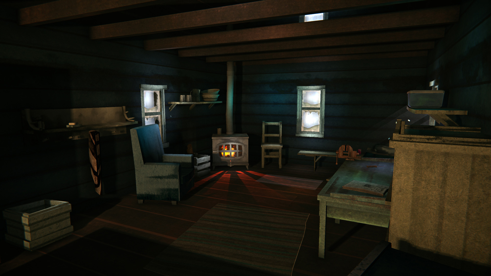
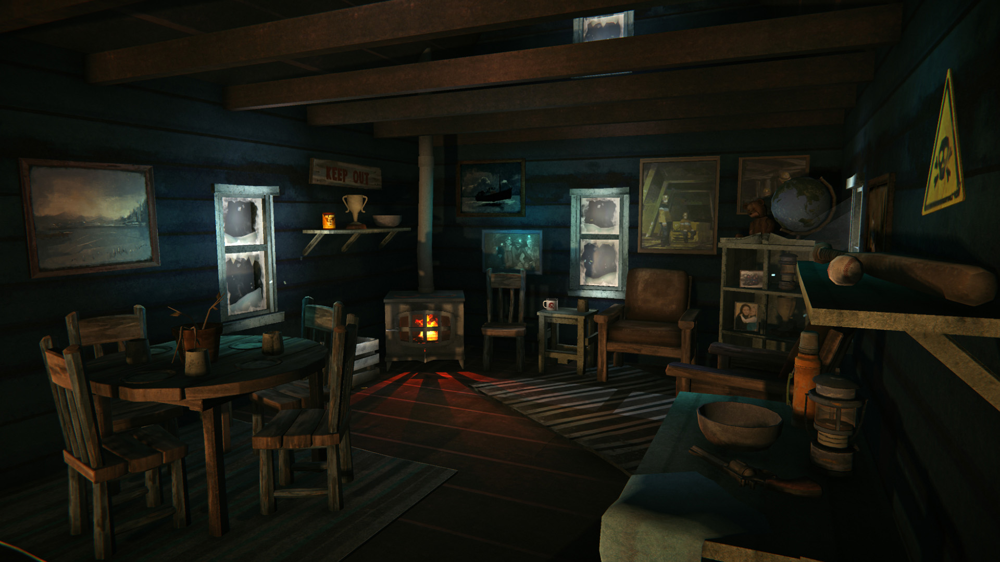
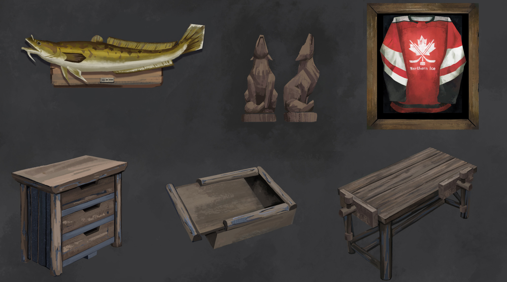

# Safehouse Customization

**Categories:** Interactable Objects · **Source:** [Fandom](https://thelongdark.fandom.com/wiki/Safehouse_Customization)

**Contents**

- [Overview](#overview)
- [Customization Mode](#customization-mode)
- [Repairing Objects](#repairing-objects)
- [Destroying Objects](#destroying-objects)
- [Limitations](#limitations)
- [General Limitations](#general-limitations)
- [Console Limitations](#console-limitations)
- [Safehouse Decorations](#safehouse-decorations)
- [Safehouse Locations](#safehouse-locations)
- [Lower Great Bear](#lower-great-bear)
- [Ash Canyon (5)](#ash-canyon-5)
- [Blackrock (12)](#blackrock-12)
- [Bleak Inlet (14)](#bleak-inlet-14)
- [Broken Railroad (3)](#broken-railroad-3)
- [Coastal Highway (28) (17 on I/M)](#coastal-highway-28-17-on-im)
- [Desolation Point (4)](#desolation-point-4)
- [Forlorn Muskeg (1)](#forlorn-muskeg-1)
- [Hushed River Valley (2)](#hushed-river-valley-2)
- [Mountain Town (16)](#mountain-town-16)
- [Mystery Lake (16)](#mystery-lake-16)
- [Pleasant Valley (18) (17 on Misery)](#pleasant-valley-18-17-on-misery)
- [Timberwolf Mountain (2)](#timberwolf-mountain-2)
- [Transitions](#transitions)
- [Crumbling Highway (1)](#crumbling-highway-1)
- [Keeper's Pass North (0)](#keepers-pass-north-0)
- [Keeper's Pass South (1)](#keepers-pass-south-1)
- [The Ravine (0)](#the-ravine-0)
- [Winding River (0)](#winding-river-0)
- [The Far Territory](#the-far-territory)
- [Forsaken Airfield (10)](#forsaken-airfield-10)
- [Sundered Pass (8)](#sundered-pass-8)
- [Transfer Pass (1)](#transfer-pass-1)
- [Zone of Contamination (10)](#zone-of-contamination-10)
- [Transitions](#transitions-1)
- [Far Range Branch Line (0)](#far-range-branch-line-0)
- [Cauldron Island](#cauldron-island)
- [Port Remnant (5)](#port-remnant-5)
- [Anna Island -- Track Section 1 (1)](#anna-island----track-section-1-1)
- [Anna Island -- Track Section 2 (1)](#anna-island----track-section-2-1)
- [Anna Island -- Track Section 3 (1)](#anna-island----track-section-3-1)
- [Anna Island -- Track Section 4 (1)](#anna-island----track-section-4-1)
- [Anna Island -- Track Section 5 (0)](#anna-island----track-section-5-0)
- [Anna Island -- Track Section 6 (0)](#anna-island----track-section-6-0)
- [Places that do not support customization](#places-that-do-not-support-customization)
- [Gallery](#gallery)

> “**Move furniture and decorative props around your favourite locations in the game. Repair broken items and clean up the mess. Craft items from an entirely new series of hand-made furniture and decorative props. Collect and move every framed pancake photo in the game to one place. Make pretty much any valid interior in the game your personal Safehouse with this powerful system.**”
>
> — Hinterland Description

With the release of [Tales from the Far Territory](./Tales%20from%20the%20Far%20Territory.md) Part 6, players have the option to customize a [Safehouse](./Safehouse.md) by rearranging furniture, crafting new furniture, hanging portraits on walls, and many other activities.

There are over 800 items that can be moved, broken down, and in some cases, built using this system. There are 150 areas that can be turned into Safehouses, along with several specific "exterior interiors" like the [Mountaineer's Hut](./Mountaineer%27s%20Hut.md) in Timberwolf Mountain, and the Lookout Towers.

## Overview

### Customization Mode

When entering an interior that can be customized, an icon of a house will appear in the top left corner of the screen.

- Pressing Y (L1+ R1 on controller) will cause a pencil to appear in front of the house and the player to enter Customization Mode, and the game will show a blue outline over every object that can be moved around.
  - The blue outline shown over every object in Customization Mode can be used to navigate through the dark, without having to use a light source.
- You can put things on the floor, the walls, on top of other items, etc. But every item has info that tells it where it can and cannot be placed. This is to avoid silliness.
- You can remove Clutter (like shredded papers on the ground) by pressing the R button (you cannot get it back once this button is pressed).
- You can craft a [Framed Photo](./Framed%20Photo.md) from photos you take using the [Camera](./Camera.md) and even craft/loot [Decorations](./Decorations.md) to display inside any Safehouse.
- Pressing Y (L1+ R1 on controller) again will leave Customization Mode, and cause the game to start saving (this is also a useful way to force an autosave).

### Repairing Objects

You can currently repair a LIMITED number of items inside Safehouses.

- [Woodworking Tools](./Woodworking%20Tools.md) are required to fix things, and repairing items raises the [Repair](./Repair.md) skill.
- Currently you can repair a lot of the broken/missing [Cabinet Doors](./Cabinet%20Door.md) of kitchen [Cabinets](./Cabinet.md). Repairing restores them to their "original" state, and also restores all the container slots (so a Cabinet that had been missing a door and just had an empty space, now has the door and the door becomes a new valid container).
  - Destroying/Harvesting the Cabinet Door will make it impossible to repair that cabinet.
- The roofs of the [Mountaineer's Hut](./Mountaineer%27s%20Hut.md) and [Bricklayer's Retreat](./Bricklayer%27s%20Retreat.md) can be repaired (costs 20 [Cedar Firewood](./Cedar%20Firewood.md)). Repairing these roofs will increase the temperature bonus inside the buildings by +3 C.

### Destroying Objects

Some items in Customization Mode cannot be placed into the player's inventory, they can only moved around or destroyed (typically large items).

Harvestable items can be destroyed quickly, but the player will not receive any materials for doing so (ex, destroying a [Pillow](./Pillow.md) takes 2 minutes and gives nothing, but harvesting it with a [Hunting Knife](./Hunting%20Knife.md) takes 9 minutes and generates [Cloth](./Cloth.md)). Keep in mind that destroying/moving some objects, like sheet metal or [Planks](./Planks.md) covering holes in the [Hibernia Processing](./Hibernia%20Processing.md) floors, can create fall hazards.

## Limitations

### General Limitations

- Interior spaces only have a select zone that can be customized by the player. Walking outside of the Customization Zone (usually by exiting to the outside of the building via a door) will issue a warning to the player. Anything outside of this zone behaves normally and cannot be customized.
- [Work Benches](./Work%20Bench.md) cannot be moved between safehouses, but the Vice can be removed from an existing Work Bench by destroying the entire object, and then used as a raw material in the construction of a new Work Bench. This means you can build a Work Bench in a location that is more useful to you, but only by sacrificing an existing bench, so there are still only ever going to be a certain number of Work Benches in the world. When you remove the Vice from an existing Work Bench, it becomes a regular table.
- You can still Break Down items to get resources from them when in regular gameplay. When you're in Safehouse Edit mode, you can Destroy items which goes quickly but you don't get any resources from it. This was to give you a way to clear areas quickly without making it magical or without some reasonable trade-off. If you want to harvest things for resources, don't destroy them in Edit mode.
- You can't destroy containers that have items in them. For example, if you want to destroy a cabinet but there are items in one of the drawers, you will have to remove the items first. Keep in mind that if you destroy an item in a Safehouse, you can't rebuild it, so please be careful what you destroy because you may not be able to get it back.
- [Frozen Corpses](./Frozen%20Corpse.md) and [Corpses](./Corpse.md) cannot be destroyed or moved, only "respectfully removed" as part of general Safehouse clean-up.

### Console Limitations

This feature is very memory intensive, so it's very likely there will be a hard limit on consoles for how many items you can have inside an interior:

- Most PC players should be fine, but it partly depends on your computer specs.
- Building limits for console (Xbox, PlayStation) is likely be in the 100s of items per scene.
- The Nintendo Switch **will be the most restricted** due to hardware limitations.

## Safehouse Decorations

In general, you can take most decorative items (ex. wall hangings, vases, plates, etc.) and add them to your Backpack in the [Decorations](./Decorations.md) section. They have weight, so you will want to account for that when you move them around (some can be 5.00kg). The [Travois](./Travois.md) can be a potential way to move large amounts of Decorative items around the world.

A [Furniture Workbench](./Furniture%20Workbench.md) and [Woodworking Tools](./Woodworking%20Tools.md) are required to build furniture for a Safehouse.

- Items that only have a Decorative value will live in the Decorations section of the Backpack Inventory, and won't appear in the General tab to avoid your inventory being cluttered with a bunch of random stuff that doesn't have gameplay value.
- When you drop decorative items in the world, they spawn a small [Safehouse Decoration Box](./Safehouse%20Decoration%20Box.md), because these items don't exist as "gear items" outside of Safehouses the way normal gear items (like food, or tools, or clothing) do.

For a full list of Decorative items, see [Decorations](./Decorations.md).

## Safehouse Locations

The following locations support Safehouse Customization. Keep in mind that inside and outside customization zones are counted separately due to loading zones/outdoor customization boundaries.

Note: [Prepper's Abandoned Cache](./Prepper%27s%20Abandoned%20Cache.md) can be destroyed at the end of [Sutherland's Tale](./Sutherland%27s%20Tale.md), rendering it inaccessible as a Safehouse.

### Lower Great Bear

#### [Ash Canyon](./Ash%20Canyon.md) (5)

- [Angler's Den](./Angler%27s%20Den.md)
- [Miner's Folly](./Miner%27s%20Folly.md) cabin
- [Foreman's Retreat](./Foreman%27s%20Retreat.md)
- [Homesteader's Respite](./Homesteader%27s%20Respite.md)
- [Prepper Cache](./Prepper%20Cache.md) in the region

#### [Blackrock](./Blackrock.md) (12)

- [Blackrock Prison](./Blackrock%20Prison.md) (6)
  - The Warden's office and nearby office space
  - Inside the prison itself
  - The watch tower with the rope climb
  - Infirmary
  - Guard Barracks
  - Workshop area (must be unlocked)
- [Bricklayer's Retreat](./Bricklayer%27s%20Retreat.md)
- [Foreman's Clearcut](./Foreman%27s%20Clearcut.md)
- [Power Plant](./Power%20Plant.md)
- [Trailer (Blackrock Region)](./Trailer%20%28Blackrock%20Region%29.md) on the road to the Power Plant
- [Old Substation](./Old%20Substation.md)
- [Prepper Cache](./Prepper%20Cache.md) in the region

#### [Bleak Inlet](./Bleak%20Inlet.md) (14)

- [Last Resort Cannery](./Last%20Resort%20Cannery.md) (5)
  - The trailer
  - The cafeteria break room next to the rope climbing building (building itself can't be customized, even the upper floor that the rope leads to)
  - The warehouse reached by taking the pier as part of the obstacle course
  - Office outside of the [Workshop](./Workshop.md) (both sides of the keypad door)
  - [Workshop](./Workshop.md) (must be unlocked)
- [Cannery Worker Residences](./Cannery%20Worker%20Residences.md)
- [Cabin](./Cabin.md)
- [Pensive Lookout](./Pensive%20Lookout.md)
- [Echo One Radio Tower](./Echo%20One%20Radio%20Tower.md)
- [Washed Out Trailers](./Washed%20Out%20Trailers.md)
- [Trailers west of the Cannery](./Trailers%20west%20of%20the%20Cannery.md) (2 trailers)
- [Bunker Alpha](./Bunker%20Alpha.md) (must be unlocked)
- [Prepper Cache](./Prepper%20Cache.md) in the mountains

#### [Broken Railroad](./Broken%20Railroad.md) (3)

- [Hunting Lodge](./Hunting%20Lodge.md)
- [Maintenance Yard](./Maintenance%20Yard.md) (2)
  - The office in the yard
  - Maintenance Shed

#### [Coastal Highway](./Coastal%20Highway.md) (28) (17 on I/M)

The number of safehouses in this region are lowered if playing on [Interloper](./Interloper.md)/[Misery](./Misery.md) due to ruined buildings (labeled as I/M)

- [Abandoned Lookout](./Abandoned%20Lookout.md)
- [Coastal Townsite](./Coastal%20Townsite.md) (7) (3 on I/M)
  - 6 [Coastal House](./Coastal%20House.md) (2 on I/M)
  - [Quonset Garage](./Quonset%20Garage.md)
- [Fishing Camp](./Fishing%20Camp.md) (4)
  - 4 cabins (3 on I/M)
- [Misanthrope's Homestead](./Misanthrope%27s%20Homestead.md)
- [Jackrabbit Island](./Jackrabbit%20Island.md)
- [Log Sort](./Log%20Sort.md) (2) (1 on I/M)
  - 1 trailer
  - 1 Coastal House (sometimes spawns ruined) (ruined on I/M)
- [Rabbit Grove](./Rabbit%20Grove.md)
- [Train Unloading](./Train%20Unloading.md) trailer
- 2 [Waterfront Cottages](./Waterfront%20Cottages.md) (0 on I/M)
- miscellaneous cabins/trailers (8) (5 on I/M)
  - Clear-cut trailer south of Train Unloading
  - Cabin east of previous clear-cut trailer
  - 3 Cabins below [Abandoned Lookout](./Abandoned%20Lookout.md) (2 on I/M)
  - Trailer West of [Cinder Hills Coal Mine](./Cinder%20Hills%20Coal%20Mine.md) transition to Pleasant Valley
  - Trailer north of Coastal Townsite
  - Cabin north of [Fishing Camp](./Fishing%20Camp.md)/south of [Bear Creek Campground](./Bear%20Creek%20Campground.md) (ruined on I/M)

#### [Desolation Point](./Desolation%20Point.md) (4)

- [Lonely Lighthouse](./Lonely%20Lighthouse.md)
- [Hibernia Processing](./Hibernia%20Processing.md) (3)
  - Inside the building
  - 3 connected trailers counting as 1 space
  - Trailer north of the warehouse

#### [Forlorn Muskeg](./Forlorn%20Muskeg.md) (1)

- [Prepper Cache](./Prepper%20Cache.md) in the region

#### [Hushed River Valley](./Hushed%20River%20Valley.md) (2)

- [Bunker Gamma](./Bunker%20Gamma.md) (must be unlocked)
- [Prepper Cache](./Prepper%20Cache.md) in the region

#### [Mountain Town](./Mountain%20Town.md) (16)

- [St. Christopher's Church](./St.%20Christopher%27s%20Church.md)
- [Trailer (Mountain Town Region)](./Trailer%20%28Mountain%20Town%20Region%29.md)
- [Paradise Meadows Farm](./Paradise%20Meadows%20Farm.md) (farmhouse)
- [Milton House](./Milton%20House.md) (10 houses, including [Milton House (Grey Mother's)](./Milton%20House%20%28Grey%20Mother%27s%29.md))
- [Convenience Store](./Convenience%20Store.md)
- [Milton Park](./Milton%20Park.md) building
- [Prepper Cache](./Prepper%20Cache.md) in the region

#### [Mystery Lake](./Mystery%20Lake%20%28region%29.md) (16)

- [Camp Office](./Camp%20Office.md)
- [Carter Hydro Dam](./Carter%20Hydro%20Dam.md) (4)
  - Upper Dam
  - Lower Dam
  - 2 trailers near the Dam Staging Area/[Train Bridge](./Train%20Bridge.md)
- Cabin between [Unnamed Pond](./Unnamed%20Pond.md) and [Clearcut](./Clearcut.md)
- [Forestry Lookout](./Forestry%20Lookout.md)
- [Logging Camp](./Logging%20Camp.md) (3 trailers)
- [Mystery Lake (location)](./Mystery%20Lake%20%28location%29.md) (5 cabins)
- [Prepper Cache](./Prepper%20Cache.md) in the region

#### [Pleasant Valley](./Pleasant%20Valley.md) (18) (17 on Misery)

- [Bunker Beta](./Bunker%20Beta.md) (Must be unlocked)
- Cabin near [Point of Disagreement](./Point%20of%20Disagreement.md) (sometimes spawns ruined)
- [Draft Dodger's Cabin](./Draft%20Dodger%27s%20Cabin.md) (ruined on Misery)
- [Pleasant Valley Farmstead](./Pleasant%20Valley%20Farmstead.md) (4)
  - Farmhouse
  - Farmhouse Basement
  - Front Porch
  - [Barn (Molly's)](./Barn%20%28Molly%27s%29.md)
- [Pleasant Valley Outbuildings](./Pleasant%20Valley%20Outbuildings.md)
- [Prepper's Abandoned Cache](./Prepper%27s%20Abandoned%20Cache.md) (will be permanently destroyed by completing [Sutherland's Tale](./Sutherland%27s%20Tale.md))
- [Signal Hill](./Signal%20Hill.md)
- [Skeeter's Ridge](./Skeeter%27s%20Ridge.md) Basement
- [Thomson's Crossing](./Thomson%27s%20Crossing.md) (6)
  - [Community Hall](./Community%20Hall.md)
  - [Crossroads House](./Crossroads%20House.md) 3 (2 houses, 1 shed)
  - [Pleasant Valley Church](./Pleasant%20Valley%20Church.md)
  - [Rural Store](./Rural%20Store.md)
- [Prepper Cache](./Prepper%20Cache.md) in the region

#### [Timberwolf Mountain](./Timberwolf%20Mountain.md) (2)

- [Mountaineer's Hut](./Mountaineer%27s%20Hut.md)
- [Prepper Cache](./Prepper%20Cache.md) in the region

### Transitions

#### [Crumbling Highway](./Crumbling%20Highway.md) (1)

- [Abandoned Harris Home](./Abandoned%20Harris%20Home.md) Basement

#### [Keeper's Pass North](./Keeper%27s%20Pass%20North.md) (0)

- None

#### [Keeper's Pass South](./Keeper%27s%20Pass%20South.md) (1)

- [Mirthless Fork](./Mirthless%20Fork.md) Trailer

### [The Ravine](./The%20Ravine.md) (0)

- None

### [Winding River](./Winding%20River.md) (0)

- None

### The Far Territory

#### [Forsaken Airfield](./Forsaken%20Airfield.md) (10)

- [Control Tower](./Control%20Tower.md) (2)
  - Ground floor room and tower
  - Storage closet near Transmitter
- [Bunker Omega](./Bunker%20Omega.md) (Must be unlocked)
- [Terminal](./Terminal.md)
- [Main Hangar](./Main%20Hangar.md) and [Hangar Basement](./Hangar%20Basement.md) (counts as 1 space)
- [Cargomaster's Trailer](./Cargomaster%27s%20Trailer.md)
- [Justy's Hovel](./Justy%27s%20Hovel.md)
- [Junker's Paddock](./Junker%27s%20Paddock.md)
- [Mindful Cabin](./Mindful%20Cabin.md)
- [Island Cottage](./Island%20Cottage.md)

#### [Sundered Pass](./Sundered%20Pass.md) (8)

- [Weather Station](./Weather%20Station.md) (2)
  - Storage Shed
  - [Station Bunkhouse](./Station%20Bunkhouse.md)
- [Old Settlement](./Old%20Settlement.md) (2)
  - [Basement (Sundered Pass)](./Basement%20%28Sundered%20Pass%29.md) (Must be unlocked)
  - [Cabin (Sundered Pass)](./Cabin%20%28Sundered%20Pass%29.md)
- [Last Lonely House](./Last%20Lonely%20House.md)
- [Lotte's Rest](./Lotte%27s%20Rest.md)
- [Final Refuge](./Final%20Refuge.md)
- [Placid Notch](./Placid%20Notch.md)

#### [Transfer Pass](./Transfer%20Pass.md) (1)

- [Vacant Depot](./Vacant%20Depot.md)

#### [Zone of Contamination](./Zone%20of%20Contamination.md) (10)

- [Concentrator](./Concentrator.md), [Conveyor Room](./Conveyor%20Room.md), [Headframe Building](./Headframe%20Building.md) (All 3 of these buildings are connected inside as 1 space)
- [Indolent Hoppers](./Indolent%20Hoppers.md) (4)
  - The 3 warehouse sheds
  - inside the train station
- [Idle Camp](./Idle%20Camp.md) (3)
  - 2 bunk houses and the mess hall
- Trailer south-west of the open mine pit
- [Pump House](./Pump%20House.md)

### Transitions

#### [Far Range Branch Line](./Far%20Range%20Branch%20Line.md) (0)

- None

### Cauldron Island

#### [Port Remnant](./Port%20Remnant.md) (5)

- [Lighthouse Keeper's Cabin](./Lighthouse%20Keeper%27s%20Cabin.md) (1)
- [Departure's Memory](./Departure%27s%20Memory.md) (1 cabin to the west)
- [Looted Grotto](./Looted%20Grotto.md) (1)
- 2 Cabins west of the second [Whale Bone Shrine](./Whale%20Bone%20Shrine.md) (2)

#### [Anna Island -- Track Section 1](./Anna%20Island%20--%20Track%20Section%201.md) (1)

- [Huts](./Huts.md) (1 cabin)

#### [Anna Island -- Track Section 2](./Anna%20Island%20--%20Track%20Section%202.md) (1)

- [Repair Depot](./Repair%20Depot.md) at Western [Railyard (Track Section 2)](./Railyard%20%28Track%20Section%202%29.md) (1)

#### [Anna Island -- Track Section 3](./Anna%20Island%20--%20Track%20Section%203.md) (1)

- [Cove (Track Section 3)](./Cove%20%28Track%20Section%203%29.md) (1 cabin)

#### [Anna Island -- Track Section 4](./Anna%20Island%20--%20Track%20Section%204.md) (1)

- [Repair Depot](./Repair%20Depot.md)

#### [Anna Island -- Track Section 5](./Anna%20Island%20--%20Track%20Section%205.md) (0)

- None

#### [Anna Island -- Track Section 6](./Anna%20Island%20--%20Track%20Section%206.md) (0)

- None

## Places that do not support customization

There are about two dozen places in the game that players cannot build Safehouses in. These include:

- [The Riken](./The%20Riken.md), [Stone Church](./Stone%20Church.md), the radar dome at the [Weather Station](./Weather%20Station.md), [Old Spence Family Homestead](./Old%20Spence%20Family%20Homestead.md), the train tunnel maintenance passage in [Far Range Branch Line](./Far%20Range%20Branch%20Line.md), [Destroyed Lookout](./Destroyed%20Lookout.md), [Tail Section](./Tail%20Section.md), [Crash Site (Pleasant Valley)](./Crash%20Site%20%28Pleasant%20Valley%29.md), [Fallen Lighthouse](./Fallen%20Lighthouse.md).
- Ruined outdoor buildings that can be entered (such as [Hermit's Cabin](./Hermit%27s%20Cabin.md), [Deadfall Area](./Deadfall%20Area.md), [Boss's Settlement](./Boss%27s%20Settlement.md), [Forester's Hermitage](./Forester%27s%20Hermitage.md), [Jailer's Residence](./Jailer%27s%20Residence.md), etc.).
- [Fishing Huts](./Fishing%20Hut.md), checkpoint/toll booths, sheds, and open train box cars ([Poacher's Camp](./Poacher%27s%20Camp.md), car near [Remnant Cave](./Remnant%20Cave.md), car in [The Ravine](./The%20Ravine.md)).
- The Coal Tipple tower next to [Vacant Depot](./Vacant%20Depot.md).
- [Warm Caves](./Warm%20Cave.md) and indoor Transition Zone Caves ([Cave (Transition Zone)](./Cave%20%28Transition%20Zone%29.md), [Cinder Hills Coal Mine](./Cinder%20Hills%20Coal%20Mine.md), [Abandoned Mine No. 5](./Abandoned%20Mine%20No.%205.md), [Abandoned Mine No. 3](./No.%203%20Coal%20Mine.md), [Steam Tunnels](./Steam%20Tunnels.md)).
- Mines ([Gold Mine](./Gold%20Mine.md), [Last Prospect](./Last%20Prospect.md), [Langston Mine](./Langston%20Mine.md), [Abandoned Mine](./Abandoned%20Mine.md)).

## Gallery

_The [Trapper's Homestead](./Trapper%27s%20Homestead.md) before being customized_

