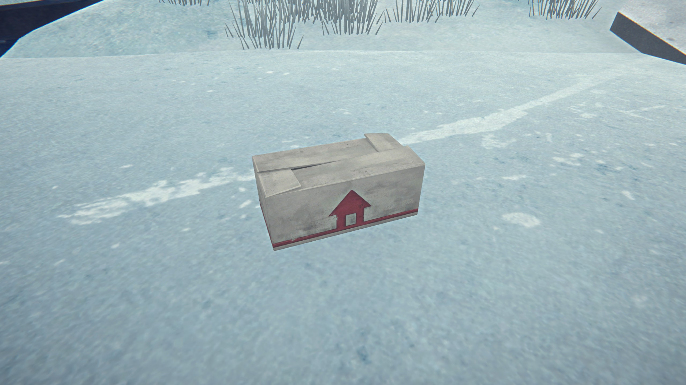
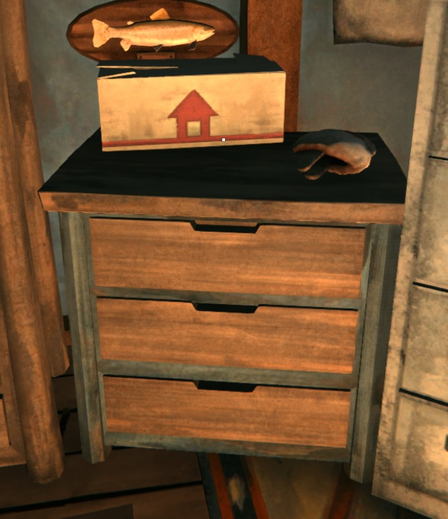

# Safehouse Decoration Box

**Safehouse Decoration Box**

| Property | Details |
| --- | --- |
|  |  / *Safehouse\_Decoration\_Box.jpg* |
| Release | TFTFT Part 6 Broken Silence |
| Update | [2.33](./The%20Long%20Dark%20%E2%80%94%20Changelog.md#2.33) |
| Story item | No |
| **Container** |  |
| Capacity | 100.00 kg(220 lbs) |

The **Safehouse Decoration Box** is a Container that is created when [Decorations](./Decorations.md) are dropped on the ground. It was introduced as part of the [Safehouse Customization](./Safehouse%20Customization.md) feature.

## Overview

Any Decoration dropped onto the ground will appear inside this box. Each box is immovable, like all containers, which can be a problem if placed inside a doorway since the player cannot walk over them.

Facing cupboards and cabinets will place the box on the surface, instead of at the player's feet. *Safehouse Decoration Box placed on a dresser* Once all items in a Safehouse Decoration Box are removed, the box disappears. Since items can freely be moved inside up to the 100 kg (220 lbs) capacity, this box is ideal for storing excess or unneeded Decoration items in one place in the player's [Safehouse](./Safehouse.md).

## Update History

**Template:update history** **Lua execution error in Module:Navbox function navbox** [ru:Коробка с украшениями для убежища](ru:%D0%9A%D0%BE%D1%80%D0%BE%D0%B1%D0%BA%D0%B0_%D1%81_%D1%83%D0%BA%D1%80%D0%B0%D1%88%D0%B5%D0%BD%D0%B8%D1%8F%D0%BC%D0%B8_%D0%B4%D0%BB%D1%8F_%D1%83%D0%B1%D0%B5%D0%B6%D0%B8%D1%89%D0%B0)
