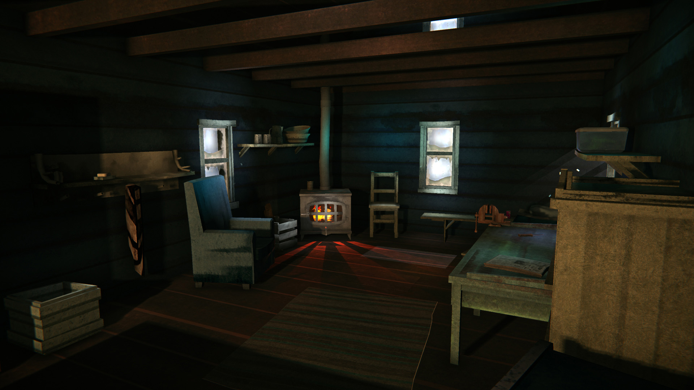
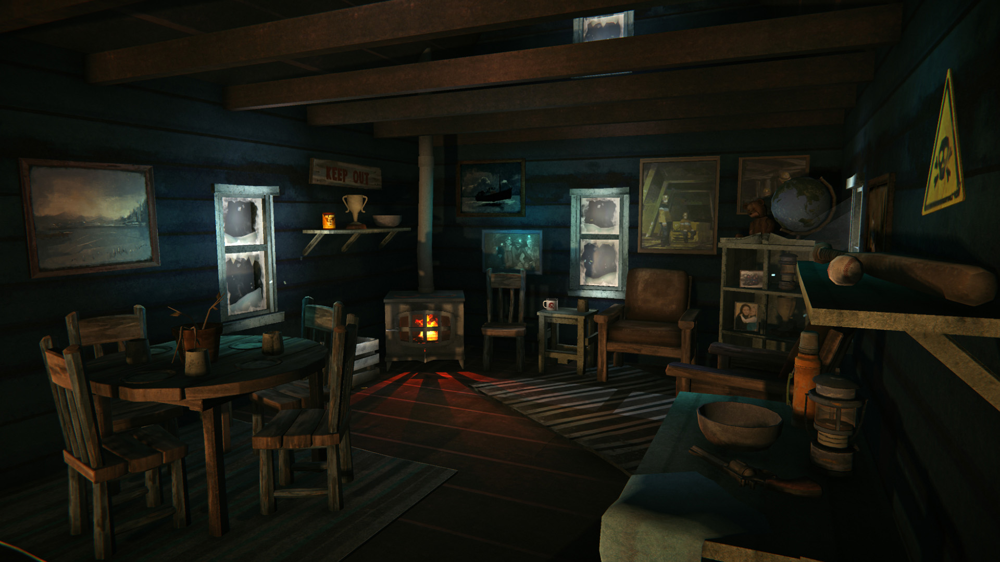
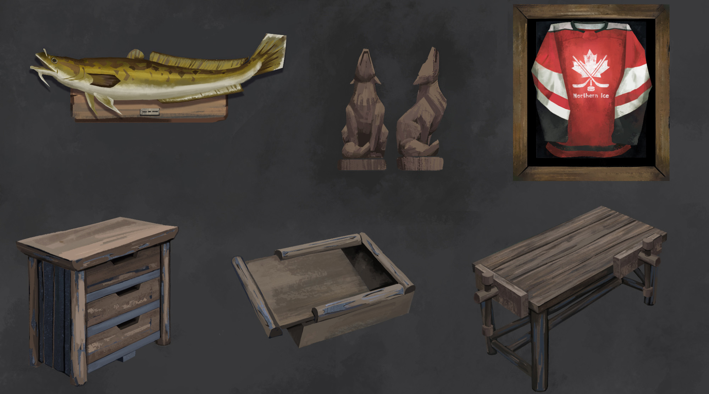

# Safehouse

**Contents**

- [Overview](#Overview)
- [Why use a safe house?](#Why_use_a_safe_house%3F)
- [Benefits of a safe house](#Benefits_of_a_safe_house)
- [Shelter from the elements/wildlife attacks](#Shelter_from_the_elements%2Fwildlife_attacks)
- [Scavenging opportunities](#Scavenging_opportunities)
- [Safe places to cook, repair, and cure](#Safe_places_to_cook%2C_repair%2C_and_cure)
- [Safe places to craft](#Safe_places_to_craft)
- [Beds](#Beds)
- [Gear and supply storage caches](#Gear_and_supply_storage_caches)
- [A quiet place to think](#A_quiet_place_to_think)
- [Assessment Criteria](#Assessment_Criteria)
- [Cooking slots](#Cooking_slots)
- [Bed](#Bed)
- [Storage](#Storage)
- [Harvestable materials](#Harvestable_materials)
- [Doors](#Doors)
- [Nearest Workstations](#Nearest_Workstations)
- [Dangerous wildlife](#Dangerous_wildlife)
- [Safe House Customization](#Safe_House_Customization)
- [Coastal Regions](#Coastal_Regions)
- [Desolation Point](#Desolation_Point)
- [Lonely Lighthouse](#Lonely_Lighthouse)
- [Hibernia Processing](#Hibernia_Processing)
- [The Riken](#The_Riken)
- [Coastal Highway](#Coastal_Highway)
- [Quonset Garage](#Quonset_Garage)
- [Jackrabbit Island](#Jackrabbit_Island)
- [Misanthrope's Homestead](#Misanthrope%27s_Homestead)
- [Bleak Inlet](#Bleak_Inlet)
- [Pensive Lookout](#Pensive_Lookout)
- [Cabin](#Cabin)
- [Cannery Worker Residences](#Cannery_Worker_Residences)
- [Northern Regions](#Northern_Regions)
- [Pleasant Valley](#Pleasant_Valley)
- [Pleasant Valley Farmstead](#Pleasant_Valley_Farmstead)
- [Community Hall](#Community_Hall)
- [Signal Hill](#Signal_Hill)
- [Keeper's Pass](#Keeper%27s_Pass)
- [Mirthless Fork](#Mirthless_Fork)
- [Forester's Hermitage](#Forester%27s_Hermitage)
- [Blackrock](#Blackrock)
- [Blackrock Prison](#Blackrock_Prison)
- [Old Substation](#Old_Substation)
- [Foreman's Clearcut](#Foreman%27s_Clearcut)
- [Timberwolf Mountain](#Timberwolf_Mountain)
- [Waterfall Cave](#Waterfall_Cave)
- [Mountaineer's Hut](#Mountaineer%27s_Hut)
- [Ash Canyon](#Ash_Canyon)
- [Angler's Den](#Angler%27s_Den)
- [Foreman's Retreat](#Foreman%27s_Retreat)
- [Homesteader's Respite](#Homesteader%27s_Respite)
- [Interior Regions](#Interior_Regions)
- [Mystery lake](#Mystery_lake)
- [Camp Office](#Camp_Office)
- [Trapper's Homestead](#Trapper%27s_Homestead)
- [Carter Hydro Dam](#Carter_Hydro_Dam)
- [The Ravine](#The_Ravine)
- [Caves](#Caves)
- [Forlorn Muskeg](#Forlorn_Muskeg)
- [Poacher's Camp](#Poacher%27s_Camp)
- [Old Spence Family Homestead](#Old_Spence_Family_Homestead)
- [Broken Railroad](#Broken_Railroad)
- [Maintenance Yard](#Maintenance_Yard)
- [Hunting Lodge](#Hunting_Lodge)
- [Mountain Town](#Mountain_Town)
- [Milton House (Grey Mother's)](#Milton_House_%28Grey_Mother%27s%29)
- [Paradise Meadows Farm](#Paradise_Meadows_Farm)
- [Hushed River Valley](#Hushed_River_Valley)
- [Ice caves](#Ice_caves)
- [Peak Cave](#Peak_Cave)
- [Pensive Vista](#Pensive_Vista)
- [Valley Cave](#Valley_Cave)
- [Far Territory](#Far_Territory)
- [Transfer Pass](#Transfer_Pass)
- [Vacant Depot](#Vacant_Depot)
- [Forsaken Airfield](#Forsaken_Airfield)
- [Main Hangar](#Main_Hangar)
- [Island Cottage](#Island_Cottage)
- [Zone of Contamination](#Zone_of_Contamination)
- [Idle Camp](#Idle_Camp)
- [Sundered Pass](#Sundered_Pass)
- [Last Lonely House](#Last_Lonely_House)

\[Missing image: Safe_House.jpg\] In an open-world experience like *<a href="./The%20Long%20Dark.md" class="wikilink" title="The Long Dark">The Long Dark</a>*, the player needs a safe, sheltered location to return to in order to recover their mind and body from the hazards of a nomadic lifestyle. A deliberate mechanic that separates *The Long Dark* from other survival games is that it does not provide the player any means to create a customized shelter from scratch. As such, the player will need to find a pre-existing location to call their temporary home as they explore the island. In a world as unforgiving and hostile as <a href="./Great%20Bear%20Island.md" class="wikilink" title="Great Bear Island">Great Bear Island</a>, **Safe Houses** are indoor sanctuaries that allow a player to survive and thrive through the permanent winter of the Quiet Apocalypse.

Safe Houses sometimes acts as a "gate" for narrative progression — I.E. events that advance the story or change the world state may only occur when the player returns to the safe house, as they often act as out of harm's way for interacting with story NPCs.

## Overview

### Why use a safe house?

Due to the sheer size of Great Bear Island, many players will need to create 1 or 2 "Home Bases" within a region, usually located near the direct center or near the entrances and exits of a region. These safe houses serve as the primary "area of operations/home base" used as supply storages from which survivors can store or restock on needed supplies for long term survival. Large buildings that generally safe to navigate to in the world and that contain <a href="./Bed.md" class="wikilink" title="Beds">Beds</a>, Fireboxes, <a href="./Work%20Bench.md" class="wikilink" title="Work Benches">Work Benches</a>, <a href="./Ammunition%20Work%20Bench.md" class="wikilink" title="Ammunition Work Benches">Ammunition Work Benches</a>, or <a href="./Forge.md" class="wikilink" title="Forges">Forges</a> are considered the most valuable locations to start a safehouse. Outdoor caves can also be used as safehouses but are generally used to combat <a href="./Cabin%20Fever.md" class="wikilink" title="Cabin Fever">Cabin Fever</a> on higher difficulties.

Long-distance travel between locations might require the establishment of temporary camps for shelter and rest. As such, returning to a previously used safe house can provide much needed shelter and supplies when traveling between regions.

There will always be a constant pull on the player to find a pre-existing shelter in order to create a Safe House, as the tension between wanting to remain in the warm and sheltered vs. returning to the open world to scavenge supplies and complete objectives is one of the main drives of self-directed sandbox gameplay of The Long Dark.

### Benefits of a safe house

#### Shelter from the elements/wildlife attacks

The primary purpose of Safe houses is to offer protection from the cold, bad weather, and hostile wildlife. A place to warm up is always in high demand when navigating the world, with even temporary safehouses providing opportunities to create <a href="./Fire.md" class="wikilink" title="Fires">Fires</a> to warm one's self.

Blizzards are frequent across the island, and being caught outside is a death sentence even with the warmest clothing, unless the player finds an indoor shelter. Safehouses not only provide refuge from storms, but also a place to dry wet clothing.

Predators such as <a href="./Wolf.md" class="wikilink" title="Wolves">Wolves</a> and <a href="./Bear.md" class="wikilink" title="Bears">Bears</a> are unable to enter buildings, and as such provide a quick go to location to escape potential attacks. They also provide safe locations to tend to injuries acquired from hostile wildlife. Multiple entry doors are an advantage to escape predators.

#### Scavenging opportunities

Most abandoned buildings can be looted for food, resources, and tools vital to survival. Chairs and furniture can be torn down or broken up to provide <a href="./Cloth.md" class="wikilink" title="Cloth">Cloth</a>, <a href="./Scrap%20Metal.md" class="wikilink" title="Scrap Metal">Scrap Metal</a>, and <a href="./Reclaimed%20Wood.md" class="wikilink" title="Reclaimed Wood">Reclaimed Wood</a> for repairs and crafting. Misplaced tools such as <a href="./Hacksaw.md" class="wikilink" title="Hacksaws">Hacksaws</a>, <a href="./Hatchet.md" class="wikilink" title="Hatchets">Hatchets</a>, <a href="./Hunting%20Knife.md" class="wikilink" title="Hunting Knives">Hunting Knives</a>, <a href="./Flashlight.md" class="wikilink" title="Flashlights">Flashlights</a>, <a href="./Storm%20Lantern.md" class="wikilink" title="Storm Lanterns">Storm Lanterns</a>, Firearms, Ammunition, <a href="./Simple%20Tools.md" class="wikilink" title="Simple Tools">Simple Tools</a>, and <a href="./Quality%20Tools.md" class="wikilink" title="Quality Tools">Quality Tools</a> can be found inside many buildings. <a href="./Clothing.md" class="wikilink" title="Clothing">Clothing</a> found in drawers or out in the open can be used to warm one's self. Toilets can provide clean drinking water (if you can stomach it) and kitchens can be raided for food and water, as well as <a href="./Can%20Opener.md" class="wikilink" title="Can Openers">Can Openers</a>, <a href="./Cooking%20Skillet.md" class="wikilink" title="Cooking Skillets">Cooking Skillets</a>, <a href="./Cooking%20Pot.md" class="wikilink" title="Cooking Pots">Cooking Pots</a>, and <a href="./Recycled%20Can.md" class="wikilink" title="Recycled Cans">Recycled Cans</a>. Bookshelves sometimes hold valuable <a href="./Research%20Book.md" class="wikilink" title="Research Books">Research Books</a> that can be read to increase your knowledge of the world by improving your <a href="./Skills.md" class="wikilink" title="Survival Skills">Survival Skills</a>.

#### Safe places to cook, repair, and cure

Indoor locations are ideal for <a href="./Cooking.md" class="wikilink" title="Cooking">Cooking</a>, as fireboxes can be used to provide heat, cook food, boil snow, etc without fear of freezing. Fireboxes located indoors are also more reliable than <a href="./Campfire.md" class="wikilink" title="Campfires">Campfires</a>, which can be blown out by strong winds.

Clothing and Tools will eventually decay with age and use, and thus must be repaired. Spending time in a safe house provides the perfect opportunity to safely restore clothing and tools to working functionality.

Saplings and Hides can be cured over time by dropping them on the floor of indoor spaces. They can stay on the floor even after curing, and can be picked up when you are ready to craft.

#### Safe places to craft

A good place to do some crafting or item repair beyond simple maintenance, many buildings in key locations within regions contain a <a href="./Work%20Bench.md" class="wikilink" title="Work Bench">Work Bench</a> for crafting high tier Clothing and Tools. Most of the animals hides and saplings you cure should be stored in these safe houses for crafting at a later date.

<a href="./Forge.md" class="wikilink" title="Forges">Forges</a> and <a href="./Furnace.md" class="wikilink" title="Furnaces">Furnaces</a> are a rare find in several coveted safe houses. They provide the only way to create <a href="./Improvised%20Knife.md" class="wikilink" title="Improvised Knives">Improvised Knives</a>, <a href="./Improvised%20Hatchet.md" class="wikilink" title="Hatchets">Hatchets</a>, and <a href="./Arrowhead.md" class="wikilink" title="Arrowheads">Arrowheads</a> and are vital locations to visit in order to survive on Interloper difficulty.

<a href="./Ammunition%20Work%20Bench.md" class="wikilink" title="Ammunition Work Benches">Ammunition Work Benches</a> are another rare feature found only in 2 safe houses, providing the ability to craft <a href="./Can%20of%20Gunpowder.md" class="wikilink" title="Gunpowder">Gunpowder</a>, create <a href="./Bullet.md" class="wikilink" title="Bullets">Bullets</a>, and reload spent shell casings. Ammo workbenches also come paired with <a href="./Milling%20Machine.md" class="wikilink" title="Milling Machines">Milling Machines</a> for repairing tools with Scrap Metal, when the lights are on that is.

#### Beds

The player will eventually tire in their travels, and as such a warm bed is a great reason to establish a safe house. “Using” a bed will bring up an analog watch interface that you can set to advance time. Resting will reduce your <a href="./Fatigue.md" class="wikilink" title="Fatigue">Fatigue</a> and will advance certain health-related conditions (i.e., healing or the progressing of illness) and is also a useful way to advance time while staying warm.

Beds are crucial in the beginning days of Interloper runs, as the player does not start with a <a href="./Bedroll.md" class="wikilink" title="Bedroll">Bedroll</a>. Knowing locations that contain beds is vital for surviving on this difficulty until the player can scavenge or build a Bedroll.

#### Gear and supply storage caches

Safe houses are the go to sanctuaries to store excess gear, as the player cannot carry the whole world on their back. As such, safe houses with many containers can be used to store clothing, tools, repair components, weapons, food and water, fuel, first aid equipment, etc.

You can also store miscellaneous items that you find in the world that you think might be useful, but don’t necessarily want to carry around with you wherever you go. Stored items may also serve as caches from which a player can resupply when needed.

#### A quiet place to think

You will always be alone in the world, thus you are entirely responsible for your own survival choices. Being able to create short and long term goals is critical for your survival and is usually impossible to do when the player is constantly worrying about their immediate personal safety. Even as a blizzard roars outside the walls of your dwelling or as predators scratch at the doors, a Safe House provides a player not just a warm and dry place to rest and escape the dangers of the outside world, but time to think. Remember, the key word in Safe House is "Safe."

This provides the player the chance to formulate future goals, reflect and learn from past mistakes, plan routes for excursions to distant locales, study maps and the layouts of regions, take stock of supplies of personal supplies and eliminate excess baggage from your inventory, and most importantly, provide a moment to have even the smallest glimmer of peace of mind, and thus hope for the future.

### Assessment Criteria

There are several locations on each map that offer good amenities to help in your attempts for survival. It is always strongly advised to have a bed and a fireplace of some sort indoors (or an indoor location that allows campfires). A <a href="./Work%20Bench.md" class="wikilink" title="workbench">workbench</a> is a bonus, as well as some containers for resource storage, although this is less critical as <a href="./Safehouse%20Customization.md" class="wikilink" title="they can be built">they can be built</a> in most locations as long as there's enough floor space to fit them. If <a href="./Tales%20from%20the%20Far%20Territory.md" class="wikilink" title="Tales from the Far Territory">Tales from the Far Territory</a> has been purchased, being able to get a <a href="./Travois.md" class="wikilink" title="Travois">Travois</a> up to your safe-house is highly desirable.

Also listed are the general characteristics of each map regarding its suitability for long-term survival. Note that these ratings are slightly subjective, and depend on your particular gameplay style and the difficulty level.

#### Cooking slots

Having interior cooking is desirable, as it enables you to cook in any weather without having to worry about a campfire being blown out by high winds. The number of cooking slots available depends on the firebox present, with <a href="./Forge.md" class="wikilink" title="forges">forges</a> and <a href="./Pot%20Belly%20Stove.md" class="wikilink" title="pot belly stoves">pot belly stoves</a> having one slot and <a href="./Stove.md" class="wikilink" title="cooking stoves">cooking stoves</a> having six. Most other fireboxes have two cooking slots. Some locations may have multiple fireboxes.

#### Bed

Having a bed in your safehouse may be essential if you don't have a bedroll, but even if you do, a stationary bed is preferable over a bedroll as it restores more condition per hour and reduces the rate at which your bedroll degrades. Most safehouses have a bed, but if your preferred location does not, you can build your own bed on <a href="./Furniture%20Workbench.md" class="wikilink" title="the appropriate workbench">the appropriate workbench</a> with the right <a href="./Woodworking%20Tools.md" class="wikilink" title="tools">tools</a> and materials. If you go this route, you <a href="./Rustic%20Bed.md" class="wikilink" title="have">have</a> <a href="./Quilted%20Bed.md" class="wikilink" title="three">three</a> <a href="./Bear%20Hide%20Bed.md" class="wikilink" title="options">options</a> to choose from.

#### Storage

Having a spacious safehouse is useful as larger locations tend to have more containers to store things, as well as more floor space to cure hides and saplings. You'll also need lots of floor space if you're planning to build your own furniture, as some of the larger pieces can take up a considerable amount of space.

#### Harvestable materials

Being able to harvest some <a href="./Cloth.md" class="wikilink" title="cloth">cloth</a>, <a href="./Reclaimed%20Wood.md" class="wikilink" title="Reclaimed Wood">Reclaimed Wood</a>, and <a href="./Scrap%20Metal.md" class="wikilink" title="Scrap Metal">Scrap Metal</a> inside your safehouse is desirable, especially in bad weather, though these resources are finite and become less important if you're planning on staying in the same location for an extended period of time.

#### Doors

Having multiple doors is useful if you're being chased into the safehouse by aggressive wildlife, or if you're trying to leave and there's an aggressive animal outside one of your doors.

#### Nearest Workstations

There are four different workstations in the game:

- Workbench
- Forge
- Ammo Workbench
- Milling Machine

All of these are useful for creating advanced items. But by far the one you'll use most often is the <a href="./Work%20Bench.md" class="wikilink" title="Work Bench">Work Bench</a>. Luckily, if a location doesn't come pre-equipped with one, it can be built by harvesting the <a href="./Workbench%20Vice.md" class="wikilink" title="vice">vice</a> from annother workbench. Forges are only necessary for creating <a href="./Arrowhead.md" class="wikilink" title="arrowheads">arrowheads</a>, <a href="./Improvised%20Hatchet.md" class="wikilink" title="improvised hatchets">improvised hatchets</a>, and <a href="./Improvised%20Knife.md" class="wikilink" title="improvised knives">improvised knives</a>; you won't need to make them often, so being close to a forge is a lower priority. <a href="./Ammunition%20Work%20Bench.md" class="wikilink" title="Ammo Workbenches">Ammo Workbenches</a> and <a href="./Milling%20Machine.md" class="wikilink" title="Milling Machines">Milling Machines</a> are found together. You likely won't use either very often, so being close to them is generally not particularly important.

#### Dangerous wildlife

Dangerous wildlife is just as the name implies: the average predator density in the area immediately around the safehouse. In this guide, an assessment of "low" means predators will only be encountered sporadically in the surroundings. If "high", expect to run into hostile wildlife most of the time when moving to and from the location. If it's rated as "medium", expect to see dangerous animals sometimes, but not all the time.

## Safe House Customization

<table>
<colgroup>
<col style="width: 33%" />
<col style="width: 33%" />
<col style="width: 33%" />
</colgroup>
<tbody>
<tr>
<td style="vertical-align: top; font-size: 3em; color: #5d5980; padding-right: 10px">
“
</td>
<td>
Move furniture and decorative props around your favourite locations in the game. Repair broken items and clean up the mess. Craft items from an entirely new series of hand-made furniture and decorative props. Collect and move every framed pancake photo in the game to one place. Make pretty much any valid interior in the game your personal Safehouse with this powerful system.

&#10;

Hinterland Description

</td>
<td style="vertical-align: bottom; font-size: 3em; color: #5d5980; padding-left: 10px">
”
</td>
</tr>
</tbody>
</table>

With the release of <a href="./Tales%20from%20the%20Far%20Territory.md" class="wikilink" title="Tales from the Far Territory">Tales from the Far Territory</a> Part 6, players have the option to customize a Safe House by rearranging furniture, crafting new furniture, hanging portraits on walls, and many other activities.

Due to the sheer amount of information that would otherwise further clutter this page, see the <a href="./Safehouse%20Customization.md" class="wikilink" title="Safehouse Customization">Safehouse Customization</a> page for more info.

<table class="gallery">
<colgroup>
<col style="width: 33%" />
<col style="width: 33%" />
<col style="width: 33%" />
</colgroup>
<tbody>
<tr>
<td><figure>

<figcaption>The <a href="./Trapper%27s%20Homestead.md" class="wikilink" title="Trapper&#39;s Homestead">Trapper's Homestead</a> before being customized</figcaption>
</figure></td>
<td><figure>

<figcaption>The Homestead after being customized</figcaption>
</figure></td>
<td><figure>

<figcaption>Safe House furniture Concept Art</figcaption>
</figure></td>
</tr>
</tbody>
</table>

## Coastal Regions

This is all the regions in Lower Great Bear with a salt water coast.

### <a href="./Desolation%20Point.md" class="wikilink" title="Desolation Point">Desolation Point</a>

Surviving here is generally easy to moderately difficult. There's plentiful shelter, and the weather here is only slightly worse than in <a href="./Coastal%20Highway.md" class="wikilink" title="Coastal Highway">Coastal Highway</a>. You have a <a href="./Forge.md" class="wikilink" title="Forge">Forge</a> close by in <a href="./The%20Riken.md" class="wikilink" title="The Riken">The Riken</a>, and deer to hunt on <a href="./Little%20Island.md" class="wikilink" title="Little Island">Little Island</a>. Inside <a href="./Hibernia%20Processing.md" class="wikilink" title="Hibernia">Hibernia</a>, you've got almost limitless storage space and a <a href="./Work%20Bench.md" class="wikilink" title="Work Bench">Work Bench</a>. If you stay on the ice, you should be able to avoid most of the wolves in the area (watch out for them on the roads, especially in Stalker!). Be careful if you want to explore the big <a href="./Cave%20%28Desolation%20Point%20location%29.md" class="wikilink" title="Cave">Cave</a> in Desolation Point, for a wolf lives there and can be quite difficult to shoot in the dark. If you do manage to kill it, though, you'll have two deer carcasses to harvest in safety.

#### <a href="./Lonely%20Lighthouse.md" class="wikilink" title="Lonely Lighthouse">Lonely Lighthouse</a>

This place has a lot, but not everything. It has some good storage, as well as a bed and a stove, though the lack of floor space makes adding custom furniture a bit tricky. It also offers one of the best views in the game, and the top of the lighthouse makes a good spot to fight cabin fever. However, there is no workbench. The closest one is as far away as Hibernia, and even that can be a dangerous journey. While it is possible to build a workbench in the lighthouse, the limited floor space may make it difficult to find a place to place it. There aren't any wolves near the lighthouse itself, but they are often found at intersection leading to the lighthouse, making entering/leaving challenging. However, this remains a good base.

| Type | Cooking slots | Bed | Workbench | Storage | Harvestable | Doors | Forge | Danger wildlife | Notes |
|----|----|----|----|----|----|----|----|----|----|
| Three floors lighthouse | 1 | yes | A couple hours' walk to <a href="./Hibernia%20Processing.md" class="wikilink" title="Hibernia Processing">Hibernia Processing</a>. | low | low | 1\* | A short walk to <a href="./The%20Riken.md" class="wikilink" title="The Riken">The Riken</a>. | low\* | Can fight <a href="./Cabin%20Fever.md" class="wikilink" title="Cabin Fever">Cabin Fever</a> from topmost floor. |

#### <a href="./Hibernia%20Processing.md" class="wikilink" title="Hibernia Processing">Hibernia Processing</a>

This place has, again, a lot. All the storage and floor space you could ever want combined with the triple threat: a bed, a workbench, and a fire barrel, making this a strong base location. Sure, there are wolves and sometimes a bear around, but as long as you stick to the side closest to the ice, you most likely won’t run into them. And with proper planning and good weather, the gatehouse off the entrance from the road can serve as a safe location from which to hunt the bear that often wanders past the processing plant.

| Type | Cooking slots | Bed | Workbench | Storage | Harvestable | Doors | Forge | Danger wildlife | Notes |
|----|----|----|----|----|----|----|----|----|----|
| Industrial | 2 | yes | present | really good | huge | 2 | A short walk away in <a href="./The%20Riken.md" class="wikilink" title="The Riken">The Riken</a>. | medium | Bear can be hunted from gatehouse. |

#### <a href="./The%20Riken.md" class="wikilink" title="The Riken">The Riken</a>

*This location cannot be modified using <a href="./Safehouse%20Customization.md" class="wikilink" title="Safehouse Customization">Safehouse Customization</a>.*\
This is one of the more popular bases in the game, and for good reason. Both the forge and the furnace make this place a place you’ll likely be familiar with by late game, and a bed on the second floor, a somewhat remote location away from predators, and protected outdoor space on the top deck contribute additional value. Little Island is also close by for hunting. Overall, this is a good spot to live in. The one weakness of this location is that the interior tends to be extremely dark, even in daytime, making it very difficult to navigate without the use of a <a href="./Storm%20Lantern.md" class="wikilink" title="Storm Lantern">Storm Lantern</a> or <a href="./Torch.md" class="wikilink" title="Torch">Torch</a>.

| Type | Cooking slots | Bed | Workbench | Storage | Harvestable | Doors | Forge | Danger wildlife | Notes |
|----|----|----|----|----|----|----|----|----|----|
| Stranded boat | 1 | yes | A short walk away at <a href="./Hibernia%20Processing.md" class="wikilink" title="Hibernia Processing">Hibernia Processing</a>. | minimal | medium | 2 | present | medium | Very dark inside. |

### <a href="./Coastal%20Highway.md" class="wikilink" title="Coastal Highway">Coastal Highway</a>

Surviving in Coastal Highway is generally pretty easy. The weather is the mildest of any region and there's lots to be found in the various houses scattered throughout the region. Forging is easy, as a trip to <a href="./The%20Riken.md" class="wikilink" title="The Riken">The Riken</a> is only a day's walk away, and there's plenty of buildings that are perfectly suited to calling your home, though Jackrabbit Island and the Quonset Garage (see below) are two of the most popular. If you need lamp oil, there's lots of fishing huts all over the ice. The only danger here is the somewhat high density of predators. On the ice, they're rather easy to avoid, but they can sneak up on you unexpectedly in the forest. On Interloper difficulty, where the cold is likely to be your worst enemy, Coastal Highway is about the easiest place to survive.

#### <a href="./Quonset%20Garage.md" class="wikilink" title="Quonset Garage">Quonset Garage</a>

It has two workbenches, a bed, and a fire barrel, as well as a central location, lots of storage, and plenty of space to add more furniture. The primary reason one wouldn’t want to live here is due to the many wolves and occasional bear that patrol the area. For a well-supplied and well-armed survivor, however, these drawbacks could serve as a solid supply of meat, gut, and hides.

| Type | Cooking slots | Bed | Workbench | Storage | Harvestable | Doors | Forge | Danger wildlife | Notes |
|----|----|----|----|----|----|----|----|----|----|
| Gas station | 2 | yes | inside | good | medium | 2 | A day's walk away at <a href="./The%20Riken.md" class="wikilink" title="The Riken">The Riken</a>. | high | Plentiful looting in nearby houses. |

#### <a href="./Jackrabbit%20Island.md" class="wikilink" title="Jackrabbit Island">Jackrabbit Island</a>

Although it lacks both a workbench and a fireplace, it has a bed and possibly some of the best rabbit hunting opportunities in the game. It also has a porch to store meat on, as well as a good amount of storage inside the house itself, along with plenty of opportunity to rearrange the furniture as you see fit. A fishing hut is also located just outside your front door, as are beachcombing areas. On top of all that, wolves rarely come up onto the island.

| Type | Cooking slots | Bed | Workbench | Storage | Harvestable | Doors | Forge | Danger wildlife | Notes |
|----|----|----|----|----|----|----|----|----|----|
| One storey house | 0 | yes | A short walk to <a href="./Fishing%20Camp.md" class="wikilink" title="Fishing Camp">Fishing Camp</a> (outdoors), or a couple hours' walk to <a href="./Quonset%20Garage.md" class="wikilink" title="Quonset Garage">Quonset Garage</a> (indoors). | good | medium | 2 | A day's walk to <a href="./The%20Riken.md" class="wikilink" title="The Riken">The Riken</a>. | very low | Excellent snaring, fishing, and <a href="./Beachcombing.md" class="wikilink" title="Beachcombing">Beachcombing</a> nearby. |

#### <a href="./Misanthrope%27s%20Homestead.md" class="wikilink" title="Misanthrope&#39;s Homestead">Misanthrope's Homestead</a>

This house has many of the same features as the one on <a href="./Jackrabbit%20Island.md" class="wikilink" title="Jackrabbit Island">Jackrabbit Island</a> to the west, but it is a two story house and features slightly more storage. It can be a good safe house to use if you ever run out of rabbits at Jackrabbit Island for some reason, and is the closest safe house to <a href="./Trader.md" class="wikilink" title="Sutherland&#39;s">Sutherland's</a> dock if you're planning to trade.

| Type | Cooking slots | Bed | Workbench | Storage | Harvestable | Doors | Forge | Danger wildlife | Notes |
|----|----|----|----|----|----|----|----|----|----|
| Two storey house | 0 | yes | A short walk to <a href="./Fishing%20Camp.md" class="wikilink" title="Fishing Camp">Fishing Camp</a> (outdoors), or a couple hours' walk to <a href="./Quonset%20Garage.md" class="wikilink" title="Quonset Garage">Quonset Garage</a> (indoors). | good | medium | 1 | A day's walk to <a href="./The%20Riken.md" class="wikilink" title="The Riken">The Riken</a>. | low | Good snaring, fishing, and <a href="./Beachcombing.md" class="wikilink" title="Beachcombing">Beachcombing</a> nearby. |

### <a href="./Bleak%20Inlet.md" class="wikilink" title="Bleak Inlet">Bleak Inlet</a>

This region is one of the most challenging to survive in for any significant amount of time. While there is fishing available as a food source and the ammunition crating workbench is close by, along with a nearby <a href="./Forge.md" class="wikilink" title="Forge">Forge</a> in <a href="./Forlorn%20Muskeg.md" class="wikilink" title="Forlorn Muskeg">Forlorn Muskeg</a>, the region is full of <a href="./Timberwolf.md" class="wikilink" title="timberwolves">timberwolves</a>. Regardless of how careful you are, you're going to get into a fight with them sooner or later. The region's also very windy and chilly, lacking good shelters aside from a cabin in the northeast, the Cannery Worker Residences, and Pensive Lookout. For most players, there's little reason to live here for an extended period of time, unless you want a challenge.

#### <a href="./Pensive%20Lookout.md" class="wikilink" title="Pensive Lookout">Pensive Lookout</a>

This location can make a decent safehouse. Being located on the plateau, the nearby population of timberwolves isn't as high as along the coast. It also contains a <a href="./Pot%20Belly%20Stove.md" class="wikilink" title="Pot Belly Stove">Pot Belly Stove</a>, a commanding view of the entire region, and a good vantage point from which to hunt timberwolves or <a href="./Deer.md" class="wikilink" title="Deer">Deer</a>. The major disadvantage of this location is the need to travel <a href="./Rope%20Climbing.md" class="wikilink" title="down a long rope">down a long rope</a> to go and forge, and that it can be rather cold, especially in harder difficulty modes. It is also a relatively small location, limiting the amount of custom furniture the player can add.

| Type | Cooking slots | Bed | Workbench | Storage | Harvestable | Doors | Forge | Danger wildlife | Notes |
|----|----|----|----|----|----|----|----|----|----|
| Fire tower | 1 | Yes | A few hours walk to <a href="./Cannery%20Pier.md" class="wikilink" title="Cannery Pier">Cannery Pier</a>. | Little | Medium | 1 | Half a day's walk to <a href="./Old%20Spence%20Family%20Homestead.md" class="wikilink" title="Old Spence Family Homestead">Old Spence Family Homestead</a>. | medium | Fairly safe from Timberwolves. |

#### <a href="./Cabin.md" class="wikilink" title="Cabin">Cabin</a>

Another decent place to call home, this location has nearby <a href="./Deer.md" class="wikilink" title="Deer">Deer</a> hunting opportunities, a decent amount of storage, sufficient floor space to add some furniture, and a rim grill to cook on. There are occasional timberwolves around, but they shouldn't be too much of a problem. The cabin can be somewhat chilly, due to having a hole in its roof, and it's located a long distance from the <a href="./Cannery%20Pier.md" class="wikilink" title="Cannery Pier">Cannery Pier</a>'s <a href="./Workshop.md" class="wikilink" title="Workshop">Workshop</a>.

| Type | Cooking slots | Bed | Workbench | Storage | Harvestable | Doors | Forge | Danger wildlife | Notes |
|----|----|----|----|----|----|----|----|----|----|
| Cabin | 2 | Yes | A few hours' walk to <a href="./Cannery%20Pier.md" class="wikilink" title="Cannery Pier">Cannery Pier</a>. | Medium | Medium | 1 | Half a day's walk to <a href="./Old%20Spence%20Family%20Homestead.md" class="wikilink" title="Old Spence Family Homestead">Old Spence Family Homestead</a>. | low | Decent hunting nearby. |

#### <a href="./Cannery%20Worker%20Residences.md" class="wikilink" title="Cannery Worker Residences">Cannery Worker Residences</a>

This location offers nearby ice fishing opportunities, is located near the center of the map, features a <a href="./Fireplace.md" class="wikilink" title="Fireplace">Fireplace</a>, and decent hunting and trapping opportunities. If you need to cook a large amount of meat or fish, it's only a short stroll over to the <a href="./Fallen%20Lighthouse.md" class="wikilink" title="Fallen Lighthouse">Fallen Lighthouse</a> to use its six-burner stove. Downsides to this location include a <a href="./Bear.md" class="wikilink" title="Bear">Bear</a> that sometimes wanders over, as well as the occasional presence of Timberwolves, and that this cabin is quite small, limiting customization opportunities.

| Type | Cooking slots | Bed | Workbench | Storage | Harvestable | Doors | Forge | Danger wildlife | Notes |
|----|----|----|----|----|----|----|----|----|----|
| Cabin | 1 | Yes | A couple hours' walk to <a href="./Cannery%20Pier.md" class="wikilink" title="Cannery Pier">Cannery Pier</a>. | Medium | Medium | 1 | Half a day's walk to <a href="./Old%20Spence%20Family%20Homestead.md" class="wikilink" title="Old Spence Family Homestead">Old Spence Family Homestead</a>. | medium |  |

## Northern Regions

This is all the regions in Lower Great Bear which require traveling through Pleasant Valley to access.

### <a href="./Pleasant%20Valley.md" class="wikilink" title="Pleasant Valley">Pleasant Valley</a>

This region might be "advanced" according to its official description, but, especially since the Crossroads Elegy update, it's really of more of a moderate difficulty region. While it *is* a large region with changeable weather (resulting in a considerable risk of getting <a href="./Cabin%20Fever.md" class="wikilink" title="Cabin Fever">Cabin Fever</a> on Interloper), there are quite a few bears and wolves, and it's easy to get disoriented in the featureless fields, you should be fine as long as you don't wander off the roads and you pay attention. There's plenty of food and clothing to start you off in <a href="./Thomson%27s%20Crossing.md" class="wikilink" title="Thomson&#39;s Crossing">Thomson's Crossing</a>, and the <a href="./Crash%20Site%20%28Pleasant%20Valley%29.md" class="wikilink" title="Crash Site">Crash Site</a> is loaded full of food and clothing too. Hunting opportunities are plentiful, and you're highly likely to find some excellent loot in <a href="./Misty%20Falls%20Cave.md" class="wikilink" title="Misty Falls Cave">Misty Falls Cave</a>. Don't forget <a href="./Signal%20Hill.md" class="wikilink" title="Signal Hill">Signal Hill</a> either, which often has an <a href="./Expedition%20Parka.md" class="wikilink" title="Expedition Parka">Expedition Parka</a>.

#### <a href="./Pleasant%20Valley%20Farmstead.md" class="wikilink" title="Pleasant Valley Farmstead">Pleasant Valley Farmstead</a>

Central location, storage, workbench, fireplace AND stove, nearby rabbits and fishing, good hunting, enclosed porch, a substantial supply of cloth and other useful materials, and overall appeal--all of these qualities make the farmstead a great location to call home. Potential drawbacks include fairly common patrols by wolves and an occasional bear and that Pleasant Valley has frequent blizzards and bad weather, so a player could be forced to stay inside for several days at a time. Other than those concerns, the farmhouse serves as a great location to live for extended periods of time.

| Type | Cooking slots | Bed | Workbench | Storage | Harvestable | Doors | Forge | Danger wildlife | Notes |
|----|----|----|----|----|----|----|----|----|----|
| Two floors farmstead with basement | 6+2 | yes | present | very good | very good | 4 | A day and a half walk to <a href="./The%20Riken.md" class="wikilink" title="The Riken">The Riken</a>. | high | Outdoor porch can keep meat refrigerated. |

#### <a href="./Community%20Hall.md" class="wikilink" title="Community Hall">Community Hall</a>

Located in <a href="./Thomson%27s%20Crossing.md" class="wikilink" title="Thomson&#39;s Crossing">Thomson's Crossing</a>, the Community Hall is a solid choice as a base, given its relatively central location, proximity to multiple other structures, plentiful rabbit and deer hunting, loads of kitchen cabinets to put things into, and having both a stove and a fireplace. Wolves and a bear do occasionally wander through town, but they tend to stay north of the river most of the time. The main disadvantage of living here is the lack of a workbench, requiring the player to travel to the Pleasant Valley Outbuildings to do crafting. However, there is plenty of floor space in the building to players to construct their own workbench.

| Type | Cooking slots | Bed | Workbench | Storage | Harvestable | Doors | Forge | Danger wildlife | Notes |
|----|----|----|----|----|----|----|----|----|----|
| Large community centre | 6+2 | yes | A couple hours' walk to <a href="./Pleasant%20Valley%20Outbuildings.md" class="wikilink" title="Pleasant Valley Outbuildings">Pleasant Valley Outbuildings</a>. | very good | moderate | 2 | A day and a half walk to <a href="./The%20Riken.md" class="wikilink" title="The Riken">The Riken</a>. | moderate | Many houses nearby to loot/use for storage. |

#### <a href="./Signal%20Hill.md" class="wikilink" title="Signal Hill">Signal Hill</a>

This location has a lot, but not everything. It has plenty of storage, an interior workbench, and the view from the summit is second to none. The exterior is surrounded by a fence, reducing the chances of running into wolves when entering/leaving. While there are quite a few wolves just east of here, they can be safely hunted from the <a href="./Hunter%27s%20Blind.md" class="wikilink" title="Hunter&#39;s Blind">Hunter's Blind</a>. One slight weakness of the radio control hut is that the fire barrel is outside, however, this could be advantageous as it results in longer burn times. Also, it's worth mentioning that Signal Hill is fairly close to the southeastern side of the region, making it less than central.

| Type | Cooking slots | Bed | Workbench | Storage | Harvestable | Doors | Forge | Danger wildlife | Notes |
|----|----|----|----|----|----|----|----|----|----|
| Radio control hut | 2 | yes | present | very good | low | 1 | A day and a half's walk to either <a href="./Old%20Spence%20Family%20Homestead.md" class="wikilink" title="Old Spence Family Homestead">Old Spence Family Homestead</a> or <a href="./The%20Riken.md" class="wikilink" title="The Riken">The Riken</a>. | moderate | Quite isolated from the rest of <a href="./Pleasant%20Valley.md" class="wikilink" title="Pleasant Valley">Pleasant Valley</a>. |

### Keeper's Pass

**Keeper's Pass** is a transitional region that connects <a href="./Pleasant%20Valley.md" class="wikilink" title="Pleasant Valley">Pleasant Valley</a> to the <a href="./Blackrock.md" class="wikilink" title="Blackrock Region">Blackrock Region</a>. It is made up of <a href="./Keeper%27s%20Pass%20North.md" class="wikilink" title="Keeper&#39;s Pass North">Keeper's Pass North</a>, a connecting <a href="./Cave%20%28Transition%20Zone%29.md" class="wikilink" title="cave">cave</a>, and <a href="./Keeper%27s%20Pass%20South.md" class="wikilink" title="Keeper&#39;s Pass South">Keeper's Pass South</a>.

#### <a href="./Mirthless%20Fork.md" class="wikilink" title="Mirthless Fork">Mirthless Fork</a>

This is the only man-made structure with a interior in the <a href="./Keeper%27s%20Pass%20South.md" class="wikilink" title="Keeper&#39;s Pass South">Keeper's Pass South</a>. The fire is exterior, but it has an interior <a href="./Work%20Bench.md" class="wikilink" title="Work Bench">Work Bench</a>. Sometimes rabbits spawn in the area, but so do wolves, so be careful. There's a <a href="./Fishing%20Hut.md" class="wikilink" title="fishing hut">fishing hut</a> in the nearby river, but beware that the path back goes through wolf spawns.

| Type | Cooking slots | Bed | Workbench | Storage | Harvestable | Doors | Forge | Danger wildlife | Notes |
|----|----|----|----|----|----|----|----|----|----|
| Trailer | 2 | Yes | Yes | Lots | Moderate | 1 | Several days walk to <a href="./The%20Riken.md" class="wikilink" title="The Riken">The Riken</a>. | High | Close to <a href="./Blackrock.md" class="wikilink" title="Blackrock">Blackrock</a> for ammunition crafting. |

#### <a href="./Forester%27s%20Hermitage.md" class="wikilink" title="Forester&#39;s Hermitage">Forester's Hermitage</a>

This is the only man-made structure in the <a href="./Keeper%27s%20Pass%20North.md" class="wikilink" title="Keeper&#39;s Pass North">Keeper's Pass North</a>. Because wolves can't spawn in this area, the cold is your only enemy here. Although it offers little shelter from the elements, it does have a <a href="./Wood%20Stove.md" class="wikilink" title="Wood Stove">Wood Stove</a> to keep the player warm and a bed to rest with. Rabbits spawn in the area offering a potential food supply. Due to the linearity of Keeper's Pass North, this cabin acts as a necessary waypoint when traveling through.

| Type | Cooking slots | Bed | Workbench | Storage | Harvestable | Doors | Forge | Danger wildlife | Notes |
|----|----|----|----|----|----|----|----|----|----|
| Ruined Cabin | 2 | Yes | No | Little | None | 2 | Several days walk to <a href="./The%20Riken.md" class="wikilink" title="The Riken">The Riken</a>. | None | Close to <a href="./Blackrock.md" class="wikilink" title="Blackrock">Blackrock</a> for ammunition crafting. |

### <a href="./Blackrock.md" class="wikilink" title="Blackrock">Blackrock</a>

Home to the infamous <a href="./Blackrock%20Prison.md" class="wikilink" title="Blackrock Federal Penitentiary">Blackrock Federal Penitentiary</a>, this region is one of only three to have <a href="./Timberwolf.md" class="wikilink" title="timberwolves">timberwolves</a> in survival mode. If the timberwolves aren't enough to keep you on your toes, the region frequently has poor weather, along with being quite isolated from much of the rest of Great Bear. That being said, there is an ammunition crafting workbench here, along with a fair amount of shelter, so living here is a certainly not impossible.

#### <a href="./Blackrock%20Prison.md" class="wikilink" title="Blackrock Prison">Blackrock Prison</a>

Probably the most useful place to call home is the prison. While living in the prison itself isn't really that feasible, as most of it is destroyed and difficult to navigate, there are lots of outbuildings that can make a good base, and there is a workbench and ammunition crafting readily available. Be careful of wolves living just outside the prison yard, however. If the prison outbuildings don't offer enough storage, another option is to expand into the interconnected <a href="./Steam%20Tunnels.md" class="wikilink" title="Steam Tunnels">Steam Tunnels</a>.

| Type | Cooking slots | Bed | Workbench | Storage | Harvestable | Doors | Forge | Danger wildlife | Notes |
|----|----|----|----|----|----|----|----|----|----|
| Maximum security prison | 2 | Yes | Present. | Almost limitless | Loads | Multiple | Several days walk to <a href="./The%20Riken.md" class="wikilink" title="The Riken">The Riken</a>. | medium | Ammunition crafting possible on-site. |

#### <a href="./Old%20Substation.md" class="wikilink" title="Old Substation">Old Substation</a>

If living in a prison isn't your thing, you might want to consider living in the old substation. It is located towards the southwestern corner of the map, and features a workbench and fire barrel on site. Downsides to living here include the lack of deer nearby, making rabbits the only long-term food source, and the presence of timberwolf packs.

| Type | Cooking slots | Bed | Workbench | Storage | Harvestable | Doors | Forge | Danger wildlife | Notes |
|----|----|----|----|----|----|----|----|----|----|
| Electrical control hut | 2 | Yes | Present | Lots | Little | 1 | Several days walk to <a href="./The%20Riken.md" class="wikilink" title="The Riken">The Riken</a>. | high | Similar in layout to <a href="./Signal%20Hill.md" class="wikilink" title="Signal Hill">Signal Hill</a>. |

#### <a href="./Foreman%27s%20Clearcut.md" class="wikilink" title="Foreman&#39;s Clearcut">Foreman's Clearcut</a>

The Foreman's Clearcut is also a good location to call home, featuring an interior bed, workbench, and lots of nearby game. The greatest downside of living here are the packs of roaming timberwolves nearby, as well as the lack of a contained fire; the closest one is located at <a href="./Cook%27s%20Farm.md" class="wikilink" title="Cook&#39;s Farm">Cook's Farm</a>, a walk which may be hazardous in higher difficulty levels or in poor weather.

| Type | Cooking slots | Bed | Workbench | Storage | Harvestable | Doors | Forge | Danger wildlife | Notes |
|----|----|----|----|----|----|----|----|----|----|
| Trailer | None | Yes | Present | Moderate | Little | 1 | Several days walk to <a href="./The%20Riken.md" class="wikilink" title="The Riken">The Riken</a>. | high | Not far from the prison for ammunition crafting. |

### <a href="./Timberwolf%20Mountain.md" class="wikilink" title="Timberwolf Mountain">Timberwolf Mountain</a>

This region is notorious for its frequent blizzards, lack of shelter, and high predator density. However, if you know where to go, there are large areas of the map that don't have many predators, and don't forget the <a href="./Cargo%20Container.md" class="wikilink" title="Cargo Container">Cargo Containers</a>! If you have a <a href="./Hacksaw.md" class="wikilink" title="hacksaw">hacksaw</a> (and you're not playing Interloper), you'll find all the supplies you'll need to start off within the first few days. With good clothing, you can use the caves with interiors as long-term bases, as they're warm no matter the weather. Just remember: **bring a <a href="./Bedroll.md" class="wikilink" title="bedroll">bedroll</a>**. The importance of this here can't be overstated, as once you leave the <a href="./Mountaineer%27s%20Hut.md" class="wikilink" title="Mountaineer&#39;s Hut">Mountaineer's Hut</a>, that's it for guaranteed beds. A bedroll usually spawns in the cave nearest the summit, but it may be unusable if it spawned at low condition and you didn't get to it in time.

Due to its cold weather, Timberwolf Mountain is quite difficult to survive in when playing Interloper, but the plentiful loot in the cargo containers in Stalker and lower difficulties can make up for its poor weather, moderating the challenge somewhat.

#### <a href="./Waterfall%20Cave.md" class="wikilink" title="Waterfall Cave">Waterfall Cave</a>

Located immediately adjacent to <a href="./Eric%27s%20Falls.md" class="wikilink" title="Eric&#39;s Falls">Eric's Falls</a>, this cave provides a 10oC warmth bonus, and acts as an indoor area, allowing hides/guts to be cured inside. It's also not too far from the <a href="./Summit.md" class="wikilink" title="Summit">Summit</a>, allowing the player to gather loot from there after two rope climbs. There are plenty of <a href="./Rabbit.md" class="wikilink" title="rabbit">rabbits</a>, <a href="./Deer.md" class="wikilink" title="deer">deer</a> and <a href="./Wolf.md" class="wikilink" title="wolves">wolves</a> to hunt nearby, but those same wolves can be problematic to ill-equipped players. A <a href="./Bear.md" class="wikilink" title="bear">bear</a> occasionally wanders nearby. The cave doesn't offer any cooking, storage or sleeping quarters, but a <a href="./Campfire.md" class="wikilink" title="campfire">campfire</a> can easily be lit inside, regardless of the weather, a <a href="./Bedroll.md" class="wikilink" title="bedroll">bedroll</a> can serve as a bed, and items can be stored in the <a href="./Cargo%20Container.md" class="wikilink" title="Cargo Container">Cargo Container</a> along the river nearby (except in Interloper).

| Type | Cooking slots | Bed | Workbench | Storage | Harvestable | Doors | Forge | Danger wildlife | Notes |
|----|----|----|----|----|----|----|----|----|----|
| Natural cave | No | No\* | Half a day's walk to the <a href="./Mountaineer%27s%20Hut.md" class="wikilink" title="Mountaineer&#39;s Hut">Mountaineer's Hut</a>. | Container nearby | No | 1 | Two and a half days' travel to <a href="./The%20Riken.md" class="wikilink" title="The Riken">The Riken</a>. | moderate | Good place to rest while climbing up Timberwolf Mountain. |

#### <a href="./Mountaineer%27s%20Hut.md" class="wikilink" title="Mountaineer&#39;s Hut">Mountaineer's Hut</a>

This is probably the most popular safe house in Timberwolf Mountain. It is located near <a href="./Crystal%20Lake.md" class="wikilink" title="Crystal Lake">Crystal Lake</a>, which has a <a href="./Fishing%20Hut.md" class="wikilink" title="Fishing hut">Fishing hut</a> on it, a <a href="./Rabbit%20Grove.md" class="wikilink" title="Rabbit Grove">Rabbit Grove</a>, plentiful <a href="./Deer.md" class="wikilink" title="deer">deer</a> hunting opportunities, and <a href="./Cat%20Tail.md" class="wikilink" title="cattail plants">cattail plants</a> for tinder and emergency food. The downside of this location is that a <a href="./Bear.md" class="wikilink" title="bear">bear</a> sometimes visits the area, it's not a particularly warm location, and there is a decent chance of <a href="./Wolf.md" class="wikilink" title="wolves">wolves</a> being in the area. It's also quite a hike from the <a href="./Summit.md" class="wikilink" title="Summit">Summit</a>, limiting its usefulness for looting expeditions.

| Type | Cooking slots | Bed | Workbench | Storage | Harvestable | Doors | Forge | Danger wildlife | Notes |
|----|----|----|----|----|----|----|----|----|----|
| One story stone hut | 2 | Yes | present | small amount | moderate | 1 | Two day trip to <a href="./The%20Riken.md" class="wikilink" title="The Riken">The Riken</a>. | moderate | Fishing nearby. |

### <a href="./Ash%20Canyon.md" class="wikilink" title="Ash Canyon">Ash Canyon</a>

Survival here is slightly easier than in <a href="./Timberwolf%20Mountain.md" class="wikilink" title="Timberwolf Mountain">Timberwolf Mountain</a> or <a href="./Hushed%20River%20Valley.md" class="wikilink" title="Hushed River Valley">Hushed River Valley</a>. This is largely because this region has lots of natural resources and high-tier loot, similar to the former, but it also has several shelters scattered throughout. The main challenge of living here is to not get lost, as there are many canyons and plateaus of differing elevations, all connected via climbing ropes. Oh, and try not to fall off the rope bridges when you're crossing them... it's a long way down. Overall, survival here is moderately difficult.

#### <a href="./Angler%27s%20Den.md" class="wikilink" title="Angler&#39;s Den">Angler's Den</a>

This cabin might be small, but it proves that sometimes size doesn't matter. It's centrally located and has got a workbench, pot belly stove, and comfy bed. There's a huge trunk next to the workbench to put your stuff, along with a smaller metal container underneath the bed. The old furniture atop the bed can be broken down to give plenty of reclaimed wood, but there's no curtains to break down for cloth.

The main disadvantage of this location is that although the area immediately surrounding the cabin is safe, wolves guard every path away from the cabin. They patrol the southeast path towards Bitter Marsh, the bottom of the rope climb in the southwest that leads to Pillar's Footrest, the path near Broad Falls to the northwest, and around Long Falls before the cave that provides access to the upper areas of the region. On top of that, the weather in Ash Canyon is often very cold, limiting the amount of time the player can spend outdoors, and it is quite a long walk to both the fishing hut on <a href="./Bitter%20Marsh.md" class="wikilink" title="Bitter Marsh">Bitter Marsh</a> and any sort of hunting, limiting access to food beyond cattails and wolf meat.

| Type | Cooking slots | Bed | Workbench | Storage | Harvestable | Doors | Forge | Danger wildlife | Notes |
|----|----|----|----|----|----|----|----|----|----|
| Cabin | 1 | Yes | Present | Medium | Medium | 1 | Three days' walk to <a href="./The%20Riken.md" class="wikilink" title="The Riken">The Riken</a>. | very high | Very central location. |

#### <a href="./Foreman%27s%20Retreat.md" class="wikilink" title="Foreman&#39;s Retreat">Foreman's Retreat</a>

This location just south of <a href="./Miner%27s%20Folly.md" class="wikilink" title="Miner&#39;s Folly">Miner's Folly</a> has a lot, but not everything. It features both a <a href="./Wood%20Stove.md" class="wikilink" title="wood stove">wood stove</a> and a <a href="./Fireplace.md" class="wikilink" title="Fireplace">Fireplace</a>, several storage containers, and a decent amount of harvestable wood and cloth. While there isn't a workbench located inside, one can be found very close by at Miner's Folly (outdoors), and it can be disassembled and moved inside if desired. <a href="./Deer.md" class="wikilink" title="Deer">Deer</a> can be found around Miner's Folly too, along with a <a href="./Bear.md" class="wikilink" title="Bear">Bear</a> for those brave enough to hunt it. The main disadvantage of this location is that going any substantial distance requires crossing multiple high rope bridges, and the fact that <a href="./Ash%20Canyon.md" class="wikilink" title="Ash Canyon">Ash Canyon</a> itself is a rather isolated region.

| Type | Cooking slots | Bed | Workbench | Storage | Harvestable | Doors | Forge | Danger wildlife | Notes |
|----|----|----|----|----|----|----|----|----|----|
| Two room cabin | 2+2 | Yes | A short walk to <a href="./Miner%27s%20Folly.md" class="wikilink" title="Miner&#39;s Folly">Miner's Folly</a> (outside). | Medium | Medium | 1 | Three day's walk to <a href="./The%20Riken.md" class="wikilink" title="The Riken">The Riken</a>. | low | Excellent place to hunt the only <a href="./Bear.md" class="wikilink" title="bear">bear</a> in Ash Canyon. |

#### <a href="./Homesteader%27s%20Respite.md" class="wikilink" title="Homesteader&#39;s Respite">Homesteader's Respite</a>

The Homesteader's Respite is located towards the northeastern part of Ash Canyon, next to an old mining facility. One of this location's main advantages is that predators never spawn around the house, and that it is located close to good <a href="./Deer.md" class="wikilink" title="deer">deer</a> hunting grounds around <a href="./Bitter%20Marsh.md" class="wikilink" title="Bitter Marsh">Bitter Marsh</a> (wolves do spawn there too, so be careful). If the deer should run out, there's a broken-down ice fishing hut on Bitter Marsh, too, providing yet another source of food. So what's not to like? The largest disadvantage of living here is that getting supplies from Bitter Marsh requires climbing up a rope, which may be difficult if you're tired late in the day. Another disadvantage is that there's no workbench, and the closest one is located in <a href="./Angler%27s%20Den.md" class="wikilink" title="Angler&#39;s Den">Angler's Den</a>.

| Type | Cooking slots | Bed | Workbench | Storage | Harvestable | Doors | Forge | Danger wildlife | Notes |
|----|----|----|----|----|----|----|----|----|----|
| Cabin | 2 | Yes | A few hours walk to <a href="./Angler%27s%20Den.md" class="wikilink" title="Angler&#39;s Den">Angler's Den</a>. | Medium | Medium | 1 | Three day's walk to <a href="./The%20Riken.md" class="wikilink" title="The Riken">The Riken</a>. | None | Fishing nearby. |

## Interior Regions

This is all the regions in Lower Great Bear which require traveling through Mystery Lake or Forlorn Muskeg to access.

### <a href="./Mystery%20Lake%20%28region%29.md" class="wikilink" title="Mystery lake">Mystery lake</a>

Mystery Lake is a popular region for long-term survival, and with good reason. It has relatively few predatory animals compared to most other regions, Ice Fishing opportunities on its <a href="./Mystery%20Lake%20%28location%29.md" class="wikilink" title="namesake lake">namesake lake</a>, temperatures are fairly mild (though not as mild as <a href="./Coastal%20Highway.md" class="wikilink" title="Coastal Highway">Coastal Highway</a>), and the layout of the map is not especially complicated, so getting lost is less likely than on many other maps. Even forging and ammunition crafting aren't a problem, for it's not too far to <a href="./Bleak%20Inlet.md" class="wikilink" title="Bleak Inlet">Bleak Inlet</a> or <a href="./Forlorn%20Muskeg.md" class="wikilink" title="Forlorn Muskeg">Forlorn Muskeg</a> to do said activities. There's lots to hunt all over the map, along with <a href="./Carter%20Hydro%20Dam.md" class="wikilink" title="an entire dam">an entire dam</a> to loot for essential supplies. Overall, Mystery Lake is a good location to live in for an extended period of time, especially for new players. Survival here is arguably slightly easier than Coastal Highway in difficulties other than Interloper, due to its fairly low predator density.

#### <a href="./Camp%20Office.md" class="wikilink" title="Camp Office">Camp Office</a>

Big and centrally located, it offers lots of storage space, two fireplaces, multiple beds, and a workbench, as well as back and front doors for easy escape from wolves. Its central location makes it a great hub for exploration and hunting expeditions. While predators don't generally roam too close to Camp Office itself, they do often patrol both the lake and the <a href="./Derailment.md" class="wikilink" title="Derailment">Derailment</a> near the office, so some caution is advisable. If the player is struggling with <a href="./Cabin%20Fever.md" class="wikilink" title="Cabin Fever">Cabin Fever</a>, they may sleep in the cave at <a href="./Lake%20Overlook.md" class="wikilink" title="Lake Overlook">Lake Overlook</a> or in one of the fishing huts on the lake.

| Type | Cooking slots | Bed | Workbench | Storage | Harvestable | Doors | Forge | Danger wildlife | Notes |
|----|----|----|----|----|----|----|----|----|----|
| Two floors lodge | 2+1 | Two sets of bunk beds upstairs. | present | medium | good | 2 | Half a day's walk away at <a href="./Old%20Spence%20Family%20Homestead.md" class="wikilink" title="Old Spence Family Homestead">Old Spence Family Homestead</a>. | low | Very central location. |

#### <a href="./Trapper%27s%20Homestead.md" class="wikilink" title="Trapper&#39;s Homestead">Trapper's Homestead</a>

Cozy and remote with storage space, a bed, fireplace, workbench, and even a handy safe. The remote location means fewer wolves. However, as there is only one door, any predators stalking the player on entry may be waiting outside for some time. Also, the bear that often spawns near the homestead may sometimes wander into the valley in front of the cabin. A rabbit grove is near the cabin, deer can be seen often in the valley and also a moose may spawn close to the valley shelter.

| Type | Cooking slots | Bed | Workbench | Storage | Harvestable | Doors | Forge | Danger wildlife | Notes |
|----|----|----|----|----|----|----|----|----|----|
| Small lodge | 2 | Single bed | present | low | minimal | 1 | Half a day's walk away at <a href="./Old%20Spence%20Family%20Homestead.md" class="wikilink" title="Old Spence Family Homestead">Old Spence Family Homestead</a>. | low | Can sometimes hunt <a href="./Bear.md" class="wikilink" title="bears">bears</a> and <a href="./Moose.md" class="wikilink" title="moose">moose</a> off the front porch. |

#### <a href="./Carter%20Hydro%20Dam.md" class="wikilink" title="Carter Hydro Dam">Carter Hydro Dam</a>

The dam is all around a decent base location. It offers practically unlimited storage space, a fire barrel, a workbench and enormous amounts of harvestable resources. The dam does not have a bed, but a bedroll can be used instead. A portable building outside the upper entrance contains bunk beds if a bedroll is not available. Some drawbacks include a remote location far away from most other key locations in Mystery Lake and somewhat limited hunting opportunities in the surrounding area.

| Type | Cooking slots | Bed | Workbench | Storage | Harvestable | Doors | Forge | Danger wildlife | Notes |
|----|----|----|----|----|----|----|----|----|----|
| Large dam | 2 | no\* | present | huge | huge | 2 | A day's travel away at <a href="./Old%20Spence%20Family%20Homestead.md" class="wikilink" title="Old Spence Family Homestead">Old Spence Family Homestead</a>. | low | Watch for electrified wires during the <a href="./Aurora.md" class="wikilink" title="Aurora">Aurora</a>. |

### <a href="./The%20Ravine.md" class="wikilink" title="The Ravine">The Ravine</a>

The Ravine is a great place to call home. It's one of the only regions to have no predators.

#### Caves

Ample rabbits and deer are nearby. There's lots of <a href="./Birch%20Bark.md" class="wikilink" title="Birch Bark">Birch Bark</a> here, making recovery easier on harder difficulties. <a href="./Rock%20Cache.md" class="wikilink" title="Rock Cache">Rock Caches</a> can be created for storage. A fire may be required to stay warm, but when necessary, the player can safely navigate to the <a href="./Carter%20Hydro%20Dam.md" class="wikilink" title="Carter Hydro Dam">Carter Hydro Dam</a> in a blizzard.

| Type | Cooking slots | Bed | Workbench | Storage | Harvestable | Doors | Forge | Danger wildlife | Notes |
|----|----|----|----|----|----|----|----|----|----|
| Natural Cave | No | No | No | Low | None | 1 | A day's travel away at <a href="./Old%20Spence%20Family%20Homestead.md" class="wikilink" title="Old Spence Family Homestead">Old Spence Family Homestead</a>. | None | Largest source of <a href="./Birch%20Bark.md" class="wikilink" title="Birch Bark">Birch Bark</a> in the game. |

### <a href="./Forlorn%20Muskeg.md" class="wikilink" title="Forlorn Muskeg">Forlorn Muskeg</a>

This region is possibly tied with <a href="./Bleak%20Inlet.md" class="wikilink" title="Bleak Inlet">Bleak Inlet</a> for being one of the hardest to survive in. As if weak ice and roaming predators weren't troublesome enough, this region is very chilly and windy, with frequent fog and no interior locations (aside from a cave in the north of the region). It is extremely easy to get lost, and the region doesn't really offer anything that other regions don't have to warrant living here. Unless you want the ultimate survival challenge, just come here for the <a href="./Forge.md" class="wikilink" title="forge">forge</a>, do your forging, and go back to another region that's easier to live in.

#### <a href="./Poacher%27s%20Camp.md" class="wikilink" title="Poacher&#39;s Camp">Poacher's Camp</a>

More suited as a location to spend the night than as a long-term safe house, this location offers a <a href="./Fire%20Barrel.md" class="wikilink" title="fire barrel">fire barrel</a> inside, along with often spawning a <a href="./Bedroll.md" class="wikilink" title="bedroll">bedroll</a>. It provides some warmth bonus, but if the weather gets chilly, you'll likely need to start a fire to keep yourself from freezing. If you need food, you can hunt the <a href="./Bear.md" class="wikilink" title="bear">bear</a> that often wanders nearby, if intestinal parasites aren't a concern for you.

| Type | Cooking slots | Bed | Workbench | Storage | Harvestable | Doors | Forge | Danger wildlife | Notes |
|----|----|----|----|----|----|----|----|----|----|
| Railway boxcar | 2 | No | A couple hours walk to <a href="./Old%20Spence%20Family%20Homestead.md" class="wikilink" title="Old Spence Family Homestead">Old Spence Family Homestead</a>. | Little | None | 1 | A couple hours walk to <a href="./Old%20Spence%20Family%20Homestead.md" class="wikilink" title="Old Spence Family Homestead">Old Spence Family Homestead</a>. | medium | More suited as a short term shelter than a long term base. |

#### <a href="./Old%20Spence%20Family%20Homestead.md" class="wikilink" title="Old Spence Family Homestead">Old Spence Family Homestead</a>

This is one of the few man-made structures in the region, but it doesn't have an interior, and can be very cold at night. This danger can be partially mitigated by lighting a fire in the <a href="./Forge.md" class="wikilink" title="Forge">Forge</a> nearby. You can also use the <a href="./Work%20Bench.md" class="wikilink" title="Work Bench">Work Bench</a> to craft items, if desired. Sometimes <a href="./Deer.md" class="wikilink" title="Deer">Deer</a> spawn in the area, but so do wolves, so be careful.

| Type | Cooking slots | Bed | Workbench | Storage | Harvestable | Doors | Forge | Danger wildlife | Notes |
|----|----|----|----|----|----|----|----|----|----|
| Shed | 1 | Yes | present | Moderate | Little | 2 | present | medium | Close to <a href="./Bleak%20Inlet.md" class="wikilink" title="Bleak Inlet">Bleak Inlet</a> for ammunition crafting. |

### <a href="./Broken%20Railroad.md" class="wikilink" title="Broken Railroad">Broken Railroad</a>

The ease or difficulty of living in Broken Railroad depends a lot on the game's difficulty setting and what gear you have/don't have. Although you do have a <a href="./Forge.md" class="wikilink" title="forge">forge</a> nearby and a <a href="./Hunting%20Lodge.md" class="wikilink" title="giant lodge">giant lodge</a>, along with decent weather, one of the biggest issues you'll face is <a href="./Wolf.md" class="wikilink" title="wolves">wolves</a>... *all the time*. Especially in Stalker. If you have a <a href="./Survival%20Bow.md" class="wikilink" title="bow">bow</a> and <a href="./Simple%20Arrow.md" class="wikilink" title="arrows">arrows</a> and are proficient with them, (or you have lots of ammo for your firearm) they, along with the <a href="./Bear.md" class="wikilink" title="bear">bear</a> near the foot of the cliff, can provide a great source of food... however, if <a href="./Intestinal%20Parasites.md" class="wikilink" title="Intestinal Parasites">Intestinal Parasites</a> are enabled and you're not a level 5 cook, the meat's not really all that useful. <a href="./Deer.md" class="wikilink" title="Deer">Deer</a> aren't all that common, so you'll be eating a lot of wolf and bear meat. To summarize: Broken Railroad is fairly easy to survive in in Voyageur or if you're a level 5 cook, but quite challenging in higher difficulties.

#### <a href="./Maintenance%20Yard.md" class="wikilink" title="Maintenance Yard">Maintenance Yard</a>

One of the best places to stay since it has everything you may desire, even if dangerous, due to the presence of numerous wolves. If <a href="./Cabin%20Fever.md" class="wikilink" title="Cabin Fever">Cabin Fever</a> becomes a problem, you can sleep in the bed in the front office. The disadvantages are that's not really the most cozy base and it's also really cold, especially in Interloper. Last but not least, generally having a base in Broken Railroad is actually not recommended because this region is isolated compared to the others (same consideration can however be made with Desolation Point too).

| Type | Cooking slots | Bed | Workbench | Storage | Harvestable | Doors | Forge | Danger wildlife | Notes |
|----|----|----|----|----|----|----|----|----|----|
| Industrial | 2+1 | yes | present | good | really good | 3 | present | high | Watch for electrified wires during the <a href="./Aurora.md" class="wikilink" title="Aurora">Aurora</a>. |

#### <a href="./Hunting%20Lodge.md" class="wikilink" title="Hunting Lodge">Hunting Lodge</a>

This base is far cozier than the <a href="./Maintenance%20Yard.md" class="wikilink" title="Maintenance Yard">Maintenance Yard</a>, and going to the Maintenance Yard to use its forge doesn't take very long, especially if the player has placed a <a href="./Rope%20Climbing.md" class="wikilink" title="climbing rope">climbing rope</a> on the cliff right next to the lodge. The lodge features a fireplace, cooking stove, workbench in the basement, and generally plenty of useful items. Although a <a href="./Bear.md" class="wikilink" title="bear">bear</a> patrols the area below the cliff, he doesn't come up to the lodge, and can be safely hunted from the hunting blind not far from the rope climb. One major downfall of living here is the frequent presence of <a href="./Wolf.md" class="wikilink" title="wolves">wolves</a> right outside the door, as well as the possibility of encountering a <a href="./Moose.md" class="wikilink" title="moose">moose</a> in the same area. Finally, the Broken Railroad is not a very central region; as a result, visiting other regions may be challenging.

| Type | Cooking slots | Bed | Workbench | Storage | Harvestable | Doors | Forge | Danger wildlife | Notes |
|----|----|----|----|----|----|----|----|----|----|
| Three floors lodge | 6+2 | yes | present | really good | really good | 2 | A couple hours walk to the <a href="./Maintenance%20Yard.md" class="wikilink" title="Maintenance Yard">Maintenance Yard</a>. | high | Can hunt a <a href="./Moose.md" class="wikilink" title="moose">moose</a> just outside the door. |

### <a href="./Mountain%20Town.md" class="wikilink" title="Mountain Town">Mountain Town</a>

Although this region is supposedly "easy", it can be harder to survive here than you think, especially for somebody new to the game. Sure, there's tons of shelter in <a href="./Milton.md" class="wikilink" title="town">town</a> and lots of buildings to search through, along with a fair amount of hunting and foraging outside of town... but Mountain Town is known for having a lot of <a href="./Wolf.md" class="wikilink" title="wolves">wolves</a>, even on lower difficulties, and has a couple tricks up its sleeve, like the <a href="./Paradise%20Meadows%20Farm.md" class="wikilink" title="Paradise Meadows Farm">Paradise Meadows Farm</a> needing a key and the <a href="./Orca%20Gas%20Station.md" class="wikilink" title="Orca Gas Station">Orca Gas Station</a> needing a <a href="./Prybar.md" class="wikilink" title="prybar">prybar</a> to open. If you're a new player being chased by wolves, you could be in for a rude surprise.

#### <a href="./Milton%20House%20%28Grey%20Mother%27s%29.md" class="wikilink" title="Milton House (Grey Mother&#39;s)">Milton House (Grey Mother's)</a>

This large house is an excellent base early on in the game, as it is located close to the Town of Milton and its many lootable structures. One disadavantage of this location is it doesn't have an indoor workbench located nearby (though one can be moved inside), and <a href="./Wolf.md" class="wikilink" title="wolves">wolves</a> tend to visit the town fairly often. On the other hand, <a href="./Deer.md" class="wikilink" title="deer">deer</a> hunting is not difficult in the <a href="./Wood%20Lot.md" class="wikilink" title="Wood Lot">Wood Lot</a> nearby, and there are plenty of structures to duck into if a wolf does attack.

| Type | Cooking slots | Bed | Workbench | Storage | Harvestable | Doors | Forge | Danger wildlife | Notes |
|----|----|----|----|----|----|----|----|----|----|
| Big 2 floors estate | 6+2 | yes | A couple hours' walk to <a href="./Paradise%20Meadows%20Farm.md" class="wikilink" title="Paradise Meadows Farm">Paradise Meadows Farm</a> (outdoors), or three hours' walk to the trailer (indoors). | really good | really good | 1 | A day's walk away, at <a href="./Old%20Spence%20Family%20Homestead.md" class="wikilink" title="Old Spence Family Homestead">Old Spence Family Homestead</a>. | medium | Excellent looting in the town nearby. |

#### <a href="./Paradise%20Meadows%20Farm.md" class="wikilink" title="Paradise Meadows Farm">Paradise Meadows Farm</a>

This farm is located a short distance west of the town of Milton, and makes for a decent safe house. There's a workbench in the barn next to the house, plentiful <a href="./Moose.md" class="wikilink" title="moose">moose</a> and <a href="./Deer.md" class="wikilink" title="deer">deer</a> hunting opportunities in <a href="./Milton%20Basin.md" class="wikilink" title="Milton Basin">Milton Basin</a> located nearby. The main disadvantage of this location is that the workbench is located in an outdoor location, and there are lots of <a href="./Wolf.md" class="wikilink" title="wolves">wolves</a> around, which could attack the player as they are crafting.

| Type | Cooking slots | Bed | Workbench | Storage | Harvestable | Doors | Forge | Danger wildlife | Notes |
|----|----|----|----|----|----|----|----|----|----|
| One floor farmhouse | 6+2 | yes | In a barn next to a fire barrel (outdoors). | good | good | 1 | A day's walk away at <a href="./Old%20Spence%20Family%20Homestead.md" class="wikilink" title="Old Spence Family Homestead">Old Spence Family Homestead</a>. | high | Initially locked; must find key in a vehicle or on a corpse. |

### <a href="./Hushed%20River%20Valley.md" class="wikilink" title="Hushed River Valley">Hushed River Valley</a>

Much like <a href="./Timberwolf%20Mountain.md" class="wikilink" title="Timberwolf Mountain">Timberwolf Mountain</a>, this region is wild, with very few manmade structures. Although it can be difficult to orient yourself with this region, once you know where you are, it is absolutely brimming with natural resources and hunting opportunities, and the ice caves offer great shelter no matter what the weather (do be careful -- one contains a <a href="./Wolf.md" class="wikilink" title="wolf">wolf</a>). If you're caught away from an ice cave, you can always use one of the other caves, which do provide a warmth bonus. Predator density is moderate, and who's going to say no to the ability to carry an extra 5kg using the <a href="./Moose-Hide%20Satchel.md" class="wikilink" title="Moose-Hide Satchel">Moose-Hide Satchel</a> (doesn't spawn in Interloper). How about having up to four wolf carcasses ready to harvest? There's a <a href="./Wolfskin%20Coat.md" class="wikilink" title="Wolfskin Coat">Wolfskin Coat</a> right there. With the exception of a <a href="./Prepper%20Cache.md#Hushed_River_Valley" class="wikilink" title="Prepper Cache">Prepper Cache</a> and <a href="./Bunker%20Gamma.md" class="wikilink" title="Bunker Gamma">Bunker Gamma</a>, **there are no beds in this region: you must bring a <a href="./Bedroll.md" class="wikilink" title="bedroll">bedroll</a>.** The nearest <a href="./Work%20Bench.md" class="wikilink" title="Work Bench">Work Bench</a> is in <a href="./Mountain%20Town.md" class="wikilink" title="Mountain Town">Mountain Town</a> unless <a href="./Signal%20Void.md" class="wikilink" title="Signal Void">Signal Void</a> has been completed, enabling access to Bunker Gamma's workbench. The nearest <a href="./Forge.md" class="wikilink" title="forge">forge</a> in <a href="./Forlorn%20Muskeg.md" class="wikilink" title="Forlorn Muskeg">Forlorn Muskeg</a>, so keep that in mind. Overall, this region is moderately difficult to survive in once you know the layout.

#### <a href="./Ice%20Cave.md" class="wikilink" title="Ice cave">Ice caves</a>

There are two of these in the region. The first has an entrances near <a href="./Reclusive%20Falls.md" class="wikilink" title="Reclusive Falls">Reclusive Falls</a>, <a href="./Mammoth%20Falls.md" class="wikilink" title="Mammoth Falls">Mammoth Falls</a>, and the northwestern corner of the map, somewhat north of <a href="./Hushed%20River.md" class="wikilink" title="Hushed River">Hushed River</a>. The other one has entrances near <a href="./Valley%20View%20Point.md" class="wikilink" title="Valley View Point">Valley View Point</a>, <a href="./Long%20Shot%20Falls.md" class="wikilink" title="Long Shot Falls">Long Shot Falls</a>, and the southern portion of the map, some distance from <a href="./Lonely%20Cave.md" class="wikilink" title="Lonely Cave">Lonely Cave</a>. Both caves are generally above freezing, and are the only locations within the region where this is the case, and have interior rooms complete with <a href="./Campfire.md" class="wikilink" title="campfire">campfires</a>. One cave can have a <a href="./Wolf.md" class="wikilink" title="wolf">wolf</a> spawn inside, so be careful when you first enter. Both caves offer plentiful resources near their entrances, but are very easy to get lost in. Additionally, <a href="./Rope%20Climbing.md" class="wikilink" title="Rope Climbing">Rope Climbing</a> is required to travel through them. The caves also have waterfalls and icy cold flowing rivers in them, which can wet the character if care is not taken.

| Type | Cooking slots | Bed | Workbench | Storage | Harvestable | Doors | Forge | Danger wildlife | Notes |
|----|----|----|----|----|----|----|----|----|----|
| Icy cave | 2 | No | Half to full day's travel to the trailer in Milton. | A few backpacks spawn in some rooms | Small amount | 2-3 | Two day trip to <a href="./Old%20Spence%20Family%20Homestead.md" class="wikilink" title="Old Spence Family Homestead">Old Spence Family Homestead</a>. | moderate | Easy to get lost in. Watch for a wolf in the southern cave. |

#### <a href="./Peak%20Cave.md" class="wikilink" title="Peak Cave">Peak Cave</a>

This cave is located by going to <a href="./Monolith%20Lake.md" class="wikilink" title="Monolith Lake">Monolith Lake</a> and staying on the lake's southern shore, then travelling east as far as possible. At the top of the hill, you will come to this cave. Peak cave is arguably one of the best locations for long-term survival in the region, as it has an abundance of <a href="./Rose%20Hip.md" class="wikilink" title="rosehips">rosehips</a>, <a href="./Old%20Man%27s%20Beard%20Lichen.md" class="wikilink" title="Old Man&#39;s Beard Lichen">Old Man's Beard Lichen</a>, and <a href="./Reishi%20Mushroom.md" class="wikilink" title="mushrooms">mushrooms</a> very close to it, along with <a href="./Rabbit.md" class="wikilink" title="rabbits">rabbits</a> on the southeastern corner of the lake for providing food. <a href="./Deer.md" class="wikilink" title="Deer">Deer</a> may wander onto the lake sometimes, providing a source of food for hunting. While a <a href="./Moose.md" class="wikilink" title="moose">moose</a> can spawn on the lake, he does not wander up to the cave, <a href="./Bear.md" class="wikilink" title="bear">bears</a> never spawn in the area, and <a href="./Wolf.md" class="wikilink" title="wolves">wolves</a> don't climb up the hill as far as the cave either. The one weakness of living here long-term is the fact that it is located towards the northeastern corner of the region, and the nearest workbench is located in a trailer in <a href="./Mountain%20Town.md" class="wikilink" title="Mountain Town">Mountain Town</a>, forcing the player to travel considerable distances for crafting items. Additionally, getting to Peak Cave requires climbing up or down a very steep hill, which increases the risk of getting a <a href="./Sprained%20Wrist.md" class="wikilink" title="sprain">sprain</a> at the end of the day.

| Type | Cooking slots | Bed | Workbench | Storage | Harvestable | Doors | Forge | Danger wildlife | Notes |
|----|----|----|----|----|----|----|----|----|----|
| Natural cave | No | No | Full day hike to the trailer near Milton. | One plastic container | None | 1 | Two and a half day trip to <a href="./Old%20Spence%20Family%20Homestead.md" class="wikilink" title="Old Spence Family Homestead">Old Spence Family Homestead</a>. | Nonexistant | Likely to get a sprain on the way up the steep hill. |

#### <a href="./Pensive%20Vista.md" class="wikilink" title="Pensive Vista">Pensive Vista</a>

The cave here is located a short distance west of <a href="./Peak%20Cave.md" class="wikilink" title="Peak Cave">Peak Cave</a>, and shares many of the same resources and considerations, aside from being closer to the <a href="./Rope%20Climbing.md" class="wikilink" title="ropes">ropes</a> needed to descend into the Hushed River Valley proper.

| Type | Cooking slots | Bed | Workbench | Storage | Harvestable | Doors | Forge | Danger wildlife | Notes |
|----|----|----|----|----|----|----|----|----|----|
| Natural cave | No | No | Full day's walk to the trailer north of Milton. | None | None | 1 | Two and a half day's walk to <a href="./Old%20Spence%20Family%20Homestead.md" class="wikilink" title="Old Spence Family Homestead">Old Spence Family Homestead</a>. | very low | Easy access to lower valley. |

#### <a href="./Valley%20Cave.md" class="wikilink" title="Valley Cave">Valley Cave</a>

This cave is centrally located inside the eastern part of the Hushed River Valley proper, next to <a href="./Little%20Bear%20and%20Cub%20Falls.md" class="wikilink" title="Little Bear and Cub Falls">Little Bear and Cub Falls</a>, and offers plenty of <a href="./Deer.md" class="wikilink" title="deer">deer</a> hunting opportunities, along with <a href="./Rabbit.md" class="wikilink" title="rabbit">rabbits</a> to snare. <a href="./Coal.md" class="wikilink" title="Coal">Coal</a> can spawn on the ice of the river, making it easier to maintain a long-duration fire. If the player is well-equipped, they can hunt the <a href="./Wolf.md" class="wikilink" title="wolves">wolves</a> that may spawn nearby, as well as the <a href="./Moose.md" class="wikilink" title="moose">moose</a> -- caution is advised when exploring the nearby area, although there are no <a href="./Bear.md" class="wikilink" title="bear">bears</a> to worry about. This cave's major drawback is the long <a href="./Rope%20Climbing.md" class="wikilink" title="rope climb">rope climb</a> needed to get out of the valley proper.

| Type | Cooking slots | Bed | Workbench | Storage | Harvestable | Doors | Forge | Danger wildlife | Notes |
|----|----|----|----|----|----|----|----|----|----|
| Natural cave | No | No | Day's walk to trailer north of Milton. | None | None | 1 | Two and a half day's trip to <a href="./Old%20Spence%20Family%20Homestead.md" class="wikilink" title="Old Spence Family Homestead">Old Spence Family Homestead</a>. | low to medium | Only good shelter in the lower valley. |

## Far Territory

This is all the regions in the Far Territory.

### <a href="./Transfer%20Pass.md" class="wikilink" title="Transfer Pass">Transfer Pass</a>

Added in the <a href="./Tales%20from%20the%20Far%20Territory.md" class="wikilink" title="Tales from the Far Territory">Tales from the Far Territory</a> DLC, Transfer Pass is a small connection region. It acts as a hub for traveling to all the other DLC regions

#### <a href="./Vacant%20Depot.md" class="wikilink" title="Vacant Depot">Vacant Depot</a>

The primary structure in the region, the depot offers a temporary refuge while traveling. The nearby <a href="./Loitering%20Marsh.md" class="wikilink" title="Loitering Marsh">Loitering Marsh</a> has many <a href="./Cat%20Tail.md" class="wikilink" title="Cat Tail">Cat Tail</a> plants and the nearby woods hold many <a href="./Stick.md" class="wikilink" title="Sticks">Sticks</a> and <a href="./Ptarmigan.md" class="wikilink" title="Ptarmigan">Ptarmigan</a> to hunt.

| Type | Cooking slots | Bed | Workbench | Storage | Harvestable | Doors | Forge | Danger wildlife | Notes |
|----|----|----|----|----|----|----|----|----|----|
| Train Depot | 2 | No | Available in <a href="./Forsaken%20Airfield.md" class="wikilink" title="Forsaken Airfield">Forsaken Airfield</a> or <a href="./Broken%20Railroad.md" class="wikilink" title="Broken Railroad">Broken Railroad</a> | Some | Little | 2 | Available in <a href="./Forsaken%20Airfield.md" class="wikilink" title="Forsaken Airfield">Forsaken Airfield</a> or <a href="./Broken%20Railroad.md" class="wikilink" title="Broken Railroad">Broken Railroad</a> | Low | Long-term survival might be difficult here without frequently traveling to acquire food. |

### <a href="./Forsaken%20Airfield.md" class="wikilink" title="Forsaken Airfield">Forsaken Airfield</a>

Added in the <a href="./Tales%20from%20the%20Far%20Territory.md" class="wikilink" title="Tales from the Far Territory">Tales from the Far Territory</a> DLC, Forsaken Airfield is a very large and very open region that's also very cold and windy. It is similar to <a href="./Pleasant%20Valley.md" class="wikilink" title="Pleasant Valley">Pleasant Valley</a> in some ways, but it is much more difficult to navigate in poor weather due to its lack of roads, and offers very little shelter to any survivors who get caught in bad weather. Warm clothing is highly recommended for anyone who wishes to live in this region for any amount of time. While Forsaken Airfield makes a challenging spawn, it is arguably the most survivable region in the Far Territory for the longer-term as it has a lot of resources. A <a href="./Travois.md" class="wikilink" title="Travois">Travois</a> is very useful to help resource collection, especially given the region's flat ground.

#### <a href="./Main%20Hangar.md" class="wikilink" title="Main Hangar">Main Hangar</a>

The largest building in the airfield, the Hangar offers pretty much everything a survivor could want: a forge, a workbench, a bed, and safety from the region's <a href="./Glimmer%20Fog.md" class="wikilink" title="Glimmer Fog">Glimmer Fog</a>. There's generous amounts of storage, too, and decent hunting opportunities not far away. The only downside of living here is the frequency of wolves in the area around the building.

| Type | Cooking slots | Bed | Workbench | Storage | Harvestable | Doors | Forge | Danger wildlife | Notes |
|----|----|----|----|----|----|----|----|----|----|
| Airport Hangar | 1 | Yes | Present | Lots | Lots | 3 | Present | high | The basement protects against Glimmer Fog. |

#### <a href="./Island%20Cottage.md" class="wikilink" title="Island Cottage">Island Cottage</a>

Located on <a href="./Drift%20Island.md" class="wikilink" title="Drift Island">Drift Island</a>, this cottage offers an amazing view of <a href="./Shoulder%20Lake.md" class="wikilink" title="Shoulder Lake">Shoulder Lake</a>, and plentiful hunting and fishing opportunities in the local area. The island is also bounding with rabbits, and the tunnel from the <a href="./Cove.md" class="wikilink" title="Cove">Cove</a> offers a good place to cook food on a campfire due to it being sheltered from the wind. While wolves do spawn on the lake, they don't climb up onto the island if they're not in pursuit. The main downsides to living here are that finding Drift Island itself can be very hard when the visibility is poor and that there's no protection from the Glimmer Fog.

| Type | Cooking slots | Bed | Workbench | Storage | Harvestable | Doors | Forge | Danger wildlife | Notes |
|----|----|----|----|----|----|----|----|----|----|
| Cabin | 1 | Yes | N/A | Moderate | Moderate | 2 | In the Main Hangar, not far away | very low | Ice fishing possible nearby |

### <a href="./Zone%20of%20Contamination.md" class="wikilink" title="Zone of Contamination">Zone of Contamination</a>

Zone of Contamination is arguably the best region to spawn in the Far Territory, as it offers a large amount of loot and plenty of indoor shelter in and around the <a href="./Langston%20Mine.md" class="wikilink" title="Langston Mine">Langston Mine</a>. However, living there for an extended period of time is much more challenging: the wolves are inedible, and the hunting grounds in the more pristine parts of the region are located far from buildings. Survivors who choose to live here will likely want a <a href="./Travois.md" class="wikilink" title="Travois">Travois</a> and be prepared to dodge the many <a href="./Chemical%20Hazard.md" class="wikilink" title="chemical hazards">chemical hazards</a> in the region.

#### <a href="./Idle%20Camp.md" class="wikilink" title="Idle Camp">Idle Camp</a>

The Idle Camp is a fantastic base for the region. Being an old miner's barracks, there are beds, industrial toilets to scavenge water, various miners clothing, and a stove in the nearby mess hall. A <a href="./Train%20Shuttle.md" class="wikilink" title="Train Shuttle">Train Shuttle</a> is found just down the road near the camp and often contains rare Mining Clothes. A few Trucks are located in the camp so that one can sleep outside to manage Cabin Fever. The only downside is that a nearby field has <a href="./Poisoned%20Wolf.md" class="wikilink" title="Poisoned Wolves">Poisoned Wolves</a> that occasionally spot the survivor and wander into the camp. While there's no workbench in the camp itself, there are several around the <a href="./Langston%20Mine.md" class="wikilink" title="Langston Mine">Langston Mine</a> that can be broken down and rebuilt.

| Type | Cooking slots | Bed | Workbench | Storage | Harvestable | Doors | Forge | Danger wildlife | Notes |
|----|----|----|----|----|----|----|----|----|----|
| Camp | 6 | Yes | No | Large | Moderate | 4 | In the Main Hangar, 1/2 regions away | low | Poisoned Wolves sometimes wander into the camp from the nearby field |

### <a href="./Sundered%20Pass.md" class="wikilink" title="Sundered Pass">Sundered Pass</a>

#### <a href="./Last%20Lonely%20House.md" class="wikilink" title="Last Lonely House">Last Lonely House</a>

This house, far below the treeline in a forest, is teaming with Deer, Rabbits, and Wolves that can be hunted for food. A <a href="./Green%20Birch%20Sapling.md" class="wikilink" title="Green Birch Sapling">Green Birch Sapling</a> and <a href="./Old%20Man%27s%20Beard%20Lichen.md" class="wikilink" title="Old Man&#39;s Beard Lichen">Old Man's Beard Lichen</a> can spawn behind the house, with plenty of Rose Hips and Reishi Mushrooms to be found throughout the forest. <a href="./Seedling%20Spring.md" class="wikilink" title="Seedling Spring">Seedling Spring</a> to the south and <a href="./Giant%27s%20Thumbprint.md" class="wikilink" title="Giant&#39;s Thumbprint">Giant's Thumbprint</a> to the north are two ponds deep enough to create Free From fishing holes for Ice Fishing.

- Seedling Spring has an outdoor cave, <a href="./Miserable%20Haunt.md" class="wikilink" title="Miserable Haunt">Miserable Haunt</a>, nearby for shelter and for dealing with Cabin Fever
- Gaint's Thumbprint has an indoor cave, <a href="./Idle%20Hideout.md" class="wikilink" title="Idle Hideout">Idle Hideout</a>, nearby for shelter

The house itself has a Fire Barrel outback next to a Work Bench, and the indoor has a Wood Stove and a Fire Place. The only major issue with this location is that the bedroom is locked off until the player progresses enough through each <a href="./Tales.md" class="wikilink" title="Tales">Tales</a> until they unlock <a href="./Last%20Horizon.md" class="wikilink" title="Last Horizon">Last Horizon</a>, where they must head to the <a href="./Weather%20Station.md" class="wikilink" title="Weather Station">Weather Station</a> to find <a href="./An%20Old%20House%20Key.md" class="wikilink" title="An Old House Key">An Old House Key</a> after acquiring the <a href="./Handheld%20Shortwave%20Radio.md" class="wikilink" title="Handheld Shortwave Radio">Handheld Shortwave Radio</a>. If the player unlocks the back room, a Bed is available, along with a Safe to crack and the one of a kind <a href="./Tactical%20Gloves.md" class="wikilink" title="Tactical Gloves">Tactical Gloves</a>. If the player cannot unlock the bedroom, then it is advised to craft/bring a Bedroll to sleep inside.

| Type | Cooking slots | Bed | Workbench | Storage | Harvestable | Doors | Forge | Danger wildlife | Notes |
|----|----|----|----|----|----|----|----|----|----|
| Camp | 6 | Yes | Yes | Large | Moderate | 2 | 1/2 regions away in Main Hangar | high | Ice fishing possible nearby |

**Lua execution error in Module:Navbox function navbox**

