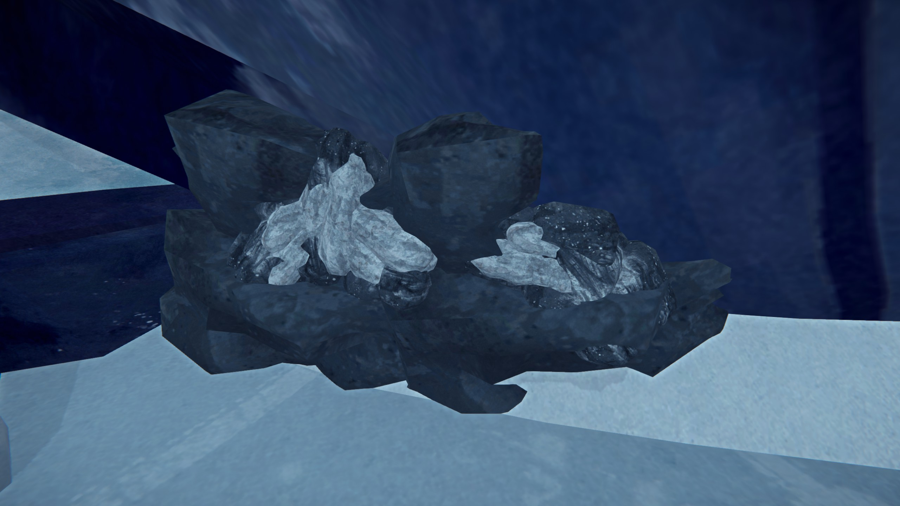
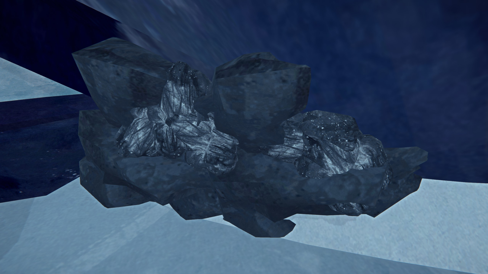

# Salt Deposit

**Categories:** Interactable Objects · **Source:** [Fandom](https://thelongdark.fandom.com/wiki/Salt_Deposit)

**Salt Deposit**

\[\[File: /  / _Full deposit_ /  / _Depleted deposit_

250px\]\]

_Full deposit_

_Depleted deposit_

**General**

**Item Type:** Item

**Wintermute:** No

A **Salt Deposit** is a harvestable interactable object found along Coastal Regions in [_The Long Dark_](./The%20Long%20Dark.md).

## Overview

Most tools can be used to scrap Salt from Salt Deposits, despite the tool-less warning message saying it requires a Hatchet. These include any [Hunting Knife](./Hunting%20Knife.md) (or variant), [Hatchet](./Hatchet.md) ([Improvised Hatchet](./Improvised%20Hatchet.md)), [Prybar](./Prybar.md), or [Heavy Hammer](./Heavy%20Hammer.md). The [Hacksaw](./Hacksaw.md) will not work. Tool condition does not degrade when harvesting Salt Deposits.

Each Salt Deposit is composed of several small interactable deposits which each produces 2 [Salt](./Salt.md) (0.25kg) when harvested. They can be useful for keeping a [Meat Curing Box](./Meat%20Curing%20Box.md) topped off with large amounts of Salt or for preparing [Cooking](./Cooking.md) Recipes.

Deposits refill every 20 days.

## Locations

They are mostly found in Coastal Regions along rocky wall surfaces near the sea, but can sometimes be found inside caves:

| Location | Region | Deposit # | General Area |
| --- | --- | --- | --- |
| [Last Resort Cannery](./Last%20Resort%20Cannery.md) | [Bleak Inlet](./Bleak%20Inlet.md) | 5 | Beneath docks of the building with the break room, on a pier support closest to The Harbinger (trawler) |
| [Cannery Pier](./Cannery%20Pier.md) | [Bleak Inlet](./Bleak%20Inlet.md) | 5 | Beneath docks of the building with the overhead crane leading to Cannery Pier, on 2 pier supports |
| Near [Bunker Alpha](./Bunker%20Alpha.md) | [Bleak Inlet](./Bleak%20Inlet.md) | 5 | In the cave closest to Bunker Alpha |
| Bear Cave | [Bleak Inlet](./Bleak%20Inlet.md) | 5 | Bear Cave east of the [Cannery Worker Residences](./Cannery%20Worker%20Residences.md) |
| [Cinder Hills Coal Mine](./Cinder%20Hills%20Coal%20Mine.md) (near [Log Sort](./Log%20Sort.md)) | [Coastal Highway](./Coastal%20Highway.md) | 10 | Near the green crates halfway through the mine (does not require taking elevator) |
| [Misanthrope's Homestead](./Misanthrope%27s%20Homestead.md) | [Coastal Highway](./Coastal%20Highway.md) | 5 | Eastern part of the island on a rockwall facing inland |
| [Jackrabbit Island](./Jackrabbit%20Island.md) | [Coastal Highway](./Coastal%20Highway.md) | 5 | Close to the ocean edge on the south side |
| Bridge | [Coastal Highway](./Coastal%20Highway.md) | 5 | West of [Rockfall](./Rockfall.md) under the bridge. Location is slightly to the west in the ocean |
| [Abandoned Mine No. 3](./No.%203%20Coal%20Mine.md) | [Crumbling Highway](./Crumbling%20Highway.md) | 10 | Corner halfway through the mine |
| [Abandoned Mine No. 5](./Abandoned%20Mine%20No.%205.md) | [Desolation Point](./Desolation%20Point.md) | 10 | Corner inside the mine closest to the [Stone Church](./Stone%20Church.md) entrance |
| [Hibernia Processing](./Hibernia%20Processing.md) | [Desolation Point](./Desolation%20Point.md) | 5 | South of the docks past the ramp on an outcropping on the ocean |
| [Little Island](./Little%20Island.md) | [Desolation Point](./Desolation%20Point.md) | 5 | Behind Little Island facing a smaller island |
| [Broken Bridge](./Broken%20Bridge%20%28Broken%20Railroad%20location%29.md) | [Desolation Point](./Desolation%20Point.md) | 4 | In the Bear cave |
| [Cave (Desolation Point location)](./Cave%20%28Desolation%20Point%20location%29.md) | [Desolation Point](./Desolation%20Point.md) | 10 | In the main chamber |

## Game History
