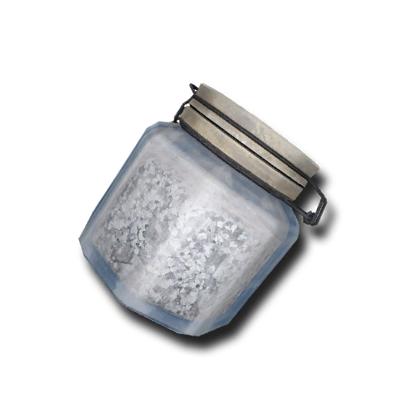

# Salt

**Contents**

- [Usage](#usage)
- [Acquisition](#acquisition)
- [Products](#products)
- [Update history](#update-history)

| Column 1 | Column 2 | Column 3 |
| --- | --- | --- |
|  / *Ptarmigan\_icon.png* | **DLC-Exclusive content.** / This content requires the [Tales from the Far Territory](./Tales%20from%20the%20Far%20Territory.md) addon to be installed before it can be seen or used in regular gameplay. | \|} / **Salt** / \| Property \| Details \| / \| --- \| --- \| / \|  \|  / *Salt\_icon.png* \| / \| Release \| [21 June 2023](./The%20Long%20Dark%20%E2%80%94%20Changelog.md#2.17) \| / \| Wintermute \| No \| / \| Renewable \| Yes \| / \| **Properties** \|  \| / \| Item type \| [Food And Drink](./Food%20And%20Drink.md)\\|- \| / \| Stackable \| Yes \| / \| Examine \| A seasoning and preservative. \| / \| **Values** \|  \| / \| Weight \| 0.25 kg (0.55 lbs) \| / \| **Decay Rate** \|  \| / \| Inside \| 0.000% per day \| / \| Outside \| 0.000% per day \| / \| **Advanced data** \|  \| / \| Item key \| GAMEPLAY\_Salt \| / *For the larger Salt bags, see [Salt (Bag)](./Salt%20%28Bag%29.md).* / **Salt** is a [seasoning](./Food%20And%20Drink.md) and preservative in *[The Long Dark](./The%20Long%20Dark.md)*. / ## Usage / Salt is used as an ingredient in numerous cooking recipes. Most recipes that use Salt tend to need 0.01 kg of Salt, meaning one container of Salt can be used in 25 recipes. / 8.00kg of Salt is required to construct a [Meat Curing Box](./Meat%20Curing%20Box.md), which is a survivor-made furniture item which can be used to turn raw meat into jerky, which lasts for much longer. Curing Meat will slowly deplete a Meat Curing Box's store of Salt over time, which must be replenished for continued use. / Salt is one of the few items that is not affected by [Decay](./Decay.md). / ## Acquisition / Smaller jars of Salt (0.25kg) can be found as loot usually in kitchens or food-related areas, while large [bags of salt](./Salt%20%28Bag%29.md) (10.00kg) can be acquired from [The Trader](./Trader.md). / [Salt Deposits](./Salt%20Deposit.md) can be found on coastal rock formations (e.g. outdoors on [Jackrabbit Island](./Jackrabbit%20Island.md), or inside [Abandoned Mine No. 3](./No.%203%20Coal%20Mine.md)) and harvested with a bladed tool. Each Salt Deposit yields 2 units (0.50kg) of Salt, with multiple deposits appearing in groups. / ## Products / ## Update history / - UPDATE **21 June 2023 ([Update](./The%20Long%20Dark%20%E2%80%94%20Changelog.md#2.17)):** / - Added to game. / **Lua execution error in Module:Navbox function navbox** [ru:Соль](ru:%D0%A1%D0%BE%D0%BB%D1%8C) |
|  / *Salt\_icon.png* |  |  |
| Release | [21 June 2023](./The%20Long%20Dark%20%E2%80%94%20Changelog.md#2.17) |  |
| Wintermute | No |  |
| Renewable | Yes |  |
| **Properties** |  |  |
| Item type | [Food And Drink](./Food%20And%20Drink.md)\|- |  |
| Stackable | Yes |  |
| Examine | A seasoning and preservative. |  |
| **Values** |  |  |
| Weight | 0.25 kg (0.55 lbs) |  |
| **Decay Rate** |  |  |
| Inside | 0.000% per day |  |
| Outside | 0.000% per day |  |
| **Advanced data** |  |  |
| Item key | GAMEPLAY\_Salt |  |
