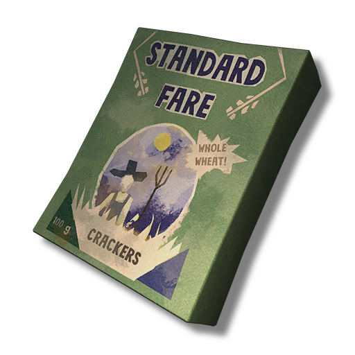
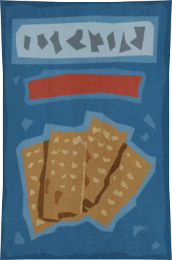

# Salty Crackers

**Contents**

- [Overview](#Overview)
- [Trivia](#Trivia)
- [Gallery](#Gallery)
- [Update history](#Update_history)

<table class="infobox">
<caption>Salty Crackers</caption>
<colgroup>
<col style="width: 50%" />
<col style="width: 50%" />
</colgroup>
<tbody>
<tr>
<td colspan="2"><figure>

<figcaption>Salty_Crackers_icon.png</figcaption>
</figure></td>
</tr>
<tr>
<td>
Release
</td>
<td>
<a href="./The%20Long%20Dark%20%E2%80%94%20Changelog.md#0.117" class="wikilink" title="22 September 2014">22 September 2014</a>
</td>
</tr>
<tr>
<td>
Wintermute
</td>
<td>
No
</td>
</tr>
<tr>
<td>
Renewable
</td>
<td>
Yes (rare <a href="./Beachcombing.md" class="wikilink" title="Beachcombing">Beachcombing</a>)
</td>
</tr>
<tr>
<td colspan="2" class="section">
<strong>Properties</strong>
</td>
</tr>
<tr>
<td>
Item type
</td>
<td>
<a href="./Food%20And%20Drink.md" class="wikilink" title="Food And Drink">Food And Drink</a>|-
</td>
</tr>
<tr>
<td>
Stackable
</td>
<td>
No
</td>
</tr>
<tr>
<td>
Examine
</td>
<td>
Dried, salty crackers. Will make you thirsty.
</td>
</tr>
<tr>
<td colspan="2" class="section">
<strong>Values</strong>
</td>
</tr>
<tr>
<td>
Calories
</td>
<td>
600 kcal
</td>
</tr>
<tr>
<td>
Hydration
</td>
<td>
-20%
</td>
</tr>
<tr>
<td>
Weight
</td>
<td>
0.10 kg (0.22 lbs)
</td>
</tr>
<tr>
<td colspan="2" class="section">
<strong>Advanced data</strong>
</td>
</tr>
<tr>
<td>
Item key
</td>
<td>
GAMEPLAY_SaltyCrackers
</td>
</tr>
</tbody>
</table>

**Salty Crackers** are a packaged <a href="./Food%20And%20Drink.md" class="wikilink" title="food">food</a> item in <a href="./The%20Long%20Dark.md" class="wikilink" title="The Long Dark"><em>The Long Dark</em></a>.

## Overview

Consuming Salty Crackers provides 600 calories of <a href="./Hunger.md" class="wikilink" title="energy">energy</a>, at the cost of a substantial -20% <a href="./Thirst.md" class="wikilink" title="hydration">hydration</a>. They can be found in all regions, but are commonly found inside houses and stores. Salty Crackers have the highest caloric density of any food item at 6,000 calories-per-kilogram (if the weight of water needed to restore that lost by consuming Salty Crackers is considered, their energy density is 2600 calories-per-kilogram).

It is ideal to consume Salty Crackers (and other dehydrating food) when at low hydration, or even when fully dehydrated to preserve water.

Salty Crackers never <a href="./Decay.md" class="wikilink" title="decay">decay</a>, but are unique in that they can still cause <a href="./Food%20Poisoning.md" class="wikilink" title="Food Poisoning">Food Poisoning</a> if spawned at low condition. They only lose condition during a <a href="./Bear.md" class="wikilink" title="Bear">Bear</a> attack (or Toxic Fog during <a href="./Escape%20the%20Darkwalker.md" class="wikilink" title="Escape the Darkwalker">Escape the Darkwalker</a>).

## Trivia

- Salty Crackers are packaged as a product called "*Standard Fare"*, possibly a play on the real-life saltine cracker brand "Premium."
- The back of the box lists "Ingredients: Wheat Flour, Soybean Oil, Sugar, Baking Soda, Salt, Natural Flavours."
- Despite being packaged in a cardboard box, no <a href="./Tinder%20Plug.md" class="wikilink" title="Tinder Plug">Tinder Plug</a> is produced by consuming Salty Crackers and the item cannot be harvested.

## Gallery

<table class="gallery">
<colgroup>
<col style="width: 100%" />
</colgroup>
<tbody>
<tr>
<td><figure>

<figcaption>old model</figcaption>
</figure></td>
</tr>
</tbody>
</table>

## Update history

- UPDATE **22 September 2014 (<a href="./The%20Long%20Dark%20%E2%80%94%20Early%20Access%20Changelog.md#0.117" class="wikilink" title="Update">Update</a>):**
  - Added to game.

**Lua execution error in Module:Navbox function navbox** <a href="ru:%D0%A1%D0%BE%D0%BB%D1%91%D0%BD%D1%8B%D0%B9_%D0%BA%D1%80%D0%B5%D0%BA%D0%B5%D1%80" class="wikilink" title="ru:Солёный крекер">ru:Солёный крекер</a>

