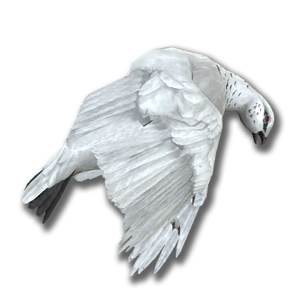
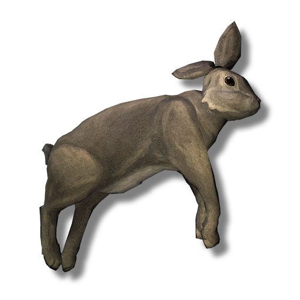
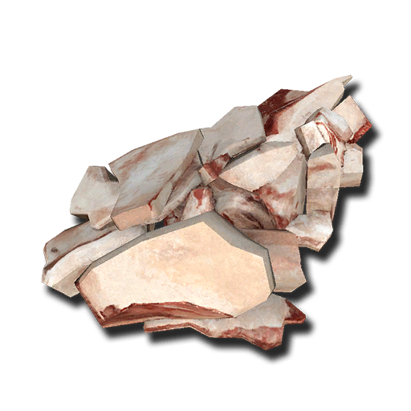
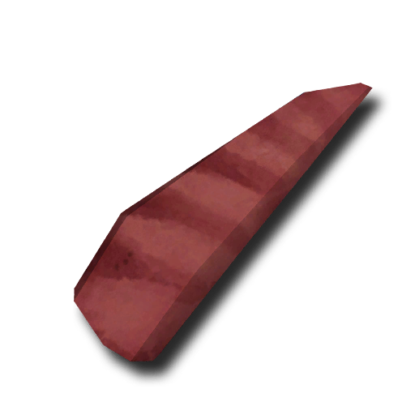
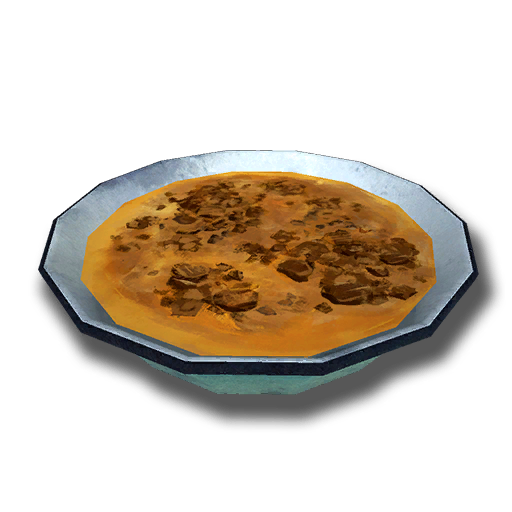

# Scent

**Contents**

- [The Scent Meter](#The_Scent_Meter)
- [Mechanics of Scent](#Mechanics_of_Scent)
- [Scent Value and Meter](#Scent_Value_and_Meter)
- [Scent Values](#Scent_Values)
- [Baiting/Decoys](#Baiting%2FDecoys)
- [Drop Decoy](#Drop_Decoy)
- [Making Bait/Decoys](#Making_Bait%2FDecoys)
- [Animal reactions to food](#Animal_reactions_to_food)
- [Specific Animal reactions to Decoys](#Specific_Animal_reactions_to_Decoys)
- [Baiting animals](#Baiting_animals)
- [Additional Tips](#Additional_Tips)

**Scent** is a mechanic in *<a href="./The%20Long%20Dark.md" class="wikilink" title="The Long Dark">The Long Dark</a>* which increases the distance which <a href="./Wildlife.md" class="wikilink" title="predators">predators</a> can detect the survivor by smell. Scent is increased when the survivor is carrying meat and fresh guts, and is affected by wind speed, wind direction, and game difficulty experience. An approximation of current Scent is represented by the "Scent Meter."

## The Scent Meter

A player's Scent makes them detectable to wandering wildlife. Meat and guts increase the character's odor when carried. Prepackaged foods produced before the Quiet Apocalypse have no odor and are therefore no longer detectable by animals at all, making them safer to transport.

If the player has 1 fresh gut, 1 raw meat/fish, or 3 cooked meat items in the inventory, they will have1 Scent Indicator. Each Scent Indicator increases the range at which the player can be detected by 10 meters, as well as creating longer ranged "Points of Interest" which nearby Wolves and Bears will approach investigate. Items dropped on the ground do not produce Scent, although meat/guts/carcasses dropped with the Decoy ability ("3") will create a 30m circle around the item, flagging other possible food items for wolves to consume.

Wind is a factor that the player should be aware of; being upwind of an animal will decrease the range at which it can smell you; however, it may still see or hear you regardless of wind direction. The Scent Meter is a toggled element which approximates the survivor's current Scent amount; the more "Scent Marks" the survivor has (colored white), the higher the survivor's scent and radius they can be detected by predators. It can be viewed under Quick Stats (TAB key) or Status (F key). \[Missing image: Scent_Upwind-Downwind.jpg\]

### Mechanics of Scent

- Scent only affects predators (<a href="./Wolf.md" class="wikilink" title="Wolves">Wolves</a>, <a href="./Timberwolf.md" class="wikilink" title="Timberwolves">Timberwolves</a>, <a href="./Poisoned%20Wolf.md" class="wikilink" title="Poisoned Wolves">Poisoned Wolves</a>, <a href="./Bear.md" class="wikilink" title="Bear">Bear</a>, and <a href="./Cougar.md" class="wikilink" title="Cougar">Cougar</a>): attracting them to the player's general area, but not necessarily to their current location.
  - Bears have the most sensitive noses of any predator, and will travel over half the map in search of the player at higher scent levels, far outside of their normal patrol pathways.
  - Cougars can wander out of their Territory if the player's Scent is high enough.
  - The greater the Scent, the wider radius a predator can detect it. If unscented, predators can only detect the survivor by sight and sound.
  - Predators only seek Decoys they can see, but can detect Scented items when carried by the survivor regardless of terrain.
- Wind Speed and Direction affects Scent distance, positively and negatively.
  - Having high scent when the wind blows on the player will carry the scent downwind, affecting predators.
- Odorous items produce a set amount of Scent, regardless of Item condition or weight (ex, a raw quarter bag always produces 50 Scent Value).
  - Stacked Scented items (e.g. Coastal Fishcakes and Fishing Bait) only count per-stack, not per item. This does not apply to Raw Gut.
  - The Scent Meter shows three indicator icons but Scent does not follow actually hard breaking points. E.g. a piece of cooked meat will not yield one Scent Meter icon, but can still be detected by predators.
- <a href="./Blood%20Loss.md" class="wikilink" title="Blood Loss">Blood Loss</a> yields maximum Scent until treated.
- Dropped Scented items instantly reduces Scent.

### Scent Value and Meter

| Total Scent Value | Scent Meter Icon |
|-------------------|------------------|
| 0-14              | 0                |
| 15-44             | 1                |
| 45-79             | 2                |
| 80+               | 3                |

### Scent Values

<table>
<colgroup>
<col style="width: 25%" />
<col style="width: 25%" />
<col style="width: 25%" />
<col style="width: 25%" />
</colgroup>
<thead>
<tr>
<th>
Gear Type
</th>
<th>
Scent Value
</th>
<th>
Item
</th>
<th>
Item
</th>
</tr>
</thead>
<tbody>
<tr>
<td>
Bleeding
</td>
<td>
80
</td>
<td>
Suffering from [Missing image: Blood_Loss_icon.png] <a href="./Blood%20Loss.md" class="wikilink" title="Blood Loss">Blood Loss</a>
</td>
<td></td>
</tr>
<tr>
<td>
Carcass Quarters
</td>
<td>
50
</td>
<td><ul>
<li> <a href="./Bear%20Quarter.md" class="wikilink" title="Bear Quarter">Bear Quarter</a></li>
<li> <a href="./Cougar%20Quarter.md" class="wikilink" title="Cougar Quarter">Cougar Quarter</a></li>
<li> <a href="./Deer%20Quarter.md" class="wikilink" title="Deer Quarter">Deer Quarter</a></li>
<li> <a href="./Moose%20Quarter.md" class="wikilink" title="Moose Quarter">Moose Quarter</a></li>
<li> <a href="./Wolf%20Quarter.md" class="wikilink" title="Wolf Quarter">Wolf Quarter</a></li>
</ul></td>
<td></td>
</tr>
<tr>
<td>
Small Carcasses
</td>
<td>
30
</td>
<td><ul>
<li> <a href="./Ptarmigan%20Carcass.md" class="wikilink" title="Ptarmigan Carcass">Ptarmigan Carcass</a></li>
<li> <a href="./Rabbit%20Carcass.md" class="wikilink" title="Rabbit Carcass">Rabbit Carcass</a></li>
</ul></td>
<td></td>
</tr>
<tr>
<td>
Fresh Gut
</td>
<td>
20
</td>
<td>
 <a href="./Fresh%20Gut.md" class="wikilink" title="Fresh Gut">Fresh Gut</a><a href="#fn1" class="footnote-ref" id="fnref1" role="doc-noteref">1</a>
</td>
<td></td>
</tr>
<tr>
<td>
Raw meat/fish
</td>
<td>
15
</td>
<td>
Raw Animal

<ul>
<li> <a href="./Bear%20Meat%20%28Raw%29.md" class="wikilink" title="Bear Meat (Raw)">Bear Meat (Raw)</a></li>
<li> <a href="./Cougar%20Meat%20%28Raw%29.md" class="wikilink" title="Cougar Meat (Raw)">Cougar Meat (Raw)</a></li>
<li> <a href="./Moose%20Meat%20%28Raw%29.md" class="wikilink" title="Moose Meat (Raw)">Moose Meat (Raw)</a></li>
<li> <a href="./Ptarmigan%20%28Raw%29.md" class="wikilink" title="Ptarmigan (Raw)">Ptarmigan (Raw)</a></li>
<li> <a href="./Rabbit%20%28Raw%29.md" class="wikilink" title="Rabbit (Raw)">Rabbit (Raw)</a></li>
<li> <a href="./Venison%20%28Raw%29.md" class="wikilink" title="Venison (Raw)">Venison (Raw)</a></li>
<li> <a href="./Wolf%20Meat%20%28Raw%29.md" class="wikilink" title="Wolf Meat (Raw)">Wolf Meat (Raw)</a></li>
</ul></td>
<td>
Raw Fish

<ul>
<li> <a href="./Coho%20Salmon%20%28Raw%29.md" class="wikilink" title="Coho Salmon (Raw)">Coho Salmon (Raw)</a></li>
<li> <a href="./Lake%20Whitefish%20%28Raw%29.md" class="wikilink" title="Lake Whitefish (Raw)">Lake Whitefish (Raw)</a></li>
<li> <a href="./Rainbow%20Trout%20%28Raw%29.md" class="wikilink" title="Rainbow Trout (Raw)">Rainbow Trout (Raw)</a></li>
<li> <a href="./Smallmouth%20Bass%20%28Raw%29.md" class="wikilink" title="Smallmouth Bass (Raw)">Smallmouth Bass (Raw)</a></li>
<li> <a href="./Burbot%20%28Raw%29.md" class="wikilink" title="Burbot (Raw)">Burbot (Raw)</a></li>
<li> <a href="./Goldeye%20%28Raw%29.md" class="wikilink" title="Goldeye (Raw)">Goldeye (Raw)</a></li>
<li> <a href="./Red%20Irish%20Lord%20%28Raw%29.md" class="wikilink" title="Red Irish Lord (Raw)">Red Irish Lord (Raw)</a></li>
<li> <a href="./Rockfish%20%28Raw%29.md" class="wikilink" title="Rockfish (Raw)">Rockfish (Raw)</a></li>
<li> <a href="./Big%20Bass%20%28Raw%29.md" class="wikilink" title="Big Bass (Raw)">Big Bass (Raw)</a></li>
</ul></td>
</tr>
<tr>
<td>
Raw animal products
</td>
<td>
5
</td>
<td>
 <a href="./Animal%20Fat.md" class="wikilink" title="Animal Fat">Animal Fat</a>
</td>
<td>
 <a href="./Fishing%20Bait.md" class="wikilink" title="Fishing Bait">Fishing Bait</a><a href="#fn2" class="footnote-ref" id="fnref2" role="doc-noteref">2</a>
</td>
</tr>
<tr>
<td>
Cooked meat/fish
</td>
<td>
5
</td>
<td>
Cooked Animal

<ul>
<li> <a href="./Bear%20Meat%20%28Cooked%29.md" class="wikilink" title="Bear Meat (Cooked)">Bear Meat (Cooked)</a></li>
<li> <a href="./Cougar%20Meat%20%28Cooked%29.md" class="wikilink" title="Cougar Meat (Cooked)">Cougar Meat (Cooked)</a></li>
<li> <a href="./Moose%20Meat%20%28Cooked%29.md" class="wikilink" title="Moose Meat (Cooked)">Moose Meat (Cooked)</a></li>
<li> <a href="./Ptarmigan%20%28Cooked%29.md" class="wikilink" title="Ptarmigan (Cooked)">Ptarmigan (Cooked)</a></li>
<li> <a href="./Rabbit%20%28Cooked%29.md" class="wikilink" title="Rabbit (Cooked)">Rabbit (Cooked)</a></li>
<li> <a href="./Venison%20%28Cooked%29.md" class="wikilink" title="Venison (Cooked)">Venison (Cooked)</a></li>
<li> <a href="./Wolf%20Meat%20%28Cooked%29.md" class="wikilink" title="Wolf Meat (Cooked)">Wolf Meat (Cooked)</a></li>
</ul></td>
<td>
Cooked Fish

<ul>
<li> <a href="./Coho%20Salmon%20%28Cooked%29.md" class="wikilink" title="Coho Salmon (Cooked)">Coho Salmon (Cooked)</a></li>
<li> <a href="./Lake%20Whitefish%20%28Cooked%29.md" class="wikilink" title="Lake Whitefish (Cooked)">Lake Whitefish (Cooked)</a></li>
<li> <a href="./Rainbow%20Trout%20%28Cooked%29.md" class="wikilink" title="Rainbow Trout (Cooked)">Rainbow Trout (Cooked)</a></li>
<li> <a href="./Smallmouth%20Bass%20%28Cooked%29.md" class="wikilink" title="Smallmouth Bass (Cooked)">Smallmouth Bass (Cooked)</a></li>
<li> <a href="./Burbot%20%28Cooked%29.md" class="wikilink" title="Burbot (Cooked)">Burbot (Cooked)</a></li>
<li> <a href="./Goldeye%20%28Cooked%29.md" class="wikilink" title="Goldeye (Cooked)">Goldeye (Cooked)</a></li>
<li> <a href="./Red%20Irish%20Lord%20%28Cooked%29.md" class="wikilink" title="Red Irish Lord (Cooked)">Red Irish Lord (Cooked)</a></li>
<li> <a href="./Rockfish%20%28Cooked%29.md" class="wikilink" title="Rockfish (Cooked)">Rockfish (Cooked)</a></li>
<li> <a href="./Big%20Bass%20%28Cooked%29.md" class="wikilink" title="Big Bass (Cooked)">Big Bass (Cooked)</a></li>
</ul></td>
</tr>
<tr>
<td>
Recipes containing meat
</td>
<td>
5
</td>
<td>
Stew

<ul>
<li> <a href="./Ptarmigan%20Stew.md" class="wikilink" title="Ptarmigan Stew">Ptarmigan Stew</a></li>
<li> <a href="./Rabbit%20Stew.md" class="wikilink" title="Rabbit Stew">Rabbit Stew</a></li>
<li> <a href="./Ranger%20Stew.md" class="wikilink" title="Ranger Stew">Ranger Stew</a></li>
<li> <a href="./Trout%20Stew.md" class="wikilink" title="Trout Stew">Trout Stew</a></li>
<li> <a href="./Venison%20Stew.md" class="wikilink" title="Venison Stew">Venison Stew</a></li>
</ul>

Soup

<ul>
<li> <a href="./Porter%27s%20Soup.md" class="wikilink" title="Porter&#39;s Soup">Porter's Soup</a></li>
<li> <a href="./Last%20Resort%20Soup.md" class="wikilink" title="Last Resort Soup">Last Resort Soup</a></li>
<li> <a href="./Vagabond%20Soup.md" class="wikilink" title="Vagabond Soup">Vagabond Soup</a></li>
</ul></td>
<td>
Pie

<ul>
<li> <a href="./Breyerhouse%20Pie.md" class="wikilink" title="Breyerhouse Pie">Breyerhouse Pie</a></li>
<li> <a href="./Dockworker%27s%20Pie.md" class="wikilink" title="Dockworker&#39;s Pie">Dockworker's Pie</a></li>
<li> <a href="./Ptarmigan%20Pie.md" class="wikilink" title="Ptarmigan Pie">Ptarmigan Pie</a></li>
<li> <a href="./Rabbit%20Pie.md" class="wikilink" title="Rabbit Pie">Rabbit Pie</a></li>
<li> <a href="./Stalker%27s%20Pie.md" class="wikilink" title="Stalker&#39;s Pie">Stalker's Pie</a></li>
<li> <a href="./Venison%20Pie.md" class="wikilink" title="Venison Pie">Venison Pie</a></li>
</ul>

Other

<ul>
<li> <a href="./Coastal%20Fishcakes.md" class="wikilink" title="Coastal Fishcakes">Coastal Fishcakes</a><a href="#fn3" class="footnote-ref" id="fnref3" role="doc-noteref">3</a></li>
</ul></td>
</tr>
</tbody>
</table>
<section id="footnotes" class="footnotes footnotes-end-of-document" role="doc-endnotes">

<ol>
<li id="fn1"></li>
<li id="fn2"></li>
<li id="fn3">1 Scent bar is added only when 3 separate stacks of these items are in the player's inventory due to bug<a href="#fnref3" class="footnote-back" role="doc-backlink">↩︎</a></li>
</ol>
</section>

## Baiting/Decoys

<a href="./Wolf.md" class="wikilink" title="Wolves">Wolves</a>, <a href="./Timberwolf.md" class="wikilink" title="Timberwolves">Timberwolves</a>, <a href="./Poisoned%20Wolf.md" class="wikilink" title="Poisoned Wolves">Poisoned Wolves</a>, <a href="./Bear.md" class="wikilink" title="Bear">Bears</a>, and <a href="./Cougar.md" class="wikilink" title="Cougar">Cougar</a> are attracted to the smell of game. This can be troublesome when the character is carrying fresh steaks back to camp after quartering a carcass and predators begin to stalk and attack the player. **Decoys/Baiting** can be used to a player's advantage to distract or lure these animals away from/to the player.

### Drop Decoy

The 'Drop Decoy' button is provided to automatically drop the smelliest item in inventory. Repeated pressing will repeatedly drop bait until none remains. Bait items may still be manually dropped from inventory, but this is a slower process than some players would like when facing a predator.

- '3'-key on keyboards.
- 'Down' directional pad on controllers.
- Manually selecting the Drop Decoy option in the <a href="./Radial%20Menu.md" class="wikilink" title="Radial Menu">Radial Menu</a>.
- Manually selecting a piece of meat in the Radial Menu, then placing it on the ground.

## Making Bait/Decoys

Giving up a whole salmon to avoid being mauled may seem like a fair trade, but there is an even more economical way. A 0.01kg sliver of cooked meat will be just as effective as a whole 1.00kg piece of cooked meat.

The game is a little stingy in how it lets you handle your meat, but there are quite a few options to make economical Decoys. Further letting these small portions rot to the point of ruined will also ensure they are the first items dropped even when you are carrying other meat.

- Aborting while eating by pressing the 'esc' key will result in a partial portion remaining.
- Increasing a harvest option to maximum and then reducing back down may result in a partial portion being selected for harvest. Repeat the harvesting action to obtain multiple small portions.
- Harvesting Fish will produce Fishing Bait.

## Animal reactions to food

Predators are the only animals to be affected by Scented Decoys, and follow a predictable set of behaviors:

- When a predator has detected an unscented character, it pursues and stalks them until sight is lost or they attack.
  - When a pursuing predator detects the smell of a bait but not the player however, it will walk directly to the first detected location of that decoy instead.
  - Once they reach the spot the smell came from, they will then search the next location where the player is and look for the origin of the Scent.
  - The player can continuously avoid a predator that is searching for them until they make eye contact, in which case they begin stalking the player.
  - Predators stalking a Scented player are far more aggressive, attacking sooner and showing less fear from the player's attacks. This includes shrugging off more damage and showing less fear of handheld light sources/<a href="./Campfire.md" class="wikilink" title="Campfires">Campfires</a>.
- If predators reach Decoys without detecting the player, the predator will instantly consume it and wander around a bit.
  - The entire Decoy food item will be consumed the moment it is reached by a predator, regardless of weight. This includes entire 10.00kg bags of quartered animal bags being gulped down in one bite (somehow).
- If the player is detected by a predator and drops a scented item and the animal eats it, they retreat briskly away from the player to a safe distance. They will eventually return to stalk the player if they do not leave the area however.
  - This can be done to multiple animals stalking the player, assuming that they have enough Decoys to sate all animals following them.
- Player's can be attacked in their sleep if they are sleeping out in the open and their Scent is high. The player will awake and then be forced into a Struggle if an animal reaches their position.
  - The player can still be attacked even if they drop all scented items before sleeping, should said items be close to them.
- Fleeing animals ignore all Decoys.

### Specific Animal reactions to Decoys

**Undetected:**

- Wolves, Poisoned Wolves, and Timberwolves will change from a slow walking speed to a brisk jog the moment Scent hits their noses. They will walk to the first location where the scent came from, then continue moving to the player's last known location if they are still carrying Scented items.
- Bears will slowly turn and walk towards the player's position and begin walking outside of their normal patrol paths to find the scented item.
- Cougars will begin to leave their Territory and find the player if their Scent is too high.

**Detected:**

- NOTE: Charging predators will not be distracted by bait! Always try to drop bait before a predator starts charging to avoid attack
- Baited animals are not blind and will charge when they see you are within striking range, so keep your distance and stay hidden.
  - Predators are unable to detect bait when they are unable to detect the character. They will not notice it or eat it if you are not around. This can be useful for storing large amounts of cooked meat outdoors to preserve their Condition.
- Wolves and Poisoned Wolves will stalk the player and growl as normal. If the player drops a Decoy, then Wolves as they cease their growling and instead go for the Decoy.
  - It is generally advised to avoid using this tactic on <a href="./Timberwolf.md" class="wikilink" title="Timberwolf">Timberwolf</a> packs. Despite the fact that they attracted to the smell of Decoys, they will ignore it if they detect the player.
- Decoys will distract a Bear that is stalking the player. They will ignore Decoys if they start charging.
- Cougars ignore Decoys the moment they detect the player.

## Baiting animals

While a predator is tracking bait, it is not tracking the player, so you could drop the bait and just walk away.

- Since you now know the animal will walk directly to your offering, you might take the opportunity and line-up a clean shot, positioning yourself to have the bait directly between you and the predator so it walks head first toward you.
- Another tactic can be to use the animal's retreat to position it where you like. Since the animal will retreat away from the player when it reaches the bait, you can determine in which direction that will be. As noted above, you can also now follow it to herd it along perhaps even shooting it in the back when it gets to where you want it.

## Additional Tips

- The Decoy key ('3' key) may be used to quickly reduce Scent. Each time it is pressed, a carried Scented item will be dropped.
  - The most odorous, lowest condition items are always dropped first, then descends in order from there.
- <a href="./Fishing%20Bait.md" class="wikilink" title="Fishing Bait">Fishing Bait</a> cannot be dropped as a Decoy.
- Meat/Meals can be mostly eaten by the survivor but still dropped as a decoy, by eating and aborting the action (ESC).
- Survival Mode affects Scent significantly (Stalker as the highest, followed by Interloper/Voyageur, with Pilgrim as lowest). On harder modes it is beneficial to minimize carrying scented items, and to drop them as soon as possible (such as immediately upon harvesting/cooking).
- <a href="./Cooking.md" class="wikilink" title="Cooking">Cooking</a> meat/fish on-site reduces Scent during transit.
- Crouching while manipulating Scent (picking up and dropping scented items) can be used to manipulate predators to specific locations, or to attack other wildlife.
- <a href="./Cat%20Tail%20Stalk.md" class="wikilink" title="Cat Tails">Cat Tails</a> and artificial foods are a scent-free way of traveling if the player is worried about Wildlife attacks. This is especially helpful when passing through Timberwolf or Cougar territory.

**Lua execution error in Module:Navbox function navboxLua execution error in Module:Navbox function navbox**

## Notes

