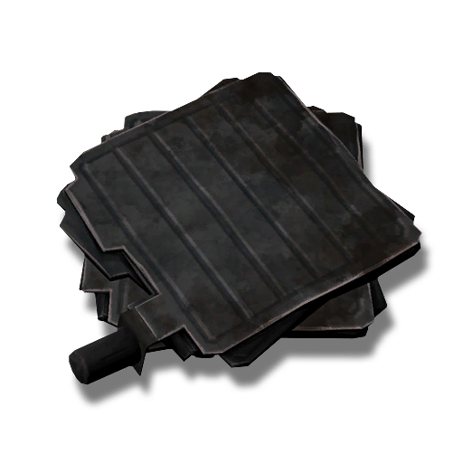

# Scrap Lead

**Categories:** Materials · **Source:** [Fandom](https://thelongdark.fandom.com/wiki/Scrap_Lead)

**Contents**

- [Overview](#overview)
- [Recipe](#recipe)
- [Products](#products)
- [Tips](#tips)
- [Trivia](#trivia)

**Scrap Lead**

_Scrap\_Lead\_icon.png_

**General**

**Item Type:** Material

**Renewable:** No

**Statistics**

**Weight:** 0.25 kg(0.55 lbs)

> “**Harvested from dead car batteries. Scrap lead can be used to craft bullets.**”
>
> — In-game Description

**Scrap Lead** is a crafting item in _[The Long Dark](./The%20Long%20Dark.md)_.

## Overview

Scrap Lead is a crafting material for ammunition at an [Ammunition Workbench](./Ammunition%20Work%20Bench.md), which they reside in their respective workshops in [Bleak Inlet](./Bleak%20Inlet.md) and [Blackrock Prison](./Blackrock%20Prison.md). It is obtained by harvesting a [Car Battery](./Car%20Battery.md) (found beneath the hood of some [Cars](./Car.md) and [Trucks](./Truck.md)) with a [Hacksaw](./Hacksaw.md); one Car Battery will always yield six Scrap Lead; each piece of Scrap Lead may be crafted into six [Bullets](./Bullet.md), so one Car Battery always allows the crafting of 36 Bullets.

Scrap Lead can also be found occasionally as a single piece when exploring the world.

## Recipe

**Scrap Lead**

| Property | Details |
| --- | --- |
|  | - |
|  | - |
|  | 30 minutes |
| **Requirements** |  |
| Facility | \[\[File:Anywhere icon.png |
| Tool | **Template:iconlink** |
| **Materials** |  |
| **Template:iconlink plain** |  |
| Item | [Car Battery](./Car%20Battery.md) |
| Quantity | 1 |

## Products

| Item | Skills | Materials |
| --- | --- | --- |
|  [Bullet](./Bullet.md) | None | - 1 × [Scrap Lead](./Scrap%20Lead.md) |

## Tips

- Car Batteries may be found by lifting the hoods of cars and trucks.
- Not all vehicles have batteries, only ~50% will have one.
- Car Batteries weigh 15kg, but can be harvested with a [Hacksaw](./Hacksaw.md) into 6 pieces of [Scrap Lead](./Scrap%20Lead.md) weighting just 1.5kg.
- A convenient and safe way to harvest Car Batteries is inside their vehicle.
- Car Batteries and Scrap Lead are useless on Interloper difficulty because firearms never spawn, as well as [Wintermute](./Wintermute.md) episodes 1, 2 and 3 because there is no access to the [Ammunition Workbench](./Ammunition%20Work%20Bench.md).
- Car Batteries are finite and non-renewable.

## Trivia

- The Errant Pilgrim update introduced [Gunsmithing](./Gunsmithing.md).
- 12-Volt Lead-acid car batteries have 6 cells inside (2 volts per cell), which is why a car battery can be harvested for 6 pieces of scrap lead (one per cell).
