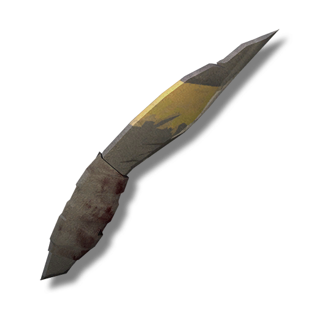
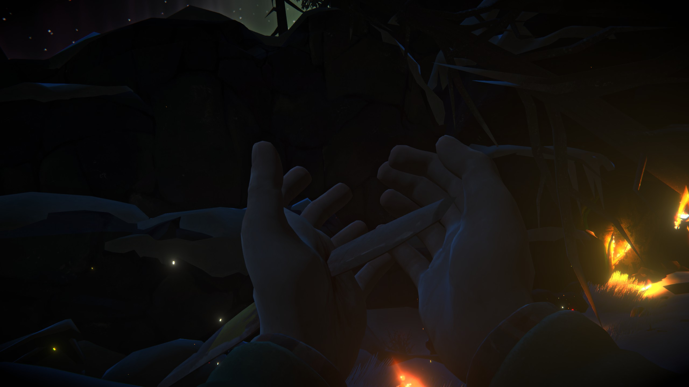

# Scrap Metal Shard

**Categories:** Story items, Tools, Wintermute · **Source:** [Fandom](https://thelongdark.fandom.com/wiki/Scrap_Metal_Shard)

**Contents**

- [Overview](#overview)
- [Location](#location)
- [Repair](#repair)
- [Harvesting](#harvesting)
- [Combat](#combat)
- [Gallery](#gallery)
- [Trivia](#trivia)

| Column 1 | Column 2 | Column 3 |
| --- | --- | --- |

|  / _Scrap\_Metal\_Shard\_icon.png_ |  |  |
| **General** |  |  |
| Item Type | Tool\|- |  |
| Weight | 0.30 kg(0.66 lbs) |  |
| Harvest | Cannot Harvest |  |
| Repair | [Whetstone](./Whetstone.md) |  |
| “ | __Sharp piece of scrap metal that broke off your plane. Makes a good improvised knife.__ / In-game description | ” |
|  / _Mackenzie pulling the metal shard out of his left hand_ |  |  |
