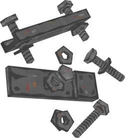

# Scrap Metal

**Contents**

- [Overview](#Overview)
- [Uses for Scrap Metal](#Uses_for_Scrap_Metal)
- [Harvesting](#Harvesting)
- [Products](#Products)
- [Gallery](#Gallery)

<table class="infobox">
<caption>Scrap Metal</caption>
<colgroup>
<col style="width: 50%" />
<col style="width: 50%" />
</colgroup>
<tbody>
<tr>
<td colspan="2"><figure>

<figcaption>Scrap_Metal_icon.png</figcaption>
</figure></td>
</tr>
<tr>
<td colspan="2" class="section">
<strong>General</strong>
</td>
</tr>
<tr>
<td>
Item Type
</td>
<td>
Material|-
</td>
</tr>
<tr>
<td>
Renewable
</td>
<td>
Yes (<a href="./Beachcombing.md" class="wikilink" title="Beachcombing">Beachcombing</a>)
</td>
</tr>
<tr>
<td colspan="2" class="section">
<strong>Statistics</strong>
</td>
</tr>
<tr>
<td>
Weight
</td>
<td>
0.20 kg(0.44 lbs)
</td>
</tr>
</tbody>
</table>

<table>
<colgroup>
<col style="width: 33%" />
<col style="width: 33%" />
<col style="width: 33%" />
</colgroup>
<tbody>
<tr>
<td style="vertical-align: top; font-size: 3em; color: #5d5980; padding-right: 10px">
“
</td>
<td>
Bits and pieces of metal scrounged from various sources.

&#10;

In-game description

</td>
<td style="vertical-align: bottom; font-size: 3em; color: #5d5980; padding-left: 10px">
”
</td>
</tr>
</tbody>
</table>

**Scrap Metal** is a crafting material in *<a href="./The%20Long%20Dark.md" class="wikilink" title="The Long Dark">The Long Dark</a>*.

## Overview

Scrap Metal is a common and useful resource for crafting and <a href="./Repair.md" class="wikilink" title="repair">repair</a>. Pieces of Scrap Metal can be found across <a href="./Great%20Bear%20Island.md" class="wikilink" title="Great Bear Island">Great Bear Island</a>, inside containers, and by <a href="./Beachcombing.md" class="wikilink" title="Beachcombing">Beachcombing</a>, but is primarily acquired by harvesting metal furniture with a <a href="./Hacksaw.md" class="wikilink" title="Hacksaw">Hacksaw</a> (metal shelves, chairs, toasters, light fixtures, etc.).

#### Uses for Scrap Metal

- Crafting <a href="./Hook.md" class="wikilink" title="Hooks">Hooks</a> (for <a href="./Ice%20Fishing.md" class="wikilink" title="Ice Fishing">Ice Fishing</a> and <a href="./Mending.md" class="wikilink" title="Mending">Mending</a>).
- <a href="./Forge.md" class="wikilink" title="Forging">Forging</a>: <a href="./Improvised%20Hatchet.md" class="wikilink" title="Improvised Hatchet">Improvised Hatchet</a>, <a href="./Improvised%20Knife.md" class="wikilink" title="Improvised Knife">Improvised Knife</a>, <a href="./Arrowhead.md" class="wikilink" title="Arrowheads">Arrowheads</a>
- Repair: <a href="./Hacksaw.md" class="wikilink" title="Hacksaw">Hacksaw</a>, <a href="./Can%20Opener.md" class="wikilink" title="Can Opener">Can Opener</a>, <a href="./Simple%20Tools.md" class="wikilink" title="Simple Tools">Simple Tools</a>, <a href="./Quality%20Tools.md" class="wikilink" title="Quality Tools">Quality Tools</a>, <a href="./Flashlight.md" class="wikilink" title="Flashlight">Flashlight</a>, <a href="./Miner%27s%20Flashlight.md" class="wikilink" title="Miner&#39;s Flashlight">Miner's Flashlight</a>, <a href="./Spelunker%27s%20Lantern.md" class="wikilink" title="Spelunker&#39;s Lantern">Spelunker's Lantern</a>, and <a href="./Storm%20Lantern.md" class="wikilink" title="Storm Lantern">Storm Lantern</a>.
- <a href="./Milling%20Machine.md" class="wikilink" title="Milling Machine">Milling Machine</a> Repair: <a href="./Hunting%20Rifle.md" class="wikilink" title="Hunting Rifle">Hunting Rifle</a> (<a href="./Barb%27s%20Rifle.md" class="wikilink" title="Barb&#39;s Rifle">Barb's Rifle</a>, <a href="./Curator%27s%20Rifle.md" class="wikilink" title="Curator&#39;s Rifle">Curator's Rifle</a>, <a href="./Vaughn%27s%20Rifle.md" class="wikilink" title="Vaughn&#39;s Rifle">Vaughn's Rifle</a>), <a href="./Revolver.md" class="wikilink" title="Revolver">Revolver</a> (<a href="./Forester%27s%20Revolver.md" class="wikilink" title="Forester&#39;s Revolver">Forester's Revolver</a>, <a href="./Hunter%27s%20Revolver.md" class="wikilink" title="Hunter&#39;s Revolver">Hunter's Revolver</a>, <a href="./Warden%27s%20Revolver.md" class="wikilink" title="Warden&#39;s Revolver">Warden's Revolver</a>), <a href="./Hacksaw.md" class="wikilink" title="Hacksaw">Hacksaw</a>, <a href="./Hatchet.md" class="wikilink" title="Hatchet">Hatchet</a> (<a href="./Improvised%20Hatchet.md" class="wikilink" title="Improvised Hatchet">Improvised Hatchet</a>), <a href="./Hunting%20Knife.md" class="wikilink" title="Hunting Knife">Hunting Knife</a> (<a href="./Improvised%20Knife.md" class="wikilink" title="Improvised Knife">Improvised Knife</a>).
- Repairing a <a href="./Transmitters.md" class="wikilink" title="Transmitter">Transmitter</a> requires 5 scrap metal.

## Harvesting

Scrap metal can be obtained by harvesting various pieces of furniture in-game by using a <a href="./Hacksaw.md" class="wikilink" title="hacksaw">hacksaw</a>:

| Item | Time | Yield | Calories burned (Interloper) | Time per piece of scrap |
|----|----|----|----|----|
| Lamp | 15min | 1 | 56 | 15 min |
| Bucket | 15m | 1 | 56 | 15 min |
| Broken metal door | 45m | 2 | 169 | 22 min 30 sec |
| Small shelf | 1h30 | 4 | 338 | 22 min 30 sec |
| Medium shelf | 2h15 | 6 | 506 | 22 min 30 sec |
| Chair | 2h36 | 6 +1cloth | 585 | 26 min 30 sec |
| Bed frame | 3h | 8 | 675 | 22min 30 sec |

## Products

## Gallery

<table class="gallery">
<colgroup>
<col style="width: 50%" />
<col style="width: 50%" />
</colgroup>
<tbody>
<tr>
<td><figure>

<figcaption>Old model.</figcaption>
</figure></td>
<td><figure>
[Missing image: Materials.png]
<figcaption>Ditto, with old Leather model</figcaption>
</figure></td>
</tr>
</tbody>
</table>

**Lua execution error in Module:Navbox function navbox** <a href="ru:%D0%9C%D0%B5%D1%82%D0%B0%D0%BB%D0%BB%D0%BE%D0%BB%D0%BE%D0%BC" class="wikilink" title="ru:Металлолом">ru:Металлолом</a>

