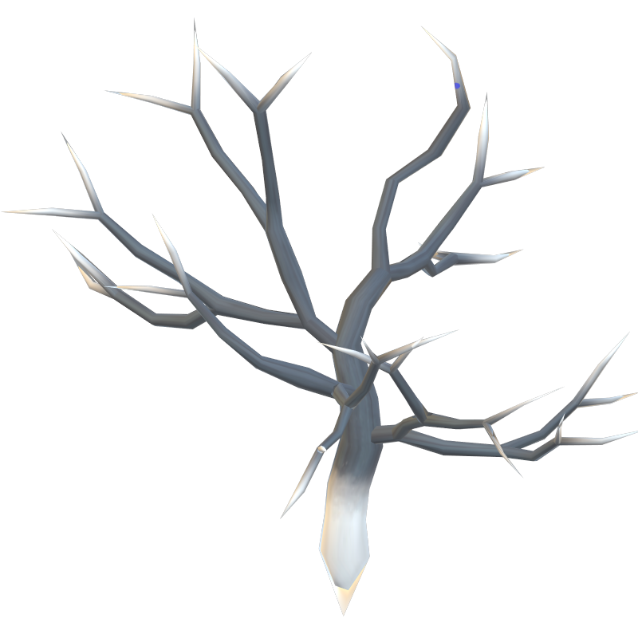
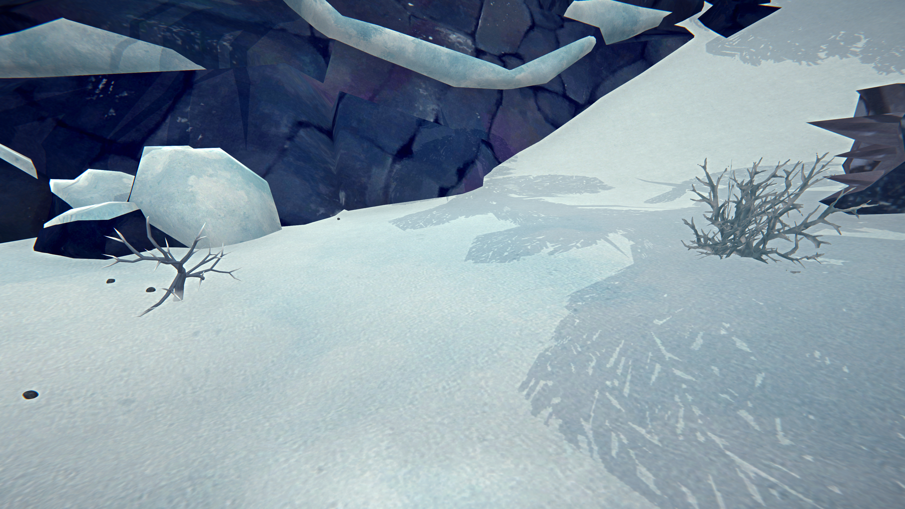
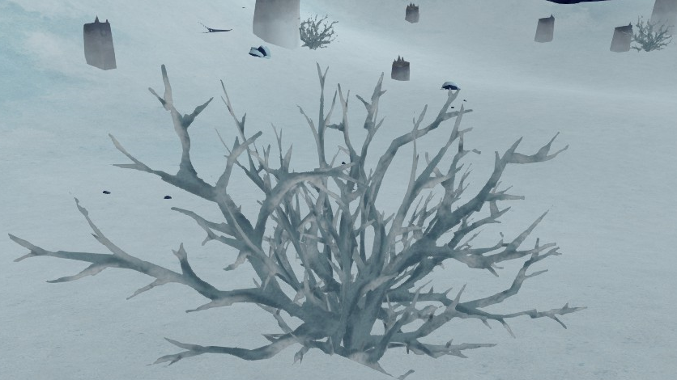
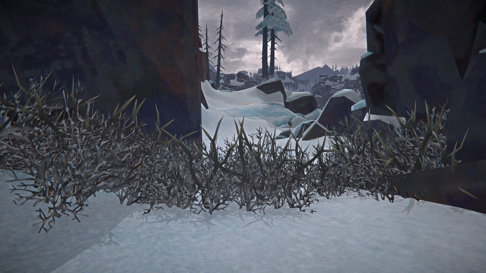

# Scrub Brush

**Source:** [Fandom](https://thelongdark.fandom.com/wiki/Scrub_Brush)

**Contents**

- [Overview](#overview)
- [Harvesting](#harvesting)
- [Hand](#hand)
- [Hatchet](#hatchet)
- [Characteristics](#characteristics)
- [Scrub Brush](#scrub-brush)
- [False Scrub Brush](#false-scrub-brush)
- [Locations](#locations)
- [Scrub Brush Patches](#scrub-brush-patches)
- [Gallery](#gallery)

**Scrub Brush**

_Scrub\_Brush\_icon.png_

**General**

**Item Type:** Item

**Wintermute:** No

**Statistics**

**Harvest:** 7-12 × [Stick](./Stick.md)

A **Scrub Brush** is a type of plant that can be harvested for useful materials.

## Overview

Scrub brushes are used for harvesting [Sticks](./Stick.md). Two harvestable types of brush exist in the game. The first (pictured above), yields seven sticks per bush, and the second can yield a dozen. The first type be harvested by hand or with a [Hatchet](./Hatchet.md), while the latter requires a Hatchet and may act as a barrier until broken down.

## Harvesting

### Hand

- 20 minutes; 41 calories

### Hatchet

- 10 minutes; 21 calories

## Characteristics

The following information should generally help with identifying and distinguishing between the useful and the useless:

#### Scrub Brush

- Dark bark
- Snow-covered tips
- Small number of thick branches
- Can be somewhat uncommon
- Has a 3D model, which is easy to identify

### False Scrub Brush

- Light bark
- Entire branches may bear light patches of snow or frost
- Clusters of numerous small, short branches
- Very common
- Cannot be harvested; currently serve no purpose other than filling out scenery
- Made of 2D planar shapes, arranged in a star

## Locations

- One can be found near the back door to the [Camp Office](./Camp%20Office.md) in [Mystery Lake](./Mystery%20Lake%20%28region%29.md)
- One can be found near the front door to the [Trapper's Homestead](./Trapper%27s%20Homestead.md) in [Mystery Lake](./Mystery%20Lake%20%28region%29.md)
- Found in abundance throughout the [Forlorn Muskeg](./Forlorn%20Muskeg.md), [Bleak Inlet](./Bleak%20Inlet.md), [Hushed River Valley](./Hushed%20River%20Valley.md), and [Ash Canyon](./Ash%20Canyon.md) regions

## Scrub Brush Patches

Another type of harvestable Scrub Brush acts as a physical obstacle and requires a [Hatchet](./Hatchet.md) to break down. Beware that some direct paths will be impassable without a hatchet to remove obstructing brush. Harvesting one patch of this type of Scrub Brush will generate 12 sticks after spending 18 minutes using a Hatchet.

Hushed River Valley, Bleak Inlet, Blackrock, and Ash Canyon contain these types of Brush patches.

## Gallery

_**Scrub Brush on the left, false scrub on the right (Forlorn Muskeg)**_

_False scrub brush is very light in colour, has many branches and looks more delicate._

_An example of a patch of Scrub Brush blocking a path_
