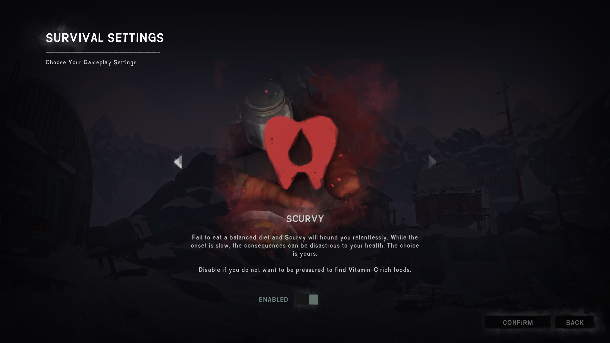
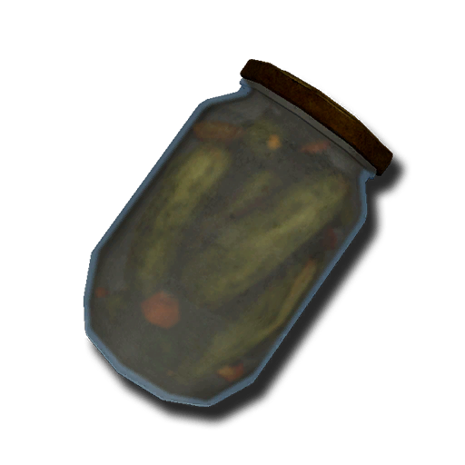
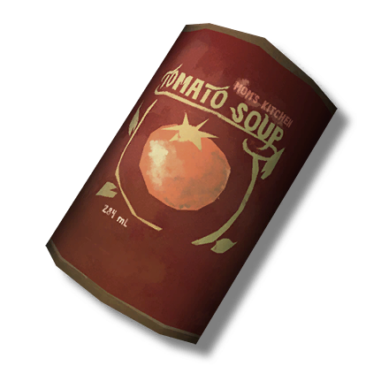
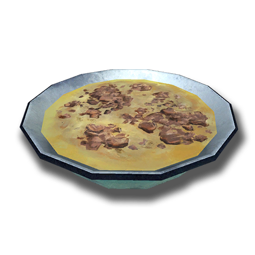

# Scurvy

**Categories:** Afflictions, Pages with update history · **Source:** [Fandom](https://thelongdark.fandom.com/wiki/Scurvy)

**Contents**

- [Overview](#overview)
- [Enable Option](#enable-option)
- [Risk and Prevention](#risk-and-prevention)
- [Affliction](#affliction)
- [Treatment](#treatment)
- [Cooked Meals vs Ingredients](#cooked-meals-vs-ingredients)
- [Vitamin-C Foods](#vitamin-c-foods)
- [Trivia](#trivia)
- [Update history](#update-history)

**Scurvy**

| Property | Details |
| --- | --- |
|  |  / _Scurvy\_icon.png_ |
| Release | [5 December 2023](./The%20Long%20Dark%20%E2%80%94%20Changelog.md#2.25) |
| Update | 2.25 |
| **Properties** |  |
| Category | [Afflictions](./Afflictions.md) |
| Description | You consumed a diet low in Vitamin-C for too long and now have Scurvy. If left untreated you will continue to weaken and lose condition until you succumb and die. |
| Caused By | Diet low in Vitamin-C |
| Effect | Negative |
| Type | Disease |
| Affliction Duration | Until Treated or Death |
| **Treatment** |  |
| Treatment | Consume foods high in Vitamin-C to cure Scurvy |
| Recovery Time | Immediate |
| **Advanced Data** |  |
| Item Key | GAMEPLAY\_Scurvy |

**Scurvy** is an [Affliction](./Afflictions.md) in _The Long Dark_. It is caused by consuming a diet with low/no Vitamin-C, and is lethal if untreated.

## Overview

Scurvy is a long-term affliction caused by Vitamin-C deficiency: failing to consume as much Vitamin-C as is drained daily. Each day the survivor's Vitamin-C level decreases by a small amount from a hidden Vitamin-C meter; this loss can be mitigated or recovered by consuming foods with Vitamin-C.

- Foods with Vitamin-C display roughly how much they contain on the item's information page ("Minor", "Moderate" or "Major" source of Vitamin-C). If a food item contains no Vitamin-C (or on a game mode where Scurvy is disabled) no amount will be shown. Condition of food items does not affect Vitamin-C values.

[Scurvy Risk](./Scurvy%20Risk.md) appears when below 20% of the Vitamin-C maximum, and will progress into the Scurvy affliction unless more Vitamin-C is consumed.

Most Vitamin-C food sources are finite (artificial foods and cattails), which can make Scurvy an increasing challenge in the late-game. However fish, and to a lesser extent [Birch Bark Tea](./Birch%20Bark%20Tea.md), are renewable sources.

## Enable Option

_Scurvy Enable option warning_

> “__Fail to eat a balanced diet and Scurvy will hound you relentlessly. While the onset is slow, the consequences can be disastrous to your health. The choice is yours.  
 Disable if you do not want to be pressured to find Vitamin-C rich foods.__”
>
> — In-game description

Starting a Survival Mode save file presents the option to enable Scurvy to that save. If enabled, foods with Vitamin-C will be labeled as a Minor, Moderate, or Major source of Vitamin-C when examined.

Scurvy is present on [Voyageur](./Voyageur.md), [Stalker](./Stalker.md), [Interloper](./Interloper.md), and [Misery](./Misery.md) modes, and is disabled in [Wintermute](./Wintermute.md) and [Pilgrim](./Pilgrim.md).

This option to disable Scurvy is not available when playing on Misery.

## Risk and Prevention

Scurvy can be prevented by regularly consuming enough Vitamin-C foods to prevent Scurvy Risk from reaching 100%. Scurvy Risk will appear when the survivor's hidden Vitamin-C stat drops below 20% remaining, giving the survivor a warning several days before the true affliction occurs.

- Vitamin-C is a hidden survivor statistic, and is not displayed on the [Status Screen](./Survival%20Menu.md).
- Vitamin-C begins at 500 units at the start of a new Survival Sandbox (or upon treating Scurvy)
- A small amount of Vitamin-C is drained each day (10 units on Voyageur or 20 units on Stalker/Interloper).
- Scurvy Risk manifests at/below 100 units of Vitamin-C (20% remaining) on the Status Screen.
- At 0 units of Vitamin-C (100% Scurvy Risk), Scurvy Risk becomes the Scurvy affliction.
- Scurvy is treated immediately by consuming 500 units of Vitamin-C, which resumes the daily Vitamin-C drain.

Because Vitamin-C drains at a consistent rate, it is possible to estimate the survivor's current Vitamin-C amount if Scurvy Risk manifests, as well as the number of days before Scurvy Risk can appear from the start of a new survival sandbox or after contracting and curing Scurvy.

- Voyageur: 50 days from game start/treatment (10 days after Scurvy Risk)
- Stalker/Interloper/Misery: 25 days from game start/treatment (5 days after Scurvy Risk)

## Affliction

> “__You consumed a diet low in Vitamin-C for too long and now have Scurvy. If left untreated you will continue to weaken and lose condition until you succumb and die.__”

Scurvy manifests when Scurvy Risk reaches 100% (0 Vitamin-C), which causes constant slow Condition loss and multiple debilitating effects until treatment or death. Scurvy is cured immediately by consuming food containing Vitamin-C and fully emptying the recovery time bar (tracked at 500 units of Vitamin-C)

When the survivor is afflicted with Scurvy, the recovery time bar will not increase over time, making it easier to find Vitamin-C.

Effects of Scurvy:

- -0.5% [Condition](./Condition.md) per hour (-12% per day)
- Disables Condition recovery while awake (when all four [Needs](./Needs.md) are met)\*
- -5.00kg of carry weight
- +50% [Fatigue](./Fatigue.md) drain
- +50% [Stamina](./Stamina.md) drain

\*Note: While afflicted with Scurvy, Condition can still be recovered from [Sleep](./Sleep.md) (if all four [Needs](./Needs.md) are met), but Condition recovery will be reduced as the -0.5% Condition loss will occur each hour even while asleep. The Condition restoring effects of [Birch Bark Tea](./Birch%20Bark%20Tea.md), [Emergency Stims](./Emergency%20Stim.md) and some [Cooked Foods](./Cooking.md) retain their full effect.

## Treatment

Scurvy and Scurvy Risk is cured by consuming food containing Vitamin-C until the "Treatment" bar is full (500 units of Vitamin-C); while Scurvy is manifest the Treatment Meter (Vitamin-C) will not deplete.

Eating a single piece food that has Minor levels of Vitamin-C will only prevent Scurvy Risk for a brief amount of time, reappearing 1-2 days or less. Because of this, it is better to consume Moderate or Major level foods (or many Minor level foods) to keep Scurvy Risk away for longer.

Artificial Foods and [Fish](./Ice%20Fishing.md) hold the largest values of Vitamin-C, catching, cooking, and eating a large amount of cooked fish should be the player's immediate priority. Cooking Fish reduces the amount of Vitamin-C, but Raw Fish carry the high likelihood of causing [Food Poisoning](./Food%20Poisoning.md). Another consideration is Calorie-to-Vitamin-C density, since the survivor cannot eat food beyond [2500 stored Calories](./Hunger.md).

If the player has the Tales from the Far Territory addon installed, reaching maximum Trust with the [Trader](./Trader.md) unlocks access to [Vitamin-C Pills](./Vitamin-C%20Pills.md), a powerful, renewable set of pills that can eliminate Scurvy instantly.

Curing Scurvy will resume the daily Vitamin-C drain, with the survivor starting at 500 units of Vitamin-C.

## Cooked Meals vs Ingredients

Cooking usually destroys some of the Vitamin-C (in real life, this process is called denaturing). Apart from two of the fish-based meals, all other items contain about the same or less Vitamin-C when compared to their ingredients consumed separately. When aiming for maximizing Vitamin-C intake, it is often better to consume the ingredients separately.

Examples (in order of added/lost Vitamin-C)

- Dockworker's Pie: +17 \[68 in final dish vs 51 (48 in 2 cooked potatoes, 3 in 0.5 kg coho salmon)\]
- Rose Hip Pie: +13,67 \[6x3=18 in final dish vs 4,33 (13/3=4,33 in 8 rose hips (in the form of 1/3 of a rose hip tea)\]
- Trout Stew: +12 \[17 in final dish vs 5 in 0.5 kg Rainbow trout\]
- Coastal Fishcakes: +3 \[56 in final dish (14 per cake) vs 53 (48 in 2 cooked potatoes, 5 in 0.5 kg rainbow trout)\]
- Camber Flight Porridge: +1 \[59 in final dish vs 58 (56 in Pinnacle peaches, 2 in 4 rose hips (in the form of 1/6 of a rose hip tea))\]
- Lily's Pancakes: +1 \[57 in final dish vs 56 in Pinnacle Peaches\]
- Peach Pie: +1 \[57 in final dish (17 per pie) vs 56 in Pinnacle Peaches\]
- Ranger Stew: 0 \[42 in final dish vs 42 (24 in 1 cooked potato, 18 in 2 carrots)\]
- Prepper's Pie: -4 \[22 in final dish vs 26 (10 in 4 reishi mushrooms (in the form of 2 reishi teas), 16 in 2 prepared burdock roots)\]
- Thomson Family Stew: -61 \[80 in final dish vs 141 (52 in canned corn, 36 in 4 carrots, 48 in 2 cooked potatoes, 5 in 2 reishi mushrooms (as 1 reishi tea))\]

## Vitamin-C Foods

Note that fish are the only food where the higher their weight, the higher their Vitamin-C levels becomes (average fish weight increases when caught with higher [Ice Fishing](./Ice%20Fishing.md) Levels). All other Vitamin-C levels in foods are static.

| Item | Vitamin C | Hidden% | Vitamin C/kg | Vitamin C/1000 kcal |
| --- | --- | --- | --- | --- |
|  [Vitamin-C Pills](./Vitamin-C%20Pills.md) | Major | 125 | 6250 | 25000 |
|  [Thomson Family Stew](./Thomson%20Family%20Stew.md) | Major | 80 | 228 | 88.89 |
|  [Airline Food - Vegetarian](./Airline%20Food%20-%20Vegetarian.md) | Major | 73 | 292 | 130.36 |
|  [Dockworker's Pie](./Dockworker%27s%20Pie.md) | Major | 68 | 226 | 45.33 |
|  [Military-Grade MRE](./Military-Grade%20MRE.md) | Major | 65 | 130 | 37.14 |
|  [Camber Flight Porridge](./Camber%20Flight%20Porridge.md) | Moderate | 59 | 197 | 47.20 |
|  [Last Resort Soup](./Last%20Resort%20Soup.md) | Moderate | 40 | 114 | 50 |
|  [Lily's Pancakes](./Lily%27s%20Pancakes.md) | Moderate | 57 | 285 | 57.00 |
|  [Pinnacle Peaches](./Pinnacle%20Peaches.md) | Moderate | 56 | 112 | 124.44 |
|  [Canned Pineapple](./Canned%20Pineapple.md) | Moderate | 56 | 140 | 189.83 |
|  [Canned Corn](./Canned%20Corn.md) | Moderate | 52 | 173 | 176.27 |
|  [Pickles](./Pickles.md) | Moderate | 50 | 83 | 76.92 |
|  [Ranger Stew](./Ranger%20Stew.md) | Moderate | 42 | 105 | 26.25 |
|  [Tomato Soup](./Tomato%20Soup.md) | Moderate | 30 | 116 | 100 |
|  [Airline Food - Chicken](./Airline%20Food%20-%20Chicken.md) | Moderate | 29 | 116 | 46.77 |
|  [Porter's Soup](./Porter%27s%20Soup.md) | Moderate | 24 | 240 | 20 |
|  [Cooked Potato](./Cooked%20Potato.md) | Moderate | 24 | 160 | 96 |
|  [Prepper's Pie](./Prepper%27s%20Pie.md) | Moderate | 22 | 110 | 24.44 |
|  [Lake Whitefish (Raw) 1kg](./Lake%20Whitefish%20%28Raw%29.md) | Moderate | 22 | 22 | 38.26 |
|  [Rainbow Trout (Raw) 1kg](./Rainbow%20Trout%20%28Raw%29.md) | Moderate | 20 | 20 | 34.78 |
|  [Peach Pie](./Peach%20Pie.md) | Minor | 19 | 190 | 76 |
|  [Trout Stew](./Trout%20Stew.md) | Minor | 17 | 48 | 22.67 |
|  [Lake Whitefish (Cooked) 1kg](./Lake%20Whitefish%20%28Cooked%29.md) | Minor | 16 | 16 | 27.83 |
|  [Rainbow Trout (Cooked) 1kg](./Rainbow%20Trout%20%28Cooked%29.md) | Minor | 15 | 15 | 26.09 |
|  [Coastal Fishcakes](./Coastal%20Fishcakes.md) | Minor | 14 | 266 | 44.87 |
|  [Pemmican Bar](./Pemmican%20Bar.md) | Minor | 14 | 224 | 31.1 |
|  [Rose Hip Tea](./Rose%20Hip%20Tea.md) | Minor | 13 | 130 | 130 |
|  [Condensed Milk](./Condensed%20Milk.md) | Minor | 12 | 48 | 16 |
|  [Coho Salmon (Raw) 1kg](./Coho%20Salmon%20%28Raw%29.md) | Minor | 12 | 12 | 7.27 |
|  [Cup of Herbal Tea](./Cup%20of%20Herbal%20Tea.md) | Minor | 11 | 110 | 110 |
|  [Smallmouth Bass (Raw) 1kg](./Smallmouth%20Bass%20%28Raw%29.md) | Minor | 11 | 11 | 7.33 |
|  [Carrot](./Carrot.md) | Minor | 9 | 90 | 51.43 |
|  [Coho Salmon (Cooked) 1kg](./Coho%20Salmon%20%28Cooked%29.md) | Minor | 9 | 9 | 5.45 |
|  [Prepared Burdock](./Prepared%20Burdock.md) | Minor | 8 | 80 | 29.09 |
|  [Smallmouth Bass (Cooked) 1kg](./Smallmouth%20Bass%20%28Cooked%29.md) | Minor | 8 | 8 | 5.33 |
|  [Burdock Tea](./Burdock%20Tea.md) | Minor | 7 | 70 | 70 |
|  [Birch Bark Tea](./Birch%20Bark%20Tea.md) | Minor | 6 | 60 | 60 |
|  [Rose Hip Pie](./Rose%20Hip%20Pie.md) | Minor | 6 | 60 | 26.67 |
|  [Ketchup Chips](./Ketchup%20Chips.md) | Minor | 5 | 50 | 16.67 |
|  [Reishi Tea](./Reishi%20Tea.md) | Minor | 5 | 50 | 50 |
|  [Energy Bar](./Energy%20Bar.md) | Minor | 4 | 40 | 8 |
|  [Dried Apples](./Dried%20Apples.md) | Minor | 4 | 26 | 10 |
|  [Tin of Sardines](./Tin%20of%20Sardines.md) | Minor | 3 | 30 | 10 |
|  [Granola Bar](./Granola%20Bar.md) | Minor | 2 | 20 | 6.67 |
|  [Pork and Beans](./Pork%20and%20Beans.md) | Minor | 2 | 8 | 3.33 |
|  [Cat Tail Stalk](./Cat%20Tail%20Stalk.md) | Minor | 1 | 20 | 6.67 |

## Trivia

- Scurvy was originally not retroactively enabled on save files created before Part Four: Buried Echoes (December 5th 2023), regardless of difficulty, "to avoid the risk that players have already harvested most of the Vitamin-C rich foods in their game world." The ability to enable it on older saves was eventually added in the Part Five update however.
- Scurvy is a real-world affliction caused by a severe Vitamin-C deficiency, usually caused by a diet lacking fruits or vegetables. It is most commonly associated with 17th- and 18th-century sailors who could be at sea for months without access to fruits or vegetables.
- The icon for Scurvy depicts a human tooth and blood droplet, both symptoms of real-world scurvy which causes tooth loosening and loss, as well as bruising (bleeding under the skin) and poor healing. Despite this, in-game Scurvy does not cause permanent damage to the survivor like [Frostbite](./Frostbite.md), or cause/increase the likelihood of [Blood Loss](./Blood%20Loss.md).
- Real-world people who inhabit arctic regions, such as the indigenous peoples of Alaska, Canada and northern Russia, primarily receive their Vitamin-C from eating fish, as depicted in-game.

## Update history

- UPDATE **5 December 2023 ([Update](./The%20Long%20Dark%20%E2%80%94%20Changelog.md#2.25_%28Steam%29)):**
  - Added to game.
