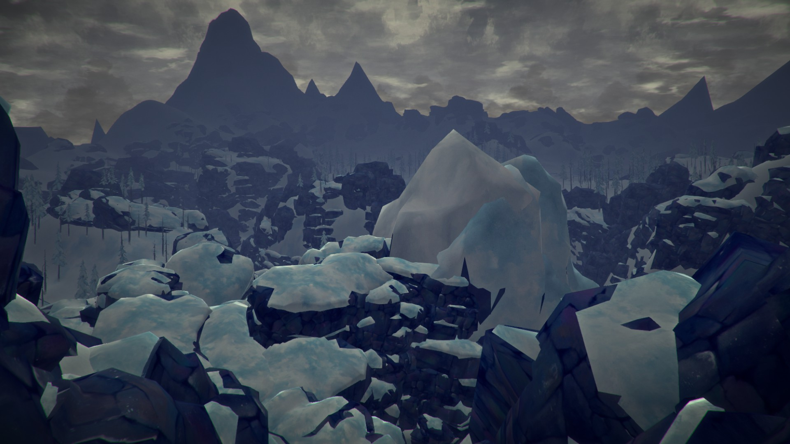

# Secluded Shelf

**Categories:** Locations, Locations in Timberwolf Mountain, Outdoor locations, Sheltered locations · **Source:** [Fandom](https://thelongdark.fandom.com/wiki/Secluded_Shelf)

**Secluded Shelf**

[Secluded Shelf](../assets/Secluded_Shelf.jpg)

**Location**

[Secluded Shelf Location](../assets/Secluded_Shelf_Location.png)

**Region:** [Timberwolf Mountain](./Timberwolf%20Mountain.md)

**General**

**Type:** Outdoors

## Overview

The shelf is a small area surrounded on all sides by cliffs. A [Green Maple Sapling](./Green%20Maple%20Sapling.md) and [Old Man's Beard Lichen](./Old%20Man%27s%20Beard%20Lichen.md) can be found growing on the shelf.

The shelf can be reached by following the path from [Deer Clearing](./Deer%20Clearing.md) and climbing the [Mountaineering Rope](./Mountaineering%20Rope.md) which is already deployed on the cliff face.

In the cliff face on the shelf is a cave which connects to another cave near the [Summit](./Summit.md), above [Eric's Falls](./Eric%27s%20Falls.md).

## Gallery

