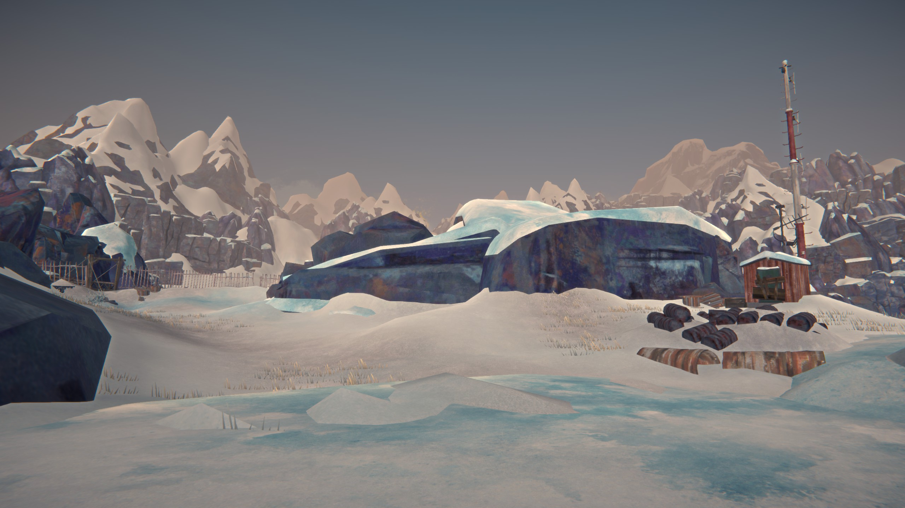
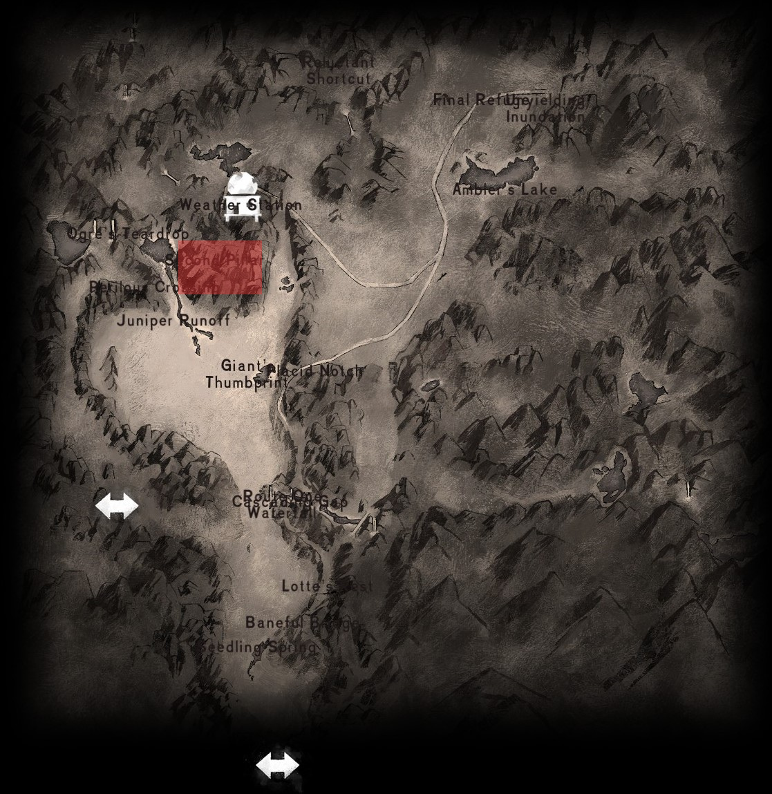

# Second Pillar

**Second Pillar**

| Property | Details |
| --- | --- |
|  |  / *Second\_Pillar.jpg* |
| **Location** |  |
|  |  / *Second\_Pillar\_Location.png* |
| Region | [Sundered Pass](./Sundered%20Pass.md)\|- |
| **General** |  |
|  | Has no shelter\|} **Second Pillar** is a location reached after crossing [Perilous Crossing](./Perilous%20Crossing.md) in [Sundered Pass](./Sundered%20Pass.md). / ## Overview / It is the anchor point for a [Rope Climbing](./Rope%20Climbing.md) section, and becomes marked once the player reaches the top. [Ptarmigan](./Ptarmigan.md) can be found above and below the rope climb spot. / Climbing across the bridge leads to the [Weather Station](./Weather%20Station.md) plateau. A one way path from the [Abandoned Mine](./Abandoned%20Mine.md) will lead the player to the base of the Pillar, but the player must climb up to reach the top. / \| Column 1 \| / \| --- \| / \|  / *The pillar as seen from below (right side) with the Weather Station pillar on the left* \| / **Lua execution error in Module:Navbox function navbox** [ru:Вторая колонна](ru:%D0%92%D1%82%D0%BE%D1%80%D0%B0%D1%8F_%D0%BA%D0%BE%D0%BB%D0%BE%D0%BD%D0%BD%D0%B0) |
|  |  / *The pillar as seen from below (right side) with the Weather Station pillar on the left* |
