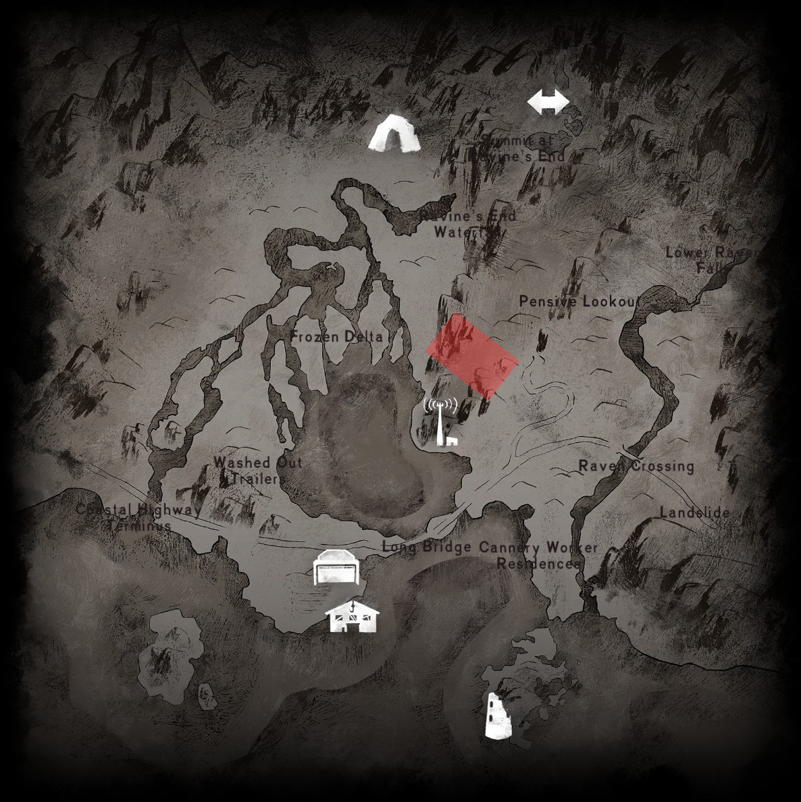
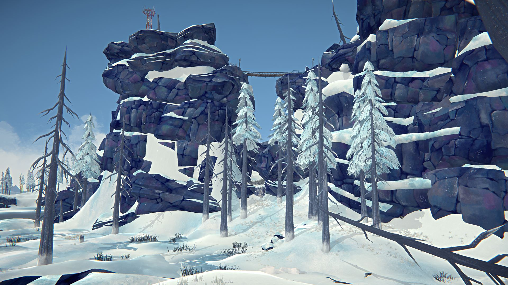

# Secret Mountain Path

**Categories:** Locations, Locations in Bleak Inlet, Outdoor locations · **Source:** [Fandom](https://thelongdark.fandom.com/wiki/Secret_Mountain_Path)

**Secret Mountain Path**

| Property | Details |
| --- | --- |
|  |  / _SS-BI-secret\_mountaion\_path002.jpg_ |
| **Location** |  |
|  |  / _Secret\_Mountain\_Path\_Location.png_ |
| Region | [Bleak Inlet](./Bleak%20Inlet.md)\|- |
| **General** |  |
| Type |  |
|  / _bed\_icon.png_ | Has a bed |

|  / _Entrance pointed by a fallen tree, Under the radio tower's suspension bridge_ |  / _Climbing spot without rope._ /  / _End of the path_ |
