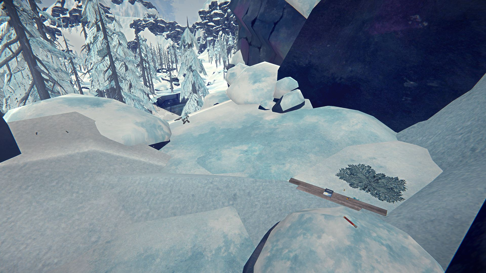

# Secret Mountain Path

**Categories:** Locations, Locations in Bleak Inlet, Outdoor locations · **Source:** [Fandom](https://thelongdark.fandom.com/wiki/Secret_Mountain_Path)

**Secret Mountain Path**

_SS-BI-secret\_mountaion\_path002.jpg_

**Location**

_Secret\_Mountain\_Path\_Location.png_

**Region:** [Bleak Inlet](./Bleak%20Inlet.md)

**General**

Type

_bed\_icon.png_

Has a bed

Has no shelter / **Secret Mountain Path** is a landmark located in [Bleak Inlet](./Bleak%20Inlet.md). The starting path to the area is close to [Coast Mountain Road](./Coast%20Mountain%20Road.md).

## Overview

The path is initially blocked off by several patches of [Scrub Brush](./Scrub%20Brush.md), so the player needs to harvest the scrubs with a [hatchet](./Hatchet.md) to penetrate this path. A log bridge then later connects the way to a bath in the mountains near [Ravine's End Waterfall](./Ravine%27s%20End%20Waterfall.md). At the end of this path, a [Frozen Corpse](./Frozen%20Corpse.md) may be found, along with a [Hunting Rifle](./Hunting%20Rifle.md), makeshift bed, food, flares and a [Heavy Hammer](./Heavy%20Hammer.md).

_Entrance pointed by a fallen tree, Under the radio tower's suspension bridge_

_Climbing spot without rope._

_End of the path_
