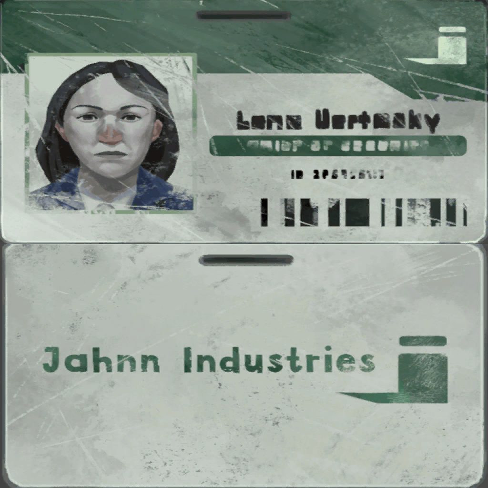

# Security Chief's ID Badge

**Categories:** Collectibles, Pages with update history · **Source:** [Fandom](https://thelongdark.fandom.com/wiki/Security_Chief's_ID_Badge)

**Security Chief's ID Badge**

| Property | Details |
| --- | --- |
|  | [Security Chief's ID Badge icon](../assets/Security_Chief%27s_ID_Badge_icon.png) |
| Release | [24 June 2024](./The%20Long%20Dark%20%E2%80%94%20Changelog.md#2-28-steam-epic-games-xbox-playstation-tftft-part-five-last-horizon-update) |
| Wintermute | No |
| **Properties** |  |
| Item type | [Collectibles](./Collectibles.md) |
| Equipable | No |
| Stackable | No |
| Examine | A plastic ID badge. |
| **Values** |  |
| Weight | 0 kg (0 lbs) |

**Security Chief's ID Badge** is a [Collectibles](./Collectibles.md) found in [Survival Mode](./Survival%20Mode.md) as part of the [Last Horizon](./Last%20Horizon.md) [Tale](./Tales.md). It is found in a hidden room in [Bunker Omega](./Bunker%20Omega.md) near the end of the Tale.

Obtaining the ID Badge unlocks the Settled Mind and Celestial Navigator [Feats](./Feats.md).

## Transcript

_The following text is transcribed from **Security Chief's ID Badge**_

A piece of corporate identification. Scratched by use and faded by time.

## Update history

\* UPDATE **24 June 2024 ([Update](./The%20Long%20Dark%20%E2%80%94%20Changelog.md#2-28-steam-epic-games-xbox-playstation-tftft-part-five-last-horizon-update)):**

- Added to game.
