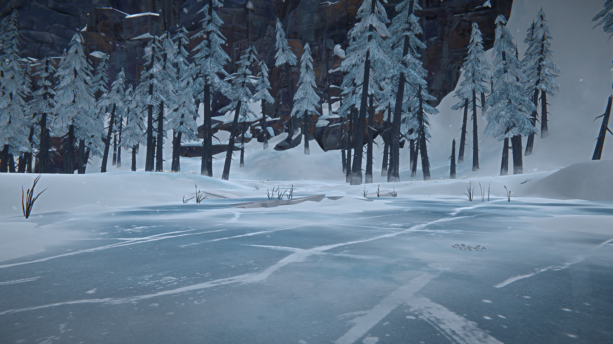

# Seedling Spring

**Categories:** Lakes, Locations, Locations in Sundered Pass, Outdoor locations · **Source:** [Fandom](https://thelongdark.fandom.com/wiki/Seedling_Spring)

**Seedling Spring**

[Seedling Spring](../assets/Seedling_Spring.jpg)

**Location**

[Seedling Spring Location](../assets/Seedling_Spring_Location.png)

**Region:** [Sundered Pass](./Sundered%20Pass.md)

**Description:** a small pond in the forest.

**General**

Has no shelter **Seedling Spring** is a location in [Sundered Pass](./Sundered%20Pass.md).

<!-- #Overview -->
​

<!-- #overview -->
## Overview

It is a small frozen pond, south of [Last Lonely House](./Last%20Lonely%20House.md) and north below the treeline of the Region Transition to [Transfer Pass](./Transfer%20Pass.md). A useful cave, [Miserable Haunt](./Miserable%20Haunt.md), is located nearby for shelter.

[Wolf](./Wolf.md), [Deer](./Deer.md), and [Rabbit](./Rabbit.md) can be found nearby, along with over a dozen [Cat Tail](./Cat%20Tail.md) plants. [Baneful Bridge](./Baneful%20Bridge.md) can be seen on the cliffside above. Despite its small size, the water in this pond is sufficiently deep to enable free-form [Ice Fishing](./Ice%20Fishing.md), which may make it useful for Survivors looking to use [Last Lonely House](./Last%20Lonely%20House.md) nearby for longer stays.

A [Rope Climbing](./Rope%20Climbing.md) section near the cliff to the mountain road is found to the south east, and leads to a cave entrance with 2 [Rose Hip](./Rose%20Hip.md) bushes. The cave system can be followed and leads to a hidden path into the mountains underneath [Baneful Bridge](./Baneful%20Bridge.md), eventually ending at a [Frozen Corpse](./Frozen%20Corpse.md) with a [Backpack](./Backpack.md) overlooking a cliff to the mountain road, which can be jumped down (beware the one way trip) to reach Baneful Bridge or [Lotte's Rest](./Lotte%27s%20Rest.md).

_The nearby [Miserable Haunt](./Miserable%20Haunt.md) cave_
