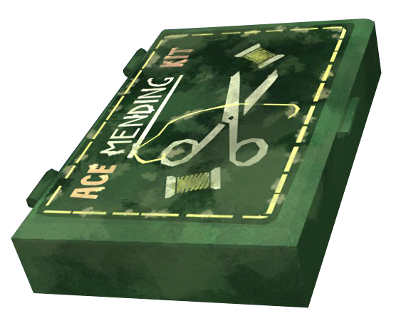

# Sewing Kit

**Contents**

- [Overview](#Overview)
- [Tips](#Tips)
- [Trivia](#Trivia)
- [Gallery](#Gallery)
- [Update history](#Update_history)

<table class="infobox">
<caption>Sewing Kit</caption>
<colgroup>
<col style="width: 50%" />
<col style="width: 50%" />
</colgroup>
<tbody>
<tr>
<td colspan="2"><figure>

<figcaption>Sewing_Kit_icon.png</figcaption>
</figure></td>
</tr>
<tr>
<td colspan="2" class="section">
<strong>General</strong>
</td>
</tr>
<tr>
<td>
Item Type
</td>
<td>
Tool|-
</td>
</tr>
<tr>
<td>
Renewable
</td>
<td>
Yes
</td>
</tr>
<tr>
<td colspan="2" class="section">
<strong>Statistics</strong>
</td>
</tr>
<tr>
<td>
Weight
</td>
<td>
0.10 kg(0.22 lbs)
</td>
</tr>
</tbody>
</table>

<table>
<colgroup>
<col style="width: 33%" />
<col style="width: 33%" />
<col style="width: 33%" />
</colgroup>
<tbody>
<tr>
<td style="vertical-align: top; font-size: 3em; color: #5d5980; padding-right: 10px">
“
</td>
<td>
A basic sewing kit. Required to craft and repair clothing.

&#10;

In-game description

</td>
<td style="vertical-align: bottom; font-size: 3em; color: #5d5980; padding-left: 10px">
”
</td>
</tr>
</tbody>
</table>

Sewing Kit is a tool in The Long Dark for repairing <a href="./Clothing.md" class="wikilink" title="Clothing">Clothing</a> or crafting improvised clothing.

## Overview

Sewing Kits are used to repair damaged clothing before it becomes <a href="./Decay.md" class="wikilink" title="Ruined">Ruined</a>, or to create Improvised Clothing (<a href="./Improvised%20Head%20Wrap.md" class="wikilink" title="Improvised Headwrap">Improvised Headwrap</a>, <a href="./Improvised%20Hand%20Wraps.md" class="wikilink" title="Improvised Hand Wraps">Improvised Hand Wraps</a>, <a href="./Improvised%20Insulation.md" class="wikilink" title="Improvised Insulation">Improvised Insulation</a>) to protect against <a href="./Frostbite.md" class="wikilink" title="Frostbite">Frostbite</a>. Clothing Decays condition over time, reducing it's Warmth and Windproof values and eventually becoming Ruined and unusable (and unrepairable). Improvised Clothing is useful at preventing Frostbite to the head and hands, especially early game on Interloper, or after a wildlife <a href="./Struggle.md" class="wikilink" title="Struggle">Struggle</a> if the survivor's clothing becomes ruined. Functionally Sewing Kits are the same as <a href="./Fishing%20Tackle.md" class="wikilink" title="Fishing Tackle">Fishing Tackle</a>, but Tackle is much slower to repair/craft with.

- Sewing Kits are 30% faster than Fishing Tackle for Repairs/Crafting.
- Successful repairs of Clothing increase the <a href="./Mending.md" class="wikilink" title="Mending">Mending</a> survival skill in <a href="./Survival%20Mode.md" class="wikilink" title="Survival Mode">Survival Mode</a>.
- Sewing Kit cannot be repaired or harvested.

The Fishing Tackle can also be used to repair clothing with the same effectiveness, and it can be fairly easily made at a <a href="./Work%20Bench.md" class="wikilink" title="Work Bench">Work Bench</a> later in the game.

## Tips

- New Sewing Kits can either be rarely found while <a href="./Beachcombing.md" class="wikilink" title="Beachcombing">Beachcombing</a> or purchased - maximum 1 per trade - from the <a href="./Trader.md" class="wikilink" title="Trader">Trader</a> after completing 4 Special Requests.

## Trivia

- Although the kit can spawn in first aid cabinets, it is not used for first aid, particularly for stitching wounds.
- Sewing Kit are branded as a product "*Ace Mending Kit*".

## Gallery

<table class="gallery">
<colgroup>
<col style="width: 50%" />
<col style="width: 50%" />
</colgroup>
<tbody>
<tr>
<td><figure>

<figcaption>3D model</figcaption>
</figure></td>
<td><figure>
[Missing image: Sewing_kit_old_model.png]
<figcaption>Old model</figcaption>
</figure></td>
</tr>
</tbody>
</table>

## Update history

- HOTFIX **2 July 2014 (<a href="./The%20Long%20Dark%20%E2%80%94%20Early%20Access%20Changelog.md#0.04" class="wikilink" title="Update">Update</a>):**
  - Added to game

**Lua execution error in Module:Navbox function navbox** <a href="ru:%D0%9D%D0%B0%D0%B1%D0%BE%D1%80_%D0%B4%D0%BB%D1%8F_%D1%88%D0%B8%D1%82%D1%8C%D1%8F" class="wikilink" title="ru:Набор для шитья">ru:Набор для шитья</a>

