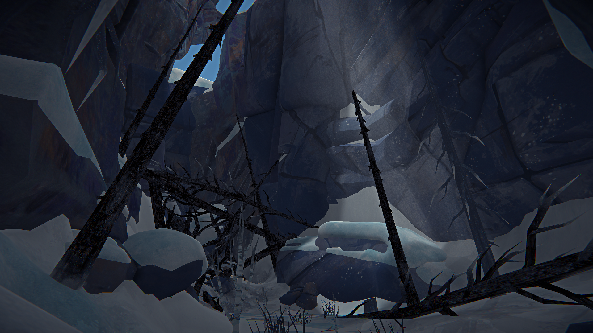

# Shattered Cove

**Categories:** Locations, Outdoor locations · **Source:** [Fandom](https://thelongdark.fandom.com/wiki/Shattered_Cove)

**Shattered Cove**

| Property | Details |
| --- | --- |
|  | [ShatteredCove](../assets/ShatteredCove.png) |
| **Location** |  |
|  | [Shattered Cove Location](../assets/Shattered_Cove_Location.png) |
| Region |  |
| Description | A depression surrounded by steep cliff walls. |
| **General** |  |
| Type |  |
|  | Has no shelter / **Shattered Cove** is a low-lying, swampy area not far from the [Echo Ravine](./Echo%20Ravine.md) connector, surrounded by high plateau on three sides. / It is possible to go from here to [Angler's Den](./Angler%27s%20Den.md) via a narrow canyon rich in natural resources (including three sets of birch saplings). The canyon pathway is relatively sheltered and can offer protection in inclement weather. A shallow cave is also located along the way. |

## Gallery

_The canyon leading from Shattered Cove to [Angler's Den](./Angler%27s%20Den.md)_
