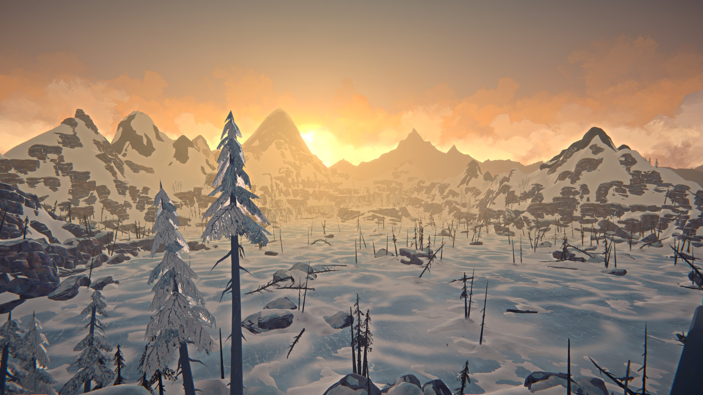

# Shattered Marsh

**Categories:** Wintermute · **Source:** [Fandom](https://thelongdark.fandom.com/wiki/Shattered_Marsh)

**Shattered Marsh**

_Shattered\_Marsh\_Photo.jpg_

**Location on [Great Bear Island](./Great%20Bear%20Island.md)**

_No\_picture.png_

**Details**

**Description:** A large marsh in the mountains

**Difficulty:** Advanced

_The\_Long\_Development\_White\_Logo.png_

**Modded Content.** / This page is about content that was not officially created by [Hinterland Studio Inc.](./Hinterland%20Studio%20Inc..md) It is not canon to the world of [The Long Dark](./The%20Long%20Dark.md).

\|}{\| style="margin:auto"

“

**An expanse of treacherous marshland that has been ravaged by wildfire. The mountains that line this location feature many transition areas to surrounding regions, as well harbor a secret to uncover.** / TLDEV Region Description

”

**Shattered Marsh** is the 4th [Modded Region](./The%20Long%20Development.md) added to the game, as part of The Long Development's unofficial region mods.

## Overview

## Locations

- Collapsed Cave
- Conflict Hill
- Fabricated Bog
- Grace's End
- Neglected Airfield
- Rines Complex
  - Living Quarters
  - Fabricator Room
- Solitude Tower
- Stone House
- Unseen Hut

-
