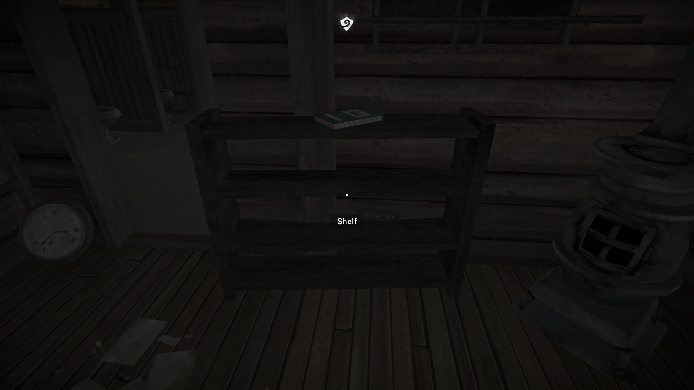
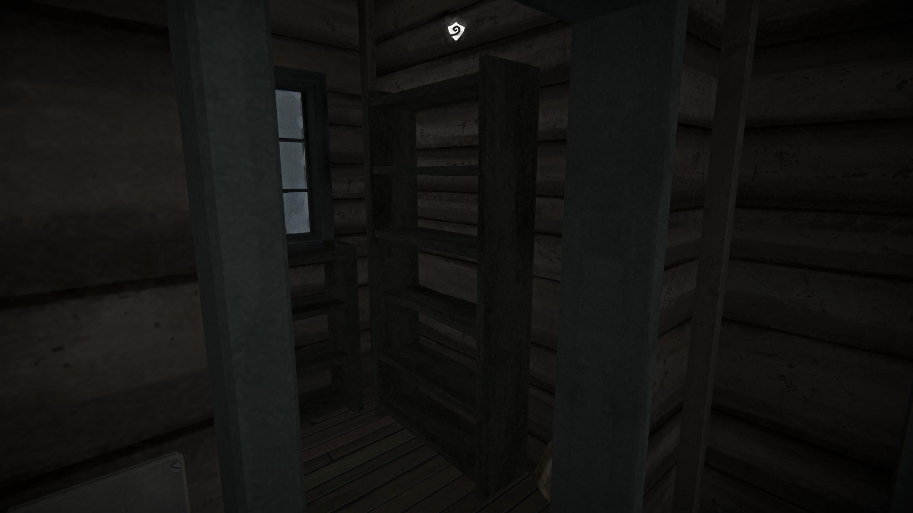
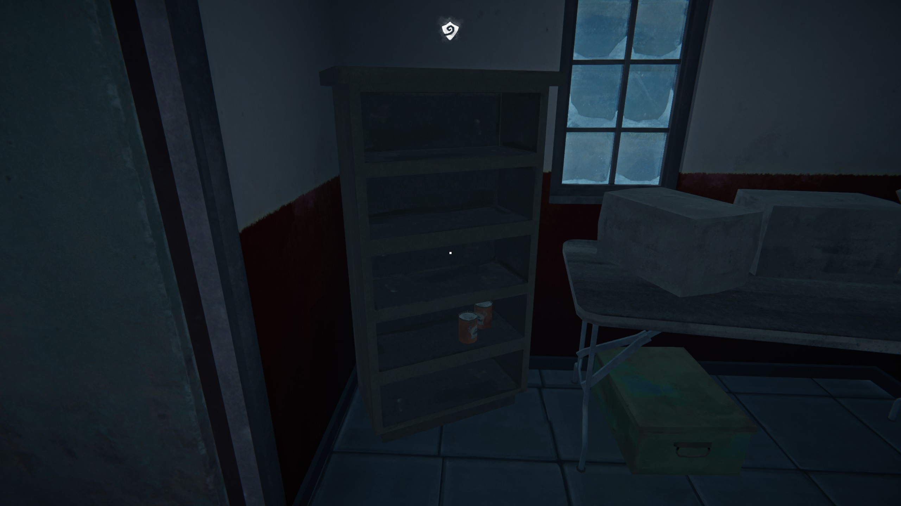
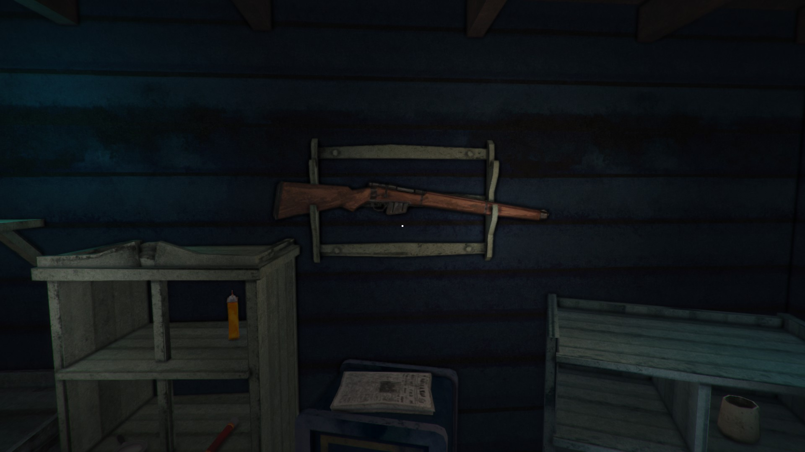
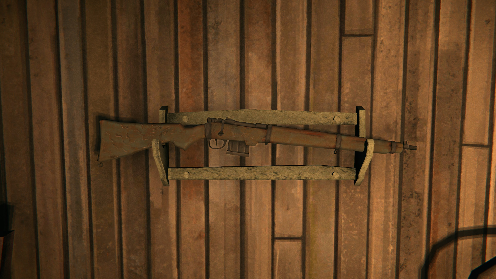

# Shelf

**Categories:** Interactable Objects · **Source:** [Fandom](https://thelongdark.fandom.com/wiki/Shelf)

**Contents**

- [Wide Shelf](#wide-shelf)
- [Large Shelf/Bookshelf](#large-shelfbookshelf)
- [Gun Rack Shelf](#gun-rack-shelf)
- [Double Rack](#double-rack)
- [Single Rack](#single-rack)

**Shelf**

**General**

Item Type

Item

Wintermute

No

**Shelves**are common features in indoor environments in _[The Long Dark](./The%20Long%20Dark.md)_.

The player can find and store many different usable items such as [Food And Drink](./Food%20And%20Drink.md), [Rifle Ammunition](./Rifle%20Ammunition.md), [Bandages](./Bandage.md) and much more on most types of shelves. These items are set out in the open (shelves are not storage containers), and may sit alongside decorative, immovable objects as well.

As with most wooden furniture, shelves can be broken down without any tools or using a hatchet for a yield of [Reclaimed Wood](./Reclaimed%20Wood.md).

## Wide Shelf

A wide Shelf can be harvested for 6 Reclaimed Wood after 1 hour 30 minutes.

| Reclaimed Wood | Time | Calories | Condition of Tool |
| --- | --- | --- | --- |
| 6 | 1 hour 30 minutes |  | -2% Hatchet |
| 6 |  |  | -3% Improvised Hatchet |
| 6 |  |  | -0.5% Heavy Hammer |

## Large Shelf/Bookshelf

Bookshelves are thick shelves that usually hold books and supplies. Large Shelves are very tall, even taller than Bookshelves, but are very thin. Both give the same amount of wood and one tinder plug.

| Reclaimed Wood | Time | Calories | Condition of Tool |
| --- | --- | --- | --- |
| 8/1 Tinder Plug | 2 hours |  | -2% Hatchet |
| 8/1 Tinder Plug |  |  | -3% Improvised Hatchet |
| 8/1 Tinder Plug |  |  | -0.5% Heavy Hammer |

## Gun Rack Shelf

Gun racks allow [Hunting Rifles](./Hunting%20Rifle.md) to be placed on them, but can also be broken down. They either have 1 or 2 racks for placing rifles.

### Double Rack

| Reclaimed Wood | Time | Calories | Condition of Tool |
| --- | --- | --- | --- |
| 2 | 15 minutes | 45 | -2% Hatchet |
| 2 | 20 minutes | 58 | -3% Improvised Hatchet |
| 2 | 22 minutes | 68 | -0.5% Heavy Hammer |

#### Single Rack

| Reclaimed Wood | Time | Calories | Condition of Tool |
| --- | --- | --- | --- |
| 1 | 8 minutes | 22 | -2% Hatchet |
| 1 | 10 minutes | 29 | -3% Improvised Hatchet |
| 1 | 11 minutes | 34 | -0.5% Heavy Hammer |
