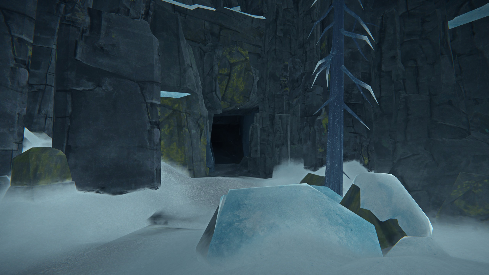
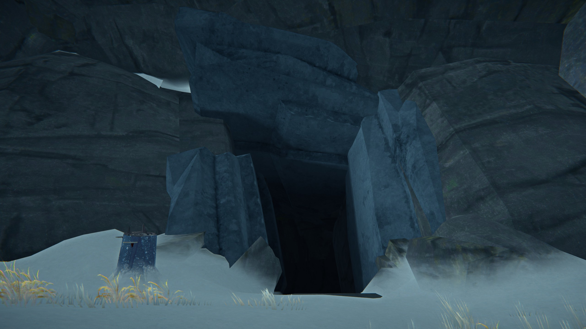

# Sheltered Access

**Categories:** DLC Content, Locations, Locations in Port Remnant, Outdoor locations · **Source:** [Fandom](https://thelongdark.fandom.com/wiki/Sheltered_Access)

_Seal\_icon.png_

**DLC-Exclusive content.** / This content requires the [Iron Road](./Iron%20Road.md) addon to be installed before it can be seen or used in regular gameplay.

\[\[File: /  / _South side_ /  / _North side_

250px\]\]

_South side_

_North side_

**Location**

_Sheltered\_Access\_Location.png_

Region

[Port Remnant](./Port%20Remnant.md)

Location

**Description:** A long natural tunnel by the sea that leads to a cliff overlook.

**General**
