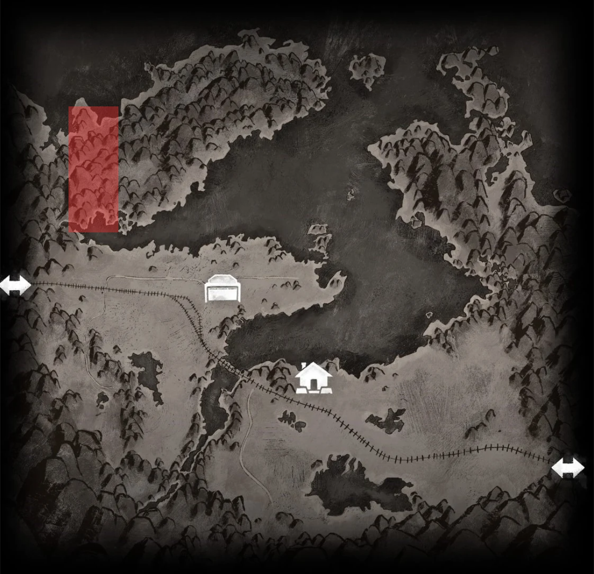

# Sheltered Access

**Categories:** DLC Content, Locations, Locations in Port Remnant, Outdoor locations · **Source:** [Fandom](https://thelongdark.fandom.com/wiki/Sheltered_Access)

**DLC-Exclusive content.** This content requires the [Iron Road](./Iron%20Road.md) addon to be installed before it can be seen or used in regular gameplay.

 **Sheltered Access**   250px\]\] **Location**  Region [Port Remnant](./Port%20Remnant.md)\\|- Location **Description:** A long natural tunnel by the sea that leads to a cliff overlook. **General** Has no shelter\ **Sheltered Access** is a location in [Port Remnant](./Port%20Remnant.md).

## Overview

The location can be found by heading west of the Lighthouse, north of [Broken Shoreline](./Broken%20Shoreline.md), and then up a [Rope Climbing](./Rope%20Climbing.md) section. Continuing back down the mountain path to the sea gives way to an almost grotto like opening, with the cave nearby.
