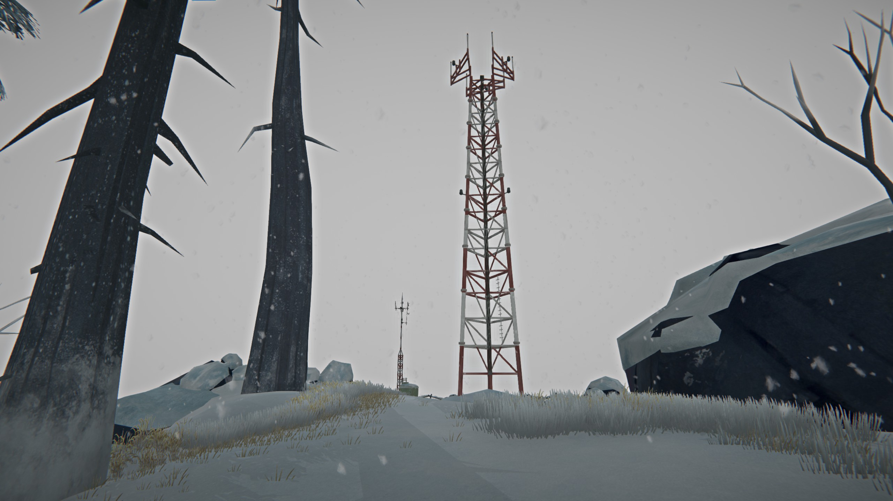

# Shortwave Tower East

**Shortwave Tower East**

| Property | Details |
| --- | --- |
|  |  / *Shortwave\_Tower\_East.jpg* |
| **Location** |  |
|  |  / *Shortwave\_Tower\_East\_Location.png* |
| Region | [Forlorn Muskeg](./Forlorn%20Muskeg.md)\|- |
| **General** |  |
| Type | OutdoorsMilitary/Sporting\|- |
