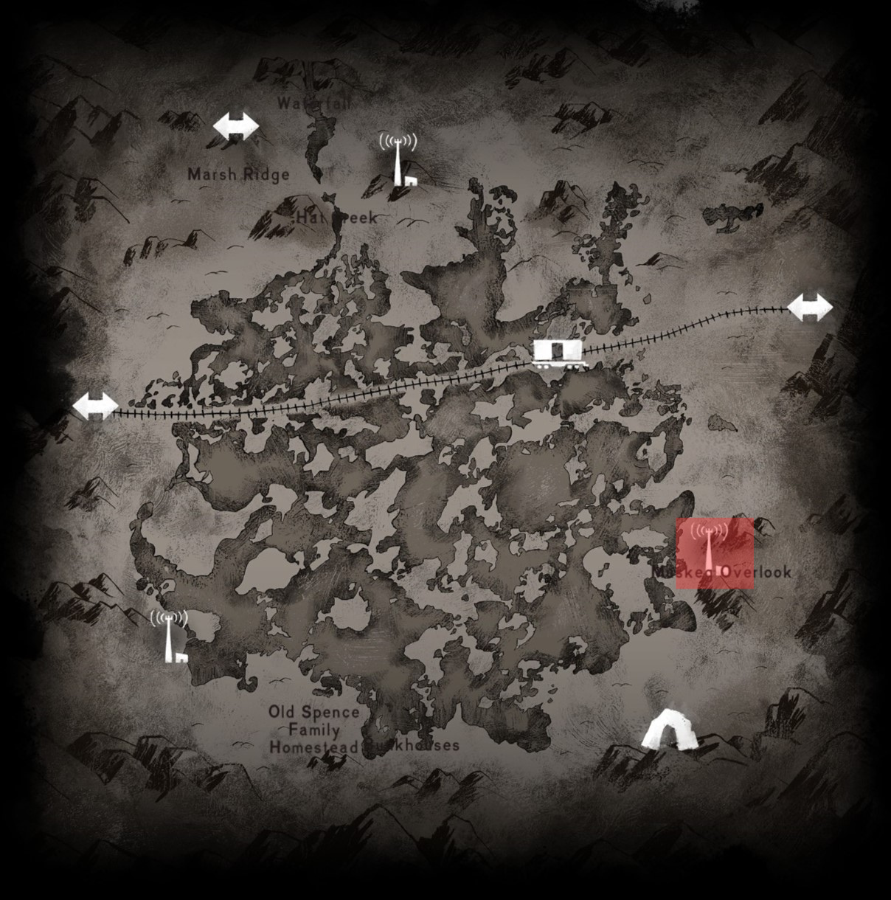

# Shortwave Tower East

**Categories:** Locations, Locations in Forlorn Muskeg, Military/Sporting locations, Outdoor locations, Unofficially named content · **Source:** [Fandom](https://thelongdark.fandom.com/wiki/Shortwave_Tower_East)

**Shortwave Tower East**

_Shortwave\_Tower\_East.jpg_

**Location**

_Shortwave\_Tower\_East\_Location.png_

**Region:** [Forlorn Muskeg](./Forlorn%20Muskeg.md)

**General**

**Type:** OutdoorsMilitary/Sporting

## Surroundings

A [Transmitter](./Transmitters.md) is found nearby, along with a [Supply Bin](./Supply%20Bin.md) with a [Car Battery](./Car%20Battery.md) inside. A [Polaroid](./Polaroids.md) Vista location can be found here.

## Story
