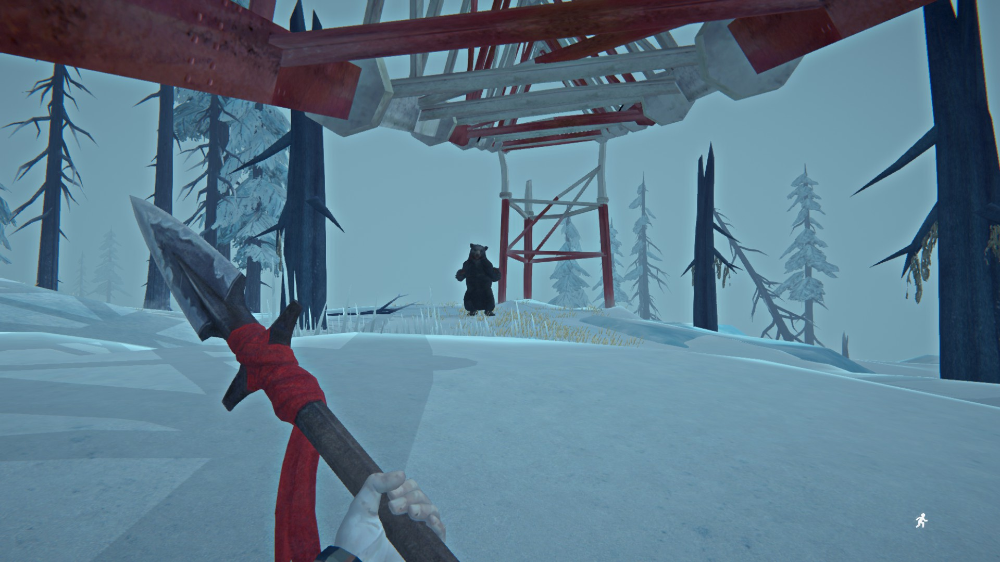

# Shortwave Tower West

**Categories:** Locations, Locations in Forlorn Muskeg, Military/Sporting locations, Outdoor locations, Unofficial locations, Unofficially named content · **Source:** [Fandom](https://thelongdark.fandom.com/wiki/Shortwave_Tower_West)

**Shortwave Tower West**

| Property | Details |
| --- | --- |
|  | [20190101173144 1](../assets/20190101173144_1.jpg) |
| **Location** |  |
|  | [Shortwave Tower West Location](../assets/Shortwave_Tower_West_Location.png) |
| Region | [Forlorn Muskeg](./Forlorn%20Muskeg.md)\|- |
| **General** |  |
| Type | OutdoorsMilitary/Sporting\|- |

## Surroundings

There are no supplies near the tower, however there is a [Warm Cave](./Warm%20Cave.md) not far away where some supplies can be found. A [Mementos](./Mementos.md) is stuck to the tower leg facing the marsh cliff side.

## Story

In Episode 2 this is one of the radio towers that has to be reached to gather radio components in the mission [Signal to Noise](./Signal%20to%20Noise.md).

## Gallery

_The [Old Bear](./Old%20Bear.md) at the Shortwave Tower West in [Episode 2](./Episode%202%20-%20Luminance%20Fugue.md)_
