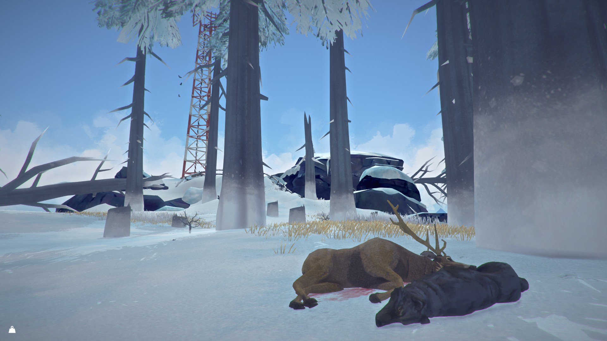
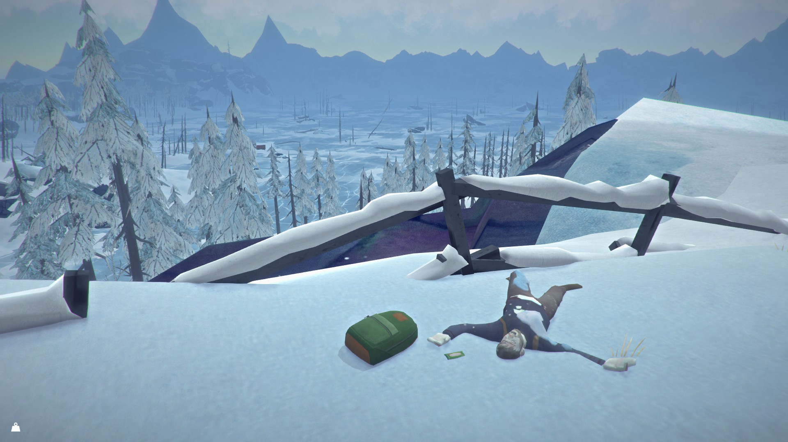
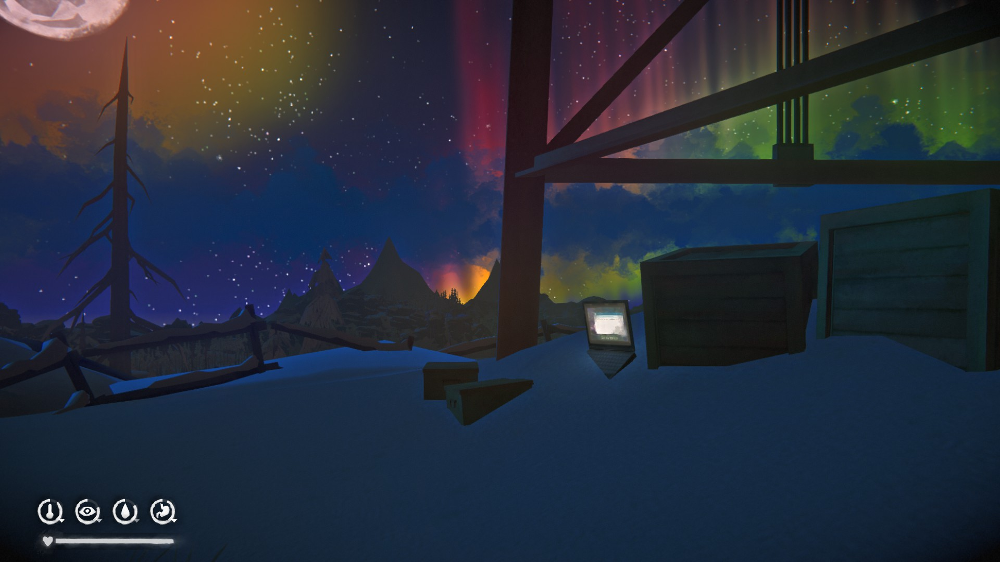

# Shortwave Tower

**Categories:** Locations, Locations in Forlorn Muskeg, Military/Sporting locations, Outdoor locations · **Source:** [Fandom](https://thelongdark.fandom.com/wiki/Shortwave_Tower)

**Shortwave Tower**

| Property | Details |
| --- | --- |
| | [Shortwave Tower](../assets/Shortwave_Tower.png) |
| **Location** | |
| | [Shortwave Tower Location](../assets/Shortwave_Tower_Location.png) |
| Region | [Forlorn Muskeg](./Forlorn%20Muskeg.md) |
| **General** | |
| Type | OutdoorsMilitary/Sporting |
| | Has no shelter |

**Shortwave Tower** (North Tower) is a location in [Forlorn Muskeg](./Forlorn%20Muskeg.md). There are two other Shortwave Towers in this region ([East](./Shortwave%20Tower%20East.md) and [West](./Shortwave%20Tower%20West.md)), however, this was the first created and thus it maintains this name.

## Overview

The tower is easily visible in clear weather. Looking from the entrance of Forlorn Muskeg, it is located on top of a mountain to the east. Its appearance is similar to the tower from [Signal Hill](./Signal%20Hill.md). Climbing to the top of the tower offers an expansive view of the muskeg, weather permitting. Several wolves can patrol the area, however, so take caution.

## Supplies

There are three crates which can be broken down for [reclaimed wood](./Reclaimed%20Wood.md). There is also a corpse and a backpack with food and sometimes matches or a [magnifying lens](./Magnifying%20Lens.md). There can also spawn up to three metal containers that often contain decent loot, such as high-level [clothing](./Clothing.md). In the area there are also [Green Birch Saplings](./Green%20Birch%20Sapling.md) to craft arrows. Strangely enough, there is a laptop sitting at the foot of the structure, which activates one of the buffer memories for the [Archivist](./Archivist.md) challenge.

## Gallery

