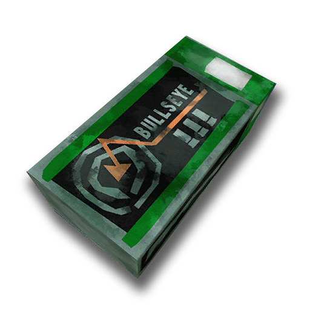

# Shotgun Ammunition

**Categories:** Pages with update history, Tools, Wintermute · **Source:** [Fandom](https://thelongdark.fandom.com/wiki/Shotgun_Ammunition)

**Contents**

- [Overview](#overview)
- [Harvesting](#harvesting)
- [Trivia](#trivia)
- [Game History](#game-history)

**Wintermute-Exclusive content.**

This content only appears in [Wintermute](./Wintermute.md).

**Shotgun Ammunition**

\[\[File:

250px\]\]

Wintermute

[Episode 5: The Light At The End Of All Things](./Episode%205%20-%20The%20Light%20At%20The%20End%20Of%20All%20Things.md)

**Properties**

Item type

[Tools](./Tools.md)|-

Equipable

Stackable

Yes

Examine

A box of Shotgun slugs.  
 A single shotgun slug shell.

**Values**

Weight

0.02 kg (0.04 lbs)

**Shotgun** **Ammunition** or a **Shotgun Slug** is a [Tools](./Tools.md) item found exclusively in [Episode 5: The Light At The End Of All Things](./Episode%205%20-%20The%20Light%20At%20The%20End%20Of%20All%20Things.md) in the [Wintermute](./Wintermute.md) story.

<!-- #Overview -->
​

<!-- #overview -->
## Overview

It is used in conjunction with the [Shotgun](./Shotgun.md) as its primary ammunition source. They are found at the second and third Geothermal Station in the [Suzuki Geothermal Region](./Suzuki%20Geothermal%20Region.md).

Dropping 4 or less slugs will produce a single slug, while dropping 5 or more will produce a box.

When fired, a [Shotgun Shell Casing](./Shotgun%20Shell%20Casing.md) is produced.

<!-- #Harvesting -->
​

<!-- #harvesting -->
## Harvesting

1 Shotgun Ammunition can be harvested in 5 minutes and produces 1 Shotgun Shell Casing and 0.01 kg of [Can of Gunpowder](./Can%20of%20Gunpowder.md). Shotgun Ammunition does not produce individual slugs when harvested.

<!-- #Trivia -->
​

<!-- #trivia -->
## Trivia

The branding for this ammunition is called Bullseye, the same company that produces [Rifle Ammunition](./Rifle%20Ammunition.md) and [Revolver Ammunition](./Revolver%20Ammunition.md).

<!-- #game_history -->
​

<!-- #Game_History -->
​

<!-- #Game_history -->
​

<!-- #game-history -->
## Game History

\* UPDATE **31 March 2026 ([Update](./The%20Long%20Dark%20%E2%80%94%20Changelog.md#2.52)):**

  - Added to game.
