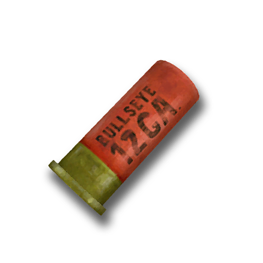

# Shotgun Ammunition

**Categories:** Pages with update history, Tools, Wintermute · **Source:** [Fandom](https://thelongdark.fandom.com/wiki/Shotgun_Ammunition)

**Contents**

- [Overview](#overview)
- [Harvesting](#harvesting)
- [Trivia](#trivia)
- [Game History](#game-history)

| Column 1 | Column 2 | Column 3 |
| --- | --- | --- |

| \[\[File: /  / _Ammunition_ /  / _Slug_ | 250px\]\] |  |
|  / _Ammunition_ |  / _Slug_ |  |
| Wintermute | [Episode 5: The Light At The End Of All Things](./Episode%205%20-%20The%20Light%20At%20The%20End%20Of%20All%20Things.md) |  |
| **Properties** |  |  |
| Item type | [Tools](./Tools.md)\|- | Equipable |
| Stackable | Yes |  |
| Examine | A box of Shotgun slugs. / A single shotgun slug shell. |  |
| **Values** |  |  |
| Weight | 0.02 kg (0.04 lbs) |  |
