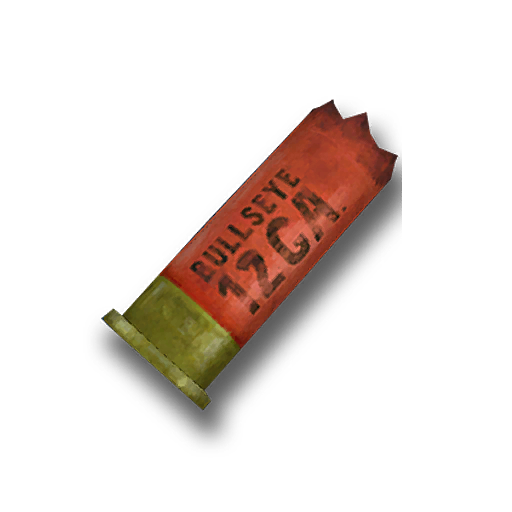

# Shotgun Shell Casing

**Categories:** Pages with update history, Tools, Wintermute · **Source:** [Fandom](https://thelongdark.fandom.com/wiki/Shotgun_Shell_Casing)

| Column 1 | Column 2 | Column 3 |
| --- | --- | --- |

|  / _Shotgun\_Shell\_Casing\_icon.png_ |  |  |
| Wintermute | [Episode 5: The Light At The End Of All Things](./Episode%205%20-%20The%20Light%20At%20The%20End%20Of%20All%20Things.md) |  |
| **Properties** |  |  |
| Item type | [Tools](./Tools.md)\|- |  |
| Stackable | Yes |  |
| Examine | Empty casing from firing a Shotgun Slug. Used for Crafting new Ammunition |  |
| **Values** |  |  |
| Weight | 0.01 kg (0.02 lbs) |  |
