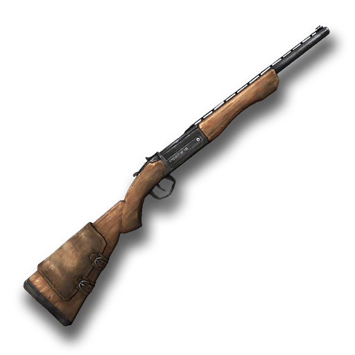

# Shotgun

**Categories:** Pages with update history, Tools, Wintermute · **Source:** [Fandom](https://thelongdark.fandom.com/wiki/Shotgun)

**Contents**

- [Overview](#overview)
- [Location](#location)
- [Use](#use)
- [Jamming](#jamming)
- [Trivia](#trivia)
- [Game History](#game-history)

_2120907963\_TLD-Wintermute-v2.png.de8a285930f6a8f5ad9cf5878754cf5b.png_

**Wintermute-Exclusive content.** / This content only appears in [Wintermute](./Wintermute.md).

_Shotgun\_icon.png_

**Wintermute:** [Episode 5: The Light At The End Of All Things](./Episode%205%20-%20The%20Light%20At%20The%20End%20Of%20All%20Things.md)

**Renewable:** No

**Properties**

**Item type:** [Tools](./Tools.md)

**Stackable:** No

**Examine:** A long barreled, single shot, break action shotgun. Calibrated to fire Slug rounds. A deadly, if slow firing weapon.

**Values**

**Weight:** 4.00 kg (8.8 lbs)

**Actions**

**Backpack:** Use, Unload, Drop

> “**Finally. The right tool for the job.**”
>
> — [Will Mackenzie](./Will%20Mackenzie.md) upon finding the Shotgun in the Supply Room
