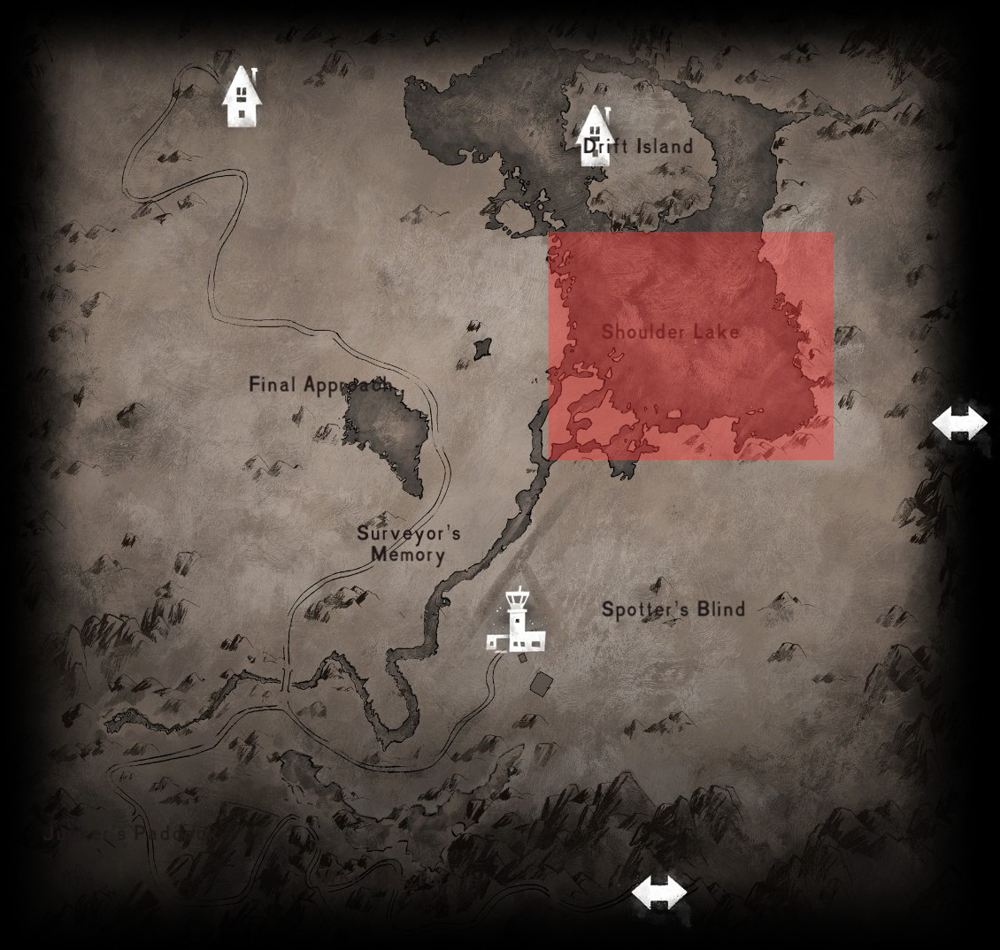

# Shoulder Lake

**Categories:** Lakes, Landmarks, Locations, Locations in Forsaken Airfield, Outdoor locations · **Source:** [Fandom](https://thelongdark.fandom.com/wiki/Shoulder_Lake)

**Shoulder Lake**

_Shoulder\_Lake\_Airplane.png_

**Location**

_Shoulder\_Lake\_Location.png_

**Region:** [Forsaken Airfield](./Forsaken%20Airfield.md)

**Description:** A large lake containing a few islands.

**General**

**Type:** Landmark
