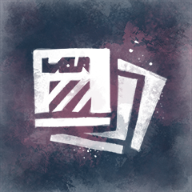

# Shutterbug

<table class="infobox">
<caption>Shutterbug</caption>
<colgroup>
<col style="width: 50%" />
<col style="width: 50%" />
</colgroup>
<tbody>
<tr>
<td colspan="2"><figure>

<figcaption>Shutterbug_icon.png</figcaption>
</figure></td>
</tr>
<tr>
<td colspan="2"></td>
</tr>
<tr>
<td>
Description
</td>
<td>
Take 10 photos with each film type – Colour, B&amp;W, and Sepia (single game).
</td>
</tr>
</tbody>
</table>

**Shutterbug** is an <a href="./The%20Long%20Dark%20%E2%80%94%20Achievements.md" class="wikilink" title="achievement">achievement</a> in *<a href="./The%20Long%20Dark.md" class="wikilink" title="The Long Dark">The Long Dark</a>*.

## Guide

This achievement is easiest to unlock when playing on <a href="./Pilgrim.md" class="wikilink" title="Pilgrim">Pilgrim</a>. The player must take 30 photos with the 3 film types with the <a href="./Camera.md" class="wikilink" title="Camera">Camera</a> in a single <a href="./Survival%20Mode.md" class="wikilink" title="Survival Mode">Survival Mode</a> game. It does not matter where the photos are taken:

- 10 photos with <a href="./FastFilm-500.md" class="wikilink" title="FastFilm-500">FastFilm-500</a>
- 10 photos with <a href="./FastFilm-500BW.md" class="wikilink" title="FastFilm-500BW">FastFilm-500BW</a>
- 10 photos with <a href="./FastFilm-500SPA.md" class="wikilink" title="FastFilm-500SPA">FastFilm-500SPA</a>

## Trivia

A shutterbug is a person who frequently takes photos with a camera.**Lua execution error in Module:Navbox function navbox**

