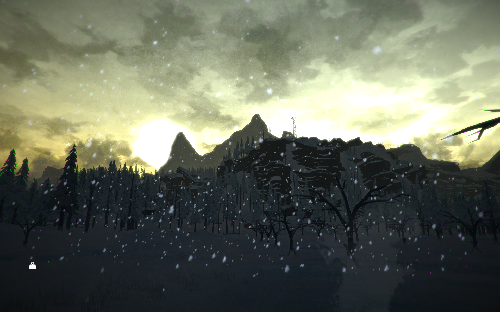
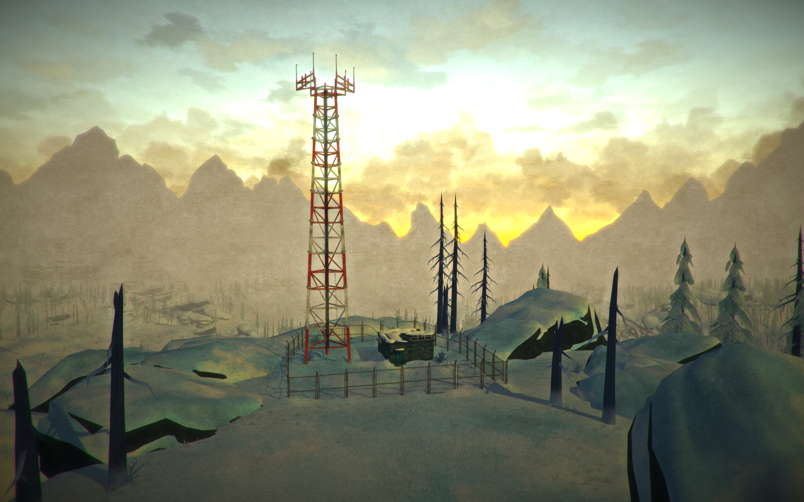
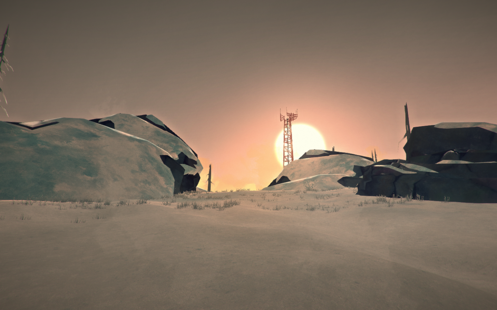

# Signal Hill

**Categories:** Indoor locations, Locations, Locations in Pleasant Valley, Locations with a workbench, Military/Sporting locations · **Source:** [Fandom](https://thelongdark.fandom.com/wiki/Signal_Hill)

**Signal Hill**

\[\[File:

\[Missing image: SignalHill2.png\]

_Exterior_

250px\]\]

**Location**

Region

[Pleasant Valley](./Pleasant%20Valley.md)|-

Description

**General**

Type

Military/Sporting|-

Firebox

Has a bed

Has a workbench|-

## Location features

Signal Hill can be accessed by trail either from the east or the west up the southern mountain.

A general variety of supplies may be found in the radio hut. These include, but are not limited to: a [hunting rifle](./Hunting%20Rifle.md), the [revolver](./Revolver.md), a pair of [cargo pants](./Cargo%20Pants.md), [Expedition parka](./Expedition%20Parka.md), [food](./Food%20And%20Drink.md) ([peaches](./Pinnacle%20Peaches.md), [tomato soup](./Tomato%20Soup.md), [pork and beans](./Pork%20and%20Beans.md), etc.), .303 [rifle ammunition](./Rifle%20Ammunition.md), [revolver ammunition](./Revolver%20Ammunition.md), [military coat](./Military%20Coat.md), some medical supplies, and a few variable items that change depending on the playthrough. Also a [buffer memory](./Buffer%20Memories.md) can be found here. A [Transmitter](./Transmitters.md) is found just outside in the fenced area.

Outside, a [fire barrel](./Fire%20Barrel.md) can be found against the shack's wall, offering the player some protection from the wind. [Bear](./Bear.md), [wolves](./Wolf.md), [deer](./Deer.md), and [rabbits](./Rabbit.md) may spawn near the shack, but fenced-in enclosure provides a level of security from predators' ambushes. Wood is also abundant within the forest nearby.

Overall, Signal Hill is one of the best places to find high-tier loot in Pleasant Valley and makes for a good [safe-house](./Safehouse.md). There is also a [climbing rock](./Rope%20Climbing.md) just outside the hut, if one does not want to hike up and down the mountain.

- [Work bench](./Work%20Bench.md)
- [Bed](./Bed.md)
- Metal Chairs
- Locker (x5)
- First aid kit
- Desk
- [Filing cabinets](./File%20Cabinet.md)
- [Fire barrel](./Fire%20Barrel.md) (located outside next to shack)

## Story

In the final chapter of [Episode 2](./Episode%202%20-%20Luminance%20Fugue.md), [Will Mackenzie](./Will%20Mackenzie.md) is following [Jeremiah](./Jeremiah.md)'s directions to Signal Hill, where he hopes to try to send a radio message to [Perseverance Mills](./Perseverance%20Mills.md) before continuing there on foot. Near the end of [Episode 3](./Episode%203%20-%20Crossroads%20Elegy.md), Astrid must brave a blizzard to reach Signal Hill in the hope of finding a functional radio to contact [Perseverance Mills](./Perseverance%20Mills.md).

## Gallery

