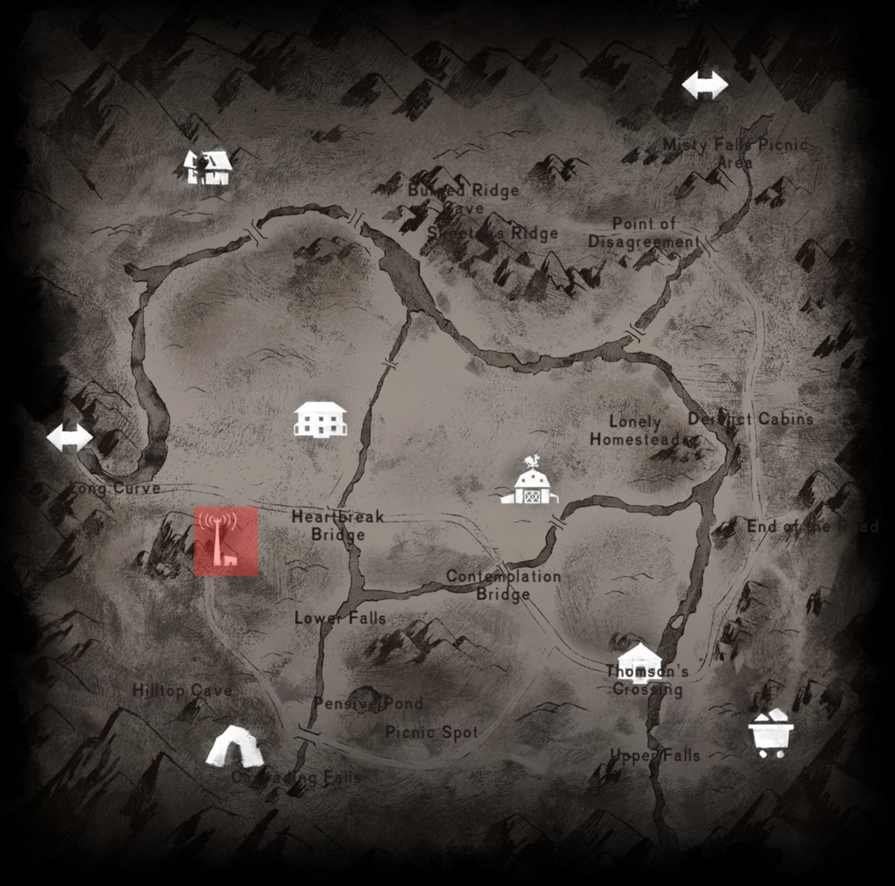

# Signal Hill

**Categories:** Indoor locations, Locations, Locations in Pleasant Valley, Locations with a workbench, Military/Sporting locations · **Source:** [Fandom](https://thelongdark.fandom.com/wiki/Signal_Hill)

**Signal Hill**

\[\[File: / \[Missing image: SignalHill2.png\] / _Exterior_ /  / _Interior_

250px\]\]

**Location**

_Signal\_Hill\_Location.png_

Region

[Pleasant Valley](./Pleasant%20Valley.md)

Description

**General**

Type

Military/Sporting

Firebox

_bed\_icon.png_

Has a bed

_workbench\_icon\_green.png_

Has a workbench
