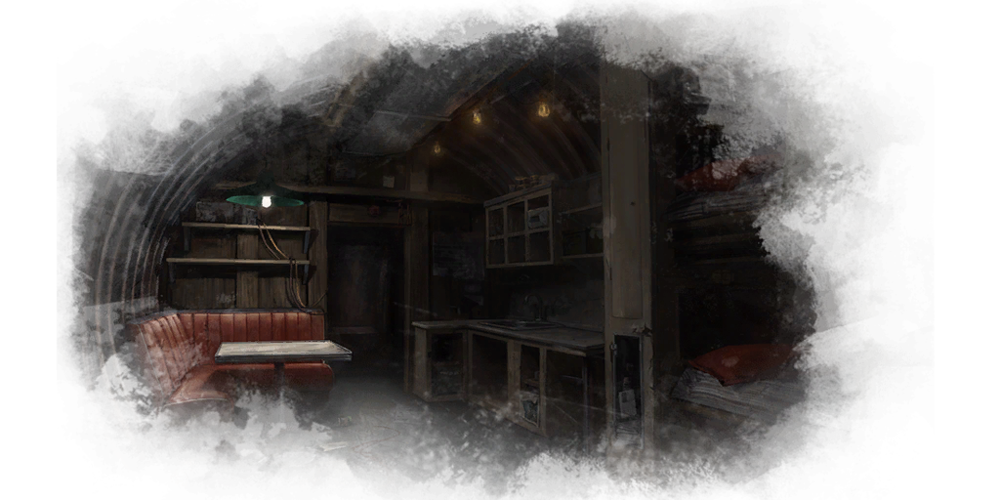

# Signal Void

**Contents**

- [Initiating the Tale](#Initiating_the_Tale)
- [Objectives](#Objectives)
- [Repairing the Transmitters](#Repairing_the_Transmitters)
- [Locating the Anomalous Signals](#Locating_the_Anomalous_Signals)
- [Investigate the Bunkers](#Investigate_the_Bunkers)
- [Locate the last Bunker](#Locate_the_last_Bunker)
- [The Rüdiger's Project](#The_R%C3%BCdiger%27s_Project)
- [Collectibles](#Collectibles)
- [Clothing](#Clothing)
- [Notes](#Notes)
- [Notes](#Notes_2)

<table class="infobox">
<caption>Signal Void</caption>
<colgroup>
<col style="width: 50%" />
<col style="width: 50%" />
</colgroup>
<tbody>
<tr>
<td colspan="2"><figure>

<figcaption>Tales_objectives_01_signalVoid.png</figcaption>
</figure></td>
</tr>
<tr>
<td colspan="2" class="section">
<strong>Missions</strong>
</td>
</tr>
<tr>
<td>
Current
</td>
<td>
Signal Void
</td>
</tr>
<tr>
<td>
Next
</td>
<td>
<a href="./Buried%20Echoes.md" class="wikilink" title="Buried Echoes">Buried Echoes</a>
</td>
</tr>
<tr>
<td>
Region
</td>
<td>
<a href="./Forsaken%20Airfield.md" class="wikilink" title="Forsaken Airfield">Forsaken Airfield</a> <a href="./Forlorn%20Muskeg.md" class="wikilink" title="Forlorn Muskeg">Forlorn Muskeg</a> 
<a href="./Bleak%20Inlet.md" class="wikilink" title="Bleak Inlet">Bleak Inlet</a> 
<a href="./Pleasant%20Valley.md" class="wikilink" title="Pleasant Valley">Pleasant Valley</a> 
<a href="./Mountain%20Town.md" class="wikilink" title="Mountain Town">Mountain Town</a> 
<a href="./Hushed%20River%20Valley.md" class="wikilink" title="Hushed River Valley">Hushed River Valley</a>
</td>
</tr>
</tbody>
</table>

<table style="width:100%;">
<colgroup>
<col style="width: 16%" />
<col style="width: 16%" />
<col style="width: 16%" />
<col style="width: 16%" />
<col style="width: 16%" />
<col style="width: 16%" />
</colgroup>
<tbody>
<tr>
<td width="40px"><figure>
[Missing image: Ptarmigan_icon.png]
<figcaption>Ptarmigan_icon.png</figcaption>
</figure></td>
<td>
<strong>DLC-Exclusive content.</strong> 

This content requires the <a href="./Tales%20from%20the%20Far%20Territory.md" class="wikilink" title="Tales from the Far Territory">Tales from the Far Territory</a> addon to be installed before it can be seen or used in regular gameplay.

</td>
<td>
|}{| style="margin:auto"
</td>
<td style="vertical-align: top; font-size: 3em; color: #5d5980; padding-right: 10px">
“
</td>
<td>
Track down the mysterious radio transmissions across Great Bear Island.
</td>
<td style="vertical-align: bottom; font-size: 3em; color: #5d5980; padding-left: 10px">
”
</td>
</tr>
</tbody>
</table>

**Signal Void** is the first of four <a href="./Tales.md" class="wikilink" title="Tales">Tales</a> in the <a href="./Tales%20from%20the%20Far%20Territory.md" class="wikilink" title="Tales from the Far Territory">Tales from the Far Territory</a> DLC. Tales are narrative-based objectives for Survival mode. It is not a selectable <a href="./Challenge.md" class="wikilink" title="Challenge">Challenge</a> but instead must be activated by first starting a Survival game.

## Initiating the Tale

<figure>

<figcaption>Signal_Void_Banner.jpg</figcaption>
</figure>

Signal Void begins when the player finds a note located on the top floor of the <a href="./Control%20Tower.md" class="wikilink" title="Control Tower">Control Tower</a> in the <a href="./Forsaken%20Airfield.md" class="wikilink" title="Forsaken Airfield">Forsaken Airfield</a> <a href="./Region.md" class="wikilink" title="Region">Region</a>. The note, labeled <a href="./Field%2031%20Operation%20Memo.md" class="wikilink" title="Field 31 Operation Memo">Field 31 Operation Memo</a>, details information about the Airfield staff's efforts to try and expand the radio wave coverage of several preexisting radio towers located within Lower Great Bear, in order to sync them with Airfield 31's radio coverage. The memo also makes note of the presence of several anomalous transmission signals that were detected across the island, but their sources were otherwise unable to be identified.

After reading and pocketing the note, the player will automatically receive a <a href="./Handheld%20Shortwave%20Radio.md" class="wikilink" title="Handheld Shortwave Radio">Handheld Shortwave Radio</a>, and a new section in the Journal menu (a flag submenu icon labeled Tales) will appear to keep track of the memo's objectives.

  

*SPOILER WARNING*\
*This section may contain spoilers from the <a href="./Wintermute.md" class="wikilink" title="story">story</a> of The Long Dark.*

## Objectives

- Repair Transmitter outside Forsaken Airfield Control Tower.
- Repair Transmitter in Forlorn Muskeg.
- Repair Transmitter in Pleasant Valley.
- Repair Transmitter in Mountain Town.
- Investigate Signal in Bleak Inlet.
  - Search Bunker Alpha.

<!-- -->

- Investigate Signal in Pleasant Valley
  - Search Bunker Beta.

<!-- -->

- Investigate Signal in Hushed River Valley.
  - Search Bunker Gamma.

<!-- -->

- Use the repaired Transmitter network to search Forsaken Airfield for signs of additional bunkers.
  - Search Bunker Omega for clues about the fate of Rüdiger's Project.

## Repairing the Transmitters

Your first objective is to repair the 4 portable <a href="./Transmitters.md" class="wikilink" title="Transmitters">Transmitters</a> at each location mentioned in the memo.

(Transmitter Towers CAN be repaired BEFORE starting the Tale by picking up the memo and radio - no need to trek back and forth too much if you start your run in Lower Great Bear. This does not seemingly break the Transponder gameplay in any way.)

You'll probably start with the one located outside the Control Tower and then work your back way down to Lower Great Bear to fix the rest.

- Repair transmitter in <a href="./Forsaken%20Airfield.md" class="wikilink" title="Forsaken Airfield">Forsaken Airfield</a>
- Repair transmitter in <a href="./Mountain%20Town.md" class="wikilink" title="Mountain Town">Mountain Town</a>
- Repair transmitter in <a href="./Forlorn%20Muskeg.md" class="wikilink" title="Forlorn Muskeg">Forlorn Muskeg</a>
- Repair transmitter in <a href="./Pleasant%20Valley.md" class="wikilink" title="Pleasant Valley">Pleasant Valley</a>

Once a Transmitter is found, each tower will require the following materials in order to be repaired:

- 5 pieces of <a href="./Scrap%20Metal.md" class="wikilink" title="Scrap Metal">Scrap Metal</a>
- 3 <a href="./Replacement%20Fuse.md" class="wikilink" title="Replacement Fuses">Replacement Fuses</a>
- 2 <a href="./Wires.md" class="wikilink" title="Wire Bundles">Wire Bundles</a>
- 1 <a href="./Car%20Battery.md" class="wikilink" title="Car Battery">Car Battery</a> (Normally found near a Transmitter, no need to haul one around. If not then cars should be present nearby.)
- Turn the power switch from OFF to ON when finished

When you repair one of the Transmitters in Lower Great Bear, you will be prompted to investigate a signal. You can continue to repair Transmitters or go find the strange signal at this point.

If the player activates the Transmitters for the first time at night, an aurora will automatically trigger. For the most effective gameplay the player should be ready to investigate the signal when activating the Transmitter.

## Locating the Anomalous Signals

After all transmitters are repaired, your next objective is to investigate the strange signals mentioned in the memo:

- Investigate signal in <a href="./Hushed%20River%20Valley.md" class="wikilink" title="Hushed River Valley">Hushed River Valley</a> (corresponds to transmitter in Mountain Town)
- Investigate signal in <a href="./Bleak%20Inlet.md" class="wikilink" title="Bleak Inlet">Bleak Inlet</a> (corresponds to transmitter in Forlorn Muskeg)
- Investigate signal in <a href="./Pleasant%20Valley.md" class="wikilink" title="Pleasant Valley">Pleasant Valley</a> (corresponds to transmitter in Pleasant Valley)

When an <a href="./Aurora.md" class="wikilink" title="Aurora">Aurora</a> becomes active in the night sky, use your Handheld Shortwave Radio to home in on the signal (switch to Blue setting). Follow the radio transmissions and you will be eventually find yourself uncovering the entrance of an underground bunker.

<u>**\*Important\***</u>

Even if you use <a href="./Charcoal.md" class="wikilink" title="Charcoal">Charcoal</a> to uncover the location of a bunker (either near the bunker or via a <a href="./Polaroids.md" class="wikilink" title="Polaroid">Polaroid</a> Vista) or if you already know the location of the bunkers, the game will not allow you to uncover a bunker hatch unless your radio is currently powered. (The same is true for any hidden supply caches. See <a href="./Handheld%20Shortwave%20Radio.md" class="wikilink" title="Handheld Shortwave Radio">Handheld Shortwave Radio</a> for more details.)

## Investigate the Bunkers

Once you discover a bunker, you are told to investigate it. Each bunker has 1 security chief's report and 1 patient interview. Collect them both to advance the narrative.

- Search <a href="./Bunker%20Alpha.md" class="wikilink" title="Bunker Alpha">Bunker Alpha</a> (corresponds to Bleak Inlet)
- Search <a href="./Bunker%20Beta.md" class="wikilink" title="Bunker Beta">Bunker Beta</a> (corresponds to Pleasant Valley)
- Search <a href="./Bunker%20Gamma.md" class="wikilink" title="Bunker Gamma">Bunker Gamma</a> (corresponds to Hushed River Valley)

## Locate the last Bunker

When all bunkers in Lower Great Bear are discovered and all documents are collected, trek back to the Forsaken Airfield to locate a final signal that was not mentioned in the memo.

The signal will lead you to the area around <a href="./Justy%27s%20Hovel.md" class="wikilink" title="Justy&#39;s Hovel">Justy's Hovel</a>. Once you uncover <a href="./Bunker%20Omega.md" class="wikilink" title="Bunker Omega">Bunker Omega</a>, search it for another security report and patient interview, thus ending the Tale.

The ultimate prize of this island wide scavenger hunt is the exclusive <a href="./Security%20Chief%27s%20Rifle%20Holster.md" class="wikilink" title="Security Chief&#39;s Rifle Holster">Security Chief's Rifle Holster</a> accessory, which is found leaning beside a kitchen crate in the first room across from the bunker entrance.

The Tales from the Far Territory continues in <a href="./Buried%20Echoes.md" class="wikilink" title="Buried Echoes">Buried Echoes</a>...

## The Rüdiger's Project

**\*SPOILERS FOR THE TALE\***

As you progress with the objectives of Signal Void, the purpose of each of the bunkers begins to become clearer. A device was built in a <a href="./Zone%20of%20Contamination.md" class="wikilink" title="large mine">large mine</a> and was used to experiment upon patients that were kept inside each bunker, though the test results of this experiment are currently unclear.

## Collectibles

### Clothing

- <a href="./Security%20Chief%27s%20Rifle%20Holster.md" class="wikilink" title="Security Chief&#39;s Rifle Holster">Security Chief's Rifle Holster</a>

### Notes

- <a href="./Security%20Chief%27s%20Log%206.md" class="wikilink" title="Security Chief&#39;s Log 6">Security Chief's Log 6</a>
- <a href="./Security%20Chief%27s%20Log%2014.md" class="wikilink" title="Security Chief&#39;s Log 14">Security Chief's Log 14</a>
- <a href="./Security%20Chief%27s%20Log%2023.md" class="wikilink" title="Security Chief&#39;s Log 23">Security Chief's Log 23</a>
- <a href="./Security%20Chief%27s%20Log%2029.md" class="wikilink" title="Security Chief&#39;s Log 29">Security Chief's Log 29</a>
- <a href="./Interview%20Transcript%204.md" class="wikilink" title="Interview Transcript 4">Interview Transcript 4</a>
- <a href="./Interview%20Transcript%2012.md" class="wikilink" title="Interview Transcript 12">Interview Transcript 12</a>
- <a href="./Interview%20Transcript%2014.md" class="wikilink" title="Interview Transcript 14">Interview Transcript 14</a>
- <a href="./Interview%20Transcript%2017.md" class="wikilink" title="Interview Transcript 17">Interview Transcript 17</a>

## Notes

- Completing the Tale will award the player with a unique <a href="./Badges.md" class="wikilink" title="Badge">Badge</a> of the same name.
- This was the first survival mode Tale released for The Long Dark, and is estimated by <a href="./Hinterland%20Studio%20Inc..md" class="wikilink" title="Hinterland">Hinterland</a> to take 5+ hours to complete.

**Lua execution error in Module:Navbox function navboxLua execution error in Module:Navbox function navbox** <a href="ru:%D0%9D%D0%B5%D1%82_%D1%81%D0%B8%D0%B3%D0%BD%D0%B0%D0%BB%D0%B0" class="wikilink" title="ru:Нет сигнала">ru:Нет сигнала</a>

