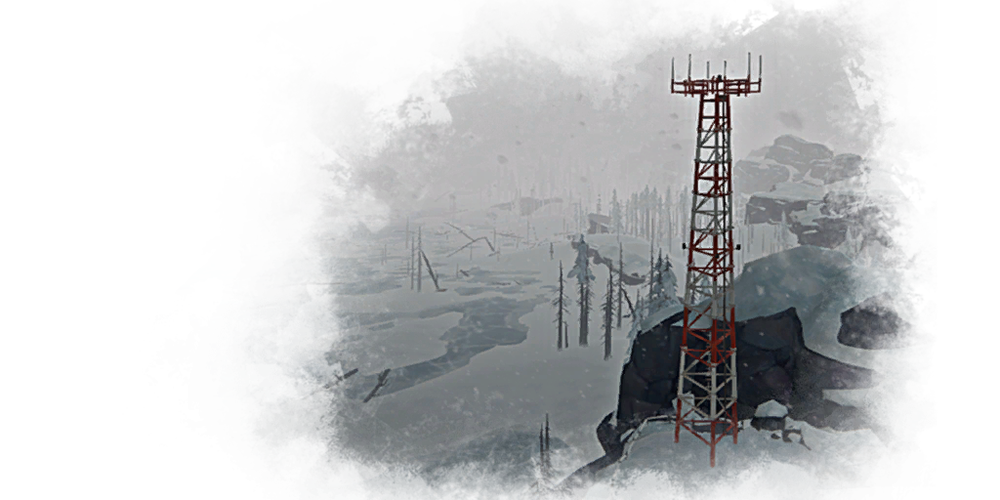

# Signal to Noise/Transcript

**Signal to Noise/Transcript**

| Property | Details |
| --- | --- |
|  |  / *Missions\_story\_ep2\_Signal\_to\_Noise.png* |
| Episode | [Episode 2](./Episode%202%20-%20Luminance%20Fugue.md)\|- |
| Previous | [The Best Defense/Transcript](./The%20Best%20Defense%20%E2%80%94%20Transcript.md) |
| Current | Signal to Noise/Transcript |
| Next | [What One Man Can Do/Transcript](./What%20One%20Man%20Can%20Do%20%E2%80%94%20Transcript.md) |
| Region | [Mystery Lake](./Mystery%20Lake%20%28disambiguation%29.md) / [Forlorn Muskeg](./Forlorn%20Muskeg.md) |
| Characters | [Will Mackenzie](./Will%20Mackenzie.md) / [Jeremiah](./Jeremiah.md) / [Old Bear](./Old%20Bear.md) |

This is the mission transcript for mission 3 [Signal to Noise](./Signal%20to%20Noise.md) of [Episode 2: Luminance Fugue](./Episode%202%20-%20Luminance%20Fugue.md).

## Transcript

CHAPTER THREE

SIGNAL TO NOISE

*Mackenzie travels back to [Forlorn Muskeg](./Forlorn%20Muskeg.md) and begins making his way to the 3 radio towers.*

*No matter what order the towers are looted for their set of [Transponder Parts](./Transponder%20Parts.md), Mackenzie takes the first set without incident. A problem occurs when reaching either the 2nd or 3rd tower however: the [Old Bear](./Old%20Bear.md) appears, as if guarding the tower.*

Mackenzie: "Holy shi...ok this time I'm ready for you."

*Mackenzie readies his spear, just as the bear charges him, only for the spear to bury itself deep into the beast. It does not kill the demon bear, nor does it seem to even wound it, but the Old Bear is driven off. The bear stays in the area, as Mackenzie quickly grabs the Parts and leaves the area.*

*After acquiring the last of the Parts, Mackenzie makes his way back to the rail tunnel leading to Mystery Lake. Before he enters the tunnel however, he hears a roar. Turning around, the Old Bear has somehow snuck up on the pilot.*

Mackenzie: "Oh no no no..."

*He charges and mercilessly attacks the pilot before he can raise his spear. Mackenzie screams as the bear tears into him, eventually fainting as the Old Bear stares at him. Mackenzie awakes for a brief moment, feeling the Old Bear dragging his body away as he faints again and the screen turns black.*

The story continues in [What One Man Can Do](./What%20One%20Man%20Can%20Do.md). **Lua execution error in Module:Navbox function navbox**
