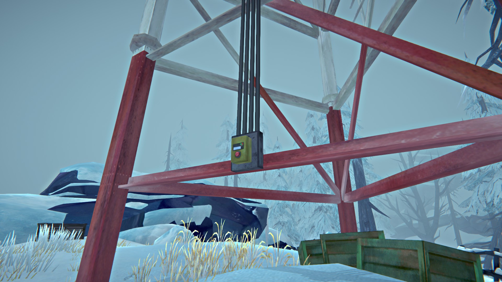

# Signal to Noise

**Categories:** Episode 2 · **Source:** [Fandom](https://thelongdark.fandom.com/wiki/Signal_to_Noise)

**Contents**

- [Objectives](#objectives)
- [Bear encounters](#bear-encounters)
- [Tips](#tips)
- [Gallery](#gallery)

**Signal to Noise**

| Property | Details |
| --- | --- |
|  | [Missions story ep2 Signal to Noise](../assets/Missions_story_ep2_Signal_to_Noise.png) |
| Episode | [Episode 2](./Episode%202%20-%20Luminance%20Fugue.md) |
| **Missions** |  |
| Previous | [The Best Defense](./The%20Best%20Defense.md) |
| Current | Signal to Noise |
| Next | [What One Man Can Do](./What%20One%20Man%20Can%20Do.md) |
| Region | [Mystery Lake](./Mystery%20Lake%20%28disambiguation%29.md) / [Forlorn Muskeg](./Forlorn%20Muskeg.md) |
| Characters | [Will Mackenzie](./Will%20Mackenzie.md) / [Jeremiah](./Jeremiah.md) / [Old Bear](./Old%20Bear.md) |

**Template:spoiler**

> “**Jeremiah has a plan for how Mackenzie can reach Perseverance Mills, but carrying it out may put the pilot on a collision course with the Old Bear.**”
>
> — In-game description

**Signal to Noise** is the third mission in [Episode 2](./Episode%202%20-%20Luminance%20Fugue.md) of the [Wintermute](./Wintermute.md) story. In this mission, [Mackenzie](./Will%20Mackenzie.md) must retrieve transponder parts from radio towers in Forlorn Muskeg and bring them back to Jeremiah. The mission is interrupted while the Mackenzie brings the parts back to Jeremiah, and the player to the next mission; [What One Man Can Do](./What%20One%20Man%20Can%20Do.md).

## Objectives

- Retrieve [Transponder Parts](./Transponder%20Parts.md) from each tower in Forlorn Muskeg.
  - [Southwest Tower](./Shortwave%20Tower%20West.md)
  - [North Tower](./Shortwave%20Tower.md)
  - [Southeast Tower](./Shortwave%20Tower%20East.md)
- Bring the transponders back to [Jeremiah](./Jeremiah.md).

### Bear encounters

The player can visit the towers in any order, but will encounter the [Old Bear](./Old%20Bear.md) at the second and third towers visited. The bear spawns in a random direction out of the player's field of view. It approaches until within a certain radius, then stands up on its hind legs, roars, and then charges the player. If the player equips the [Bear Spear](./Bear%20Spear.md) and is aiming it at the bear when it arrives, a [Struggle](./Struggle.md) will begin; else a typical bear attack cutscene will play (except that the Old Bear appears instead of the generic one), and the player will immediately die of blood loss at the end. If Mackenzie survives, he will be knocked to the ground, although no items will be dropped as in a normal bear attack. The Bear will briefly retreat and then attack again, but the game will automatically save after each struggle. Unlike other predator attacks, these encounters will result in minimal [Condition](./Condition.md) loss (<5%), no injuries, and little or no damage to gear. After 3 struggles, the Bear will flee and the player can collect the transponder parts. Mackenzie will comment before and after the event (once per location).

#### Tips

Timing is essential, as setting the spear is not instantaneous and the stamina meter runs out more quickly than when aiming ranged weapons. The bear will attempt to charge in a straight line, but may run into terrain obstacles that slow it down; ensure it has a clear path before aiming. Additionally, the meter takes time to recharge, so briefly evading the bear without running may be necessary in order to initiate the next struggle. In order to maximize available stamina, avoid running while approaching the towers and consider temporarily taking off [Clothing](./Clothing.md) with a stamina penalty.

## Gallery

